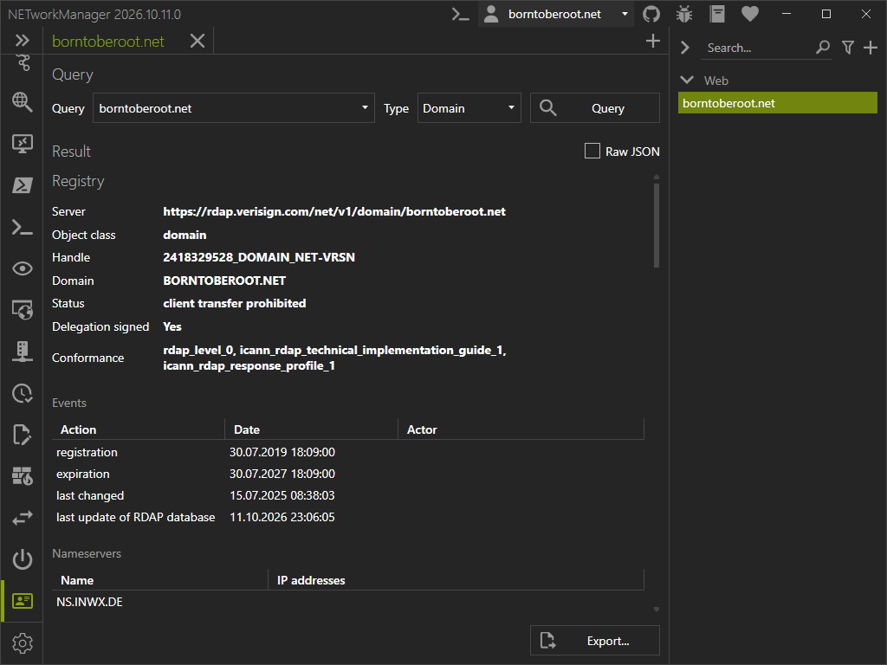

NETworkManager introduces a new tool, `RDAP`. With the **Registration Data Access Protocol** you can look up who a domain, an IP address, an AS number or an organization is registered to - with structured results, over HTTPS, and without having to know which server to ask.

<!-- truncate -->

## What is RDAP?

RDAP is the standardized successor of Whois ([RFC 7480](https://www.rfc-editor.org/rfc/rfc7480), [RFC 9082](https://www.rfc-editor.org/rfc/rfc9082), [RFC 9083](https://www.rfc-editor.org/rfc/rfc9083), [RFC 9224](https://www.rfc-editor.org/rfc/rfc9224)). It answers the same questions as Whois - who registered this domain, which organization owns this IP range, which network is behind this AS number - but fixes most of its shortcomings:

| | Whois | RDAP |
| --- | --- | --- |
| **Transport** | Plain text over TCP port 43 | HTTPS over TCP port 443 (a few registries still only offer HTTP) |
| **Response format** | Free text, different for every registry | Standardized JSON |
| **Finding the server** | Hard-coded list of servers per TLD | Official IANA bootstrap files |
| **Lookups** | Mainly domains | Domains, IP addresses/networks, AS numbers, entities |
| **Internationalized domain names** | Inconsistent | Supported |

RDAP is mandatory for all generic top-level domains (e.g. `.com`, `.net`, `.org`) and is provided by all five Regional Internet Registries (ARIN, RIPE NCC, APNIC, LACNIC, AFRINIC). Since January 2025, gTLD registries and registrars are no longer required to operate Whois at all - RDAP is the way forward.

## What you can do with it

Pick a type, enter a query and press **Query**:

| Type | Example | Description |
| --- | --- | --- |
| **Domain** | `borntoberoot.net` | Registration data of a domain from its registry |
| **TLD** | `de` | Delegation of a top-level domain from the IANA root zone |
| **IP address** | `1.1.1.1` or `2001:db8::/32` | Network an IP address or CIDR prefix belongs to |
| **ASN** | `AS13335` | Autonomous system - `13335`, `AS13335` and asdot (`1.10`) work |
| **Entity** | `ORG-RIEN1-RIPE` | An organization or contact, by its handle |

The input is validated while you type, depending on the selected type.

The result is shown in a structured view:

- **Details** like handle, name, address range, country, status and DNSSEC
- **Events** such as registration, expiration and last change
- **Nameservers** including their IP addresses
- **Contacts** with roles, name, organization, email, phone and address
- **Notices** with links to the terms of service, privacy policy or the form to report inaccurate data

If you need everything the server sent, switch to **Raw JSON**. Results can be exported as **JSON** (exactly as returned by the server) or as **text**, via the **Export...** button or the context menu.

## How it works

You don't need to know which server is responsible for a query - NETworkManager finds it for you:

1. **Bootstrap**: IANA publishes bootstrap files that map TLDs, IP ranges, AS numbers and entity tags to the responsible RDAP servers. NETworkManager downloads them with the first query, caches them locally and checks for updates once a week. You can see their status and update them manually in **Settings > RDAP**.
2. **Query**: The query is sent to the responsible registry - via HTTPS, plain HTTP is only used if a registry offers nothing else. Redirects between registries (e.g. from ARIN to RIPE NCC) are followed automatically.
3. **Referral**: For many domains (e.g. `.com` and `.net`), the registry only returns basic data and refers to the RDAP server of the registrar for the details. NETworkManager follows this referral and shows both results - registry and registrar - one below the other. You can disable this in the settings.

A few details make the tool work in places where a plain bootstrap lookup would fail:

- Some registries run an RDAP server that is not (yet) listed by IANA, for example `.de`, `.ch`, `.li` and `.io`. These are included in NETworkManager, so you get results for them as well.
- Private and reserved IP addresses like `10.0.0.1` or `fe80::1` return the IANA reservation instead of an error.
- If `data.iana.org` cannot be reached (e.g. in a restricted network), the cached files are used and the update is retried later.

Like the other tools, RDAP supports **profiles**: store a query and its type in a profile and run it from the profile panel with a double-click.

## RDAP and Whois

Not every registry offers RDAP yet. Many country code top-level domains (e.g. `.ru`, `.jp` or `.it`) still only provide Whois. If no RDAP server is known for a domain, NETworkManager tells you so and offers to open the domain in the **Whois** tool with a single click.

Keep in mind that RDAP does not unlock any data that Whois hides: registration data of personal contacts is usually redacted for privacy reasons (GDPR), with both protocols.

## Why it's useful

- **Find the owner of an IP address or network** - e.g. when analyzing logs, firewall hits or abuse reports - including the abuse contact of the responsible organization.
- **Check domains**: registrar, status (e.g. transfer locks), expiration date, nameservers and DNSSEC in one view.
- **Look up AS numbers** to see which organization operates a network, e.g. when troubleshooting routing or peering.
- **One tool for all registries**: no need to know whether an address belongs to ARIN, RIPE NCC or APNIC, or which registrar manages a domain.
- **Structured and exportable**: copy single values or export the full JSON for documentation and further processing.

## Try it now

RDAP is available in the [next pre-release of NETworkManager](https://borntoberoot.net/NETworkManager/download#pre-release).

More details are available in the [official documentation](https://borntoberoot.net/NETworkManager/docs/application/rdap).

If you find any issues or have suggestions, please open an [issue on GitHub](https://github.com/BornToBeRoot/NETworkManager/issues).
