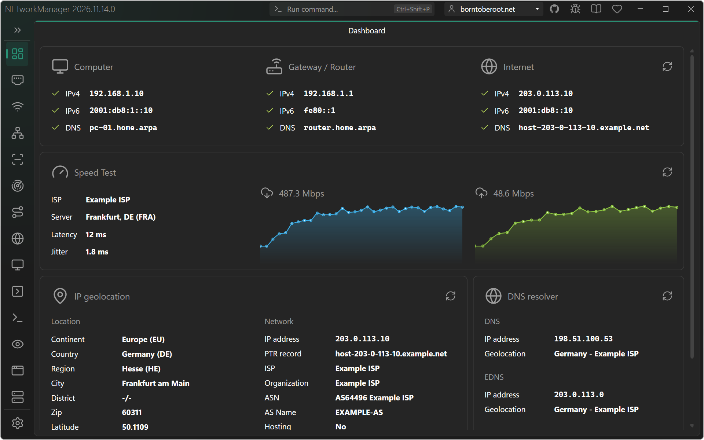
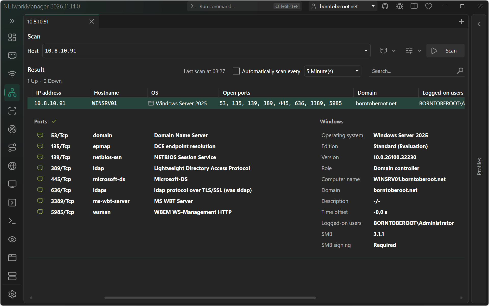
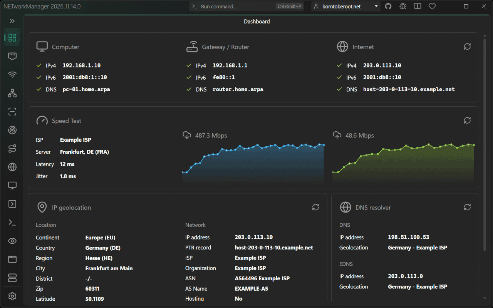
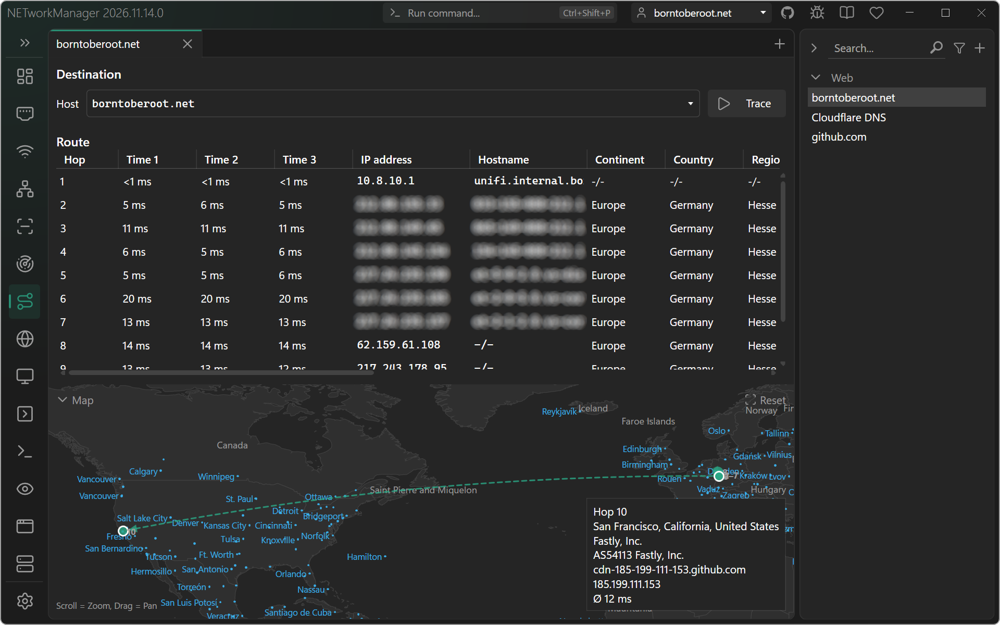
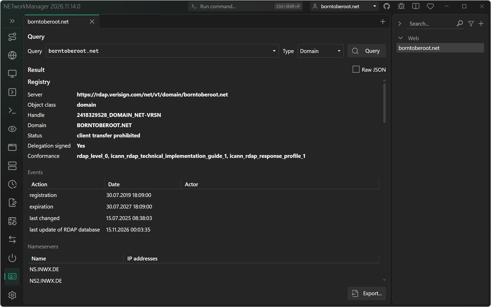

The new release of NETworkManager (version **2026.11.15.0**) is one of the biggest so far: a **redesigned interface** with new themes and accent colors, an **IP Scanner** that finds and identifies far more devices, a **run command** to start any tool from the keyboard, a **world map** for Traceroute, and the new **RDAP** tool. On top of that, it contains more than 150 improvements and more than 150 bug fixes across all tools.



<!-- truncate -->

## A fresh look

The whole interface was redesigned for a calmer, more modern look - without changing where things are:

- **New themes**: Black, Midnight, Steel and Indigo (dark), Mist, Soft and Paper (light) - and **new accent colors** like Sky, Ocean, Mint, Rose, Coral, Gold, Lavender, Slate and Graphite. Every accent works with every theme.
- **New layout**: navigation, tool and profiles as rounded boxes on a tinted window frame, tabs like in VS Code, rounded windows on Windows 11, and an optional **accent glow**.
- **One icon family** ([Lucide](https://lucide.dev)) instead of five icon packs, thin-line icons with the same size everywhere.
- **Easier to read**: Segoe UI Variable on Windows 11, technical values (IP / MAC addresses, ports, hostnames) in Cascadia Mono, clearer status colors in light and dark themes.
- **Subtle animations** for dialogs, navigation and expanders - following the Windows setting, or turned off in the settings or for all users with a [system-wide policy](https://borntoberoot.net/NETworkManager/blog/system-wide-policies-for-enterprise-deployments).

Choose your theme and accent in [Settings > Appearance](https://borntoberoot.net/NETworkManager/docs/settings/appearance).

## A smarter IP Scanner

The IP Scanner received the largest update in this release. It finds more devices, tells you what they are, and can watch a network for changes.

**Find more hosts** - a host is found by whichever probe answers first: ping, open or refused TCP ports, NetBIOS, SNMP, or - in the local subnet - its ARP / NDP entry. Devices that block ping and all ports (e.g. a Windows client in a public network, a phone or an IoT device) are found as well. The tooltip of the status shows how a host was detected (e.g. `Up (detected by Ping, TCP)`).

**Know what you found** - optional probes fill in what the device is:

- **OS** guessed from the TTL (`Windows`, `Linux / Unix`, `Network device`), or the exact Windows version (e.g. `Windows 11 25H2`) with **Read Windows host information** (beta) - including domain, time offset and logged-on users.
- **mDNS names** (`.local`) of Apple devices, printers and IoT devices.
- **Web pages**: title, server and TLS certificate of routers, printers and NAS.
- **SNMP** name, description and location of switches and printers (`v1` / `v2c`, `v3` via profiles).
- **Roles**: this computer, the default gateway and the DNS and DHCP servers are marked.

**Watch the network** - every scan is compared with the previous one: hosts that are **New**, **Gone** or have a **changed MAC address** are highlighted. **Automatically scan every** repeats the scan (`1 min` to `1 h`) and shows a notification when something changed.

**Faster and easier to use** - an empty `/24` network is scanned in about 8 seconds instead of about 50, hosts appear as soon as they answer, and results can be searched while the scan is running. Exclude addresses with `!` (e.g. `10.0.0.0/24; !10.0.0.1`), scan all local subnets with one click, and rescan single hosts from the context menu.



Reading the Windows host information with credentials needs care in a domain - learn how NETworkManager prevents account lockouts in the [FAQ](https://borntoberoot.net/NETworkManager/docs/faq/windows-account-lockout-protection). All probes and settings are explained in the [IP Scanner documentation](https://borntoberoot.net/NETworkManager/docs/application/ip-scanner#how-hosts-are-found).

## Run Command

Press `Ctrl+Shift+P`, type what you want to do and press `Enter` - NETworkManager opens the right tool and runs it:

```
ping 10.0.0.1
dns borntoberoot.net 1.1.1.1 aaaa
portscan 10.0.0.1 webserver
rdp @server-01
subnet 10.0.0.0/16 /24
```

- **Short aliases** for every tool (e.g. `ping`, `dns`, `rdp`, `ssh`, `geo`, `wol`) and **profiles** with `@` (e.g. `rdp @server-01`).
- **Suggestions** while you type: recent commands, profiles, port profiles and types - `Tab` completes, `Up`/`Down` selects.
- **Just a target** is enough: type `10.0.0.1`, `server-01` or `00:11:22:33:44:55` and get the commands that accept it. Optionally, a target in the clipboard is suggested.
- The input is **validated like in the tool** itself, and the dialog shows how it was understood (e.g. `Hosts: borntoberoot.net`, `Type: AAAA`).
- Open it from the **Run command...** box in the title bar, or from anywhere in Windows with an optional **global hotkey** (`Ctrl+Alt+P`).



All commands and their syntax are listed in the [Run Command documentation](https://borntoberoot.net/NETworkManager/docs/run-command).

## Visual Traceroute

Traceroute now shows the route on a **world map** below the hop list. Each hop with a resolved geolocation gets a marker, consecutive hops are connected with curved arrows in the direction of the trace. Hover a marker to see its location, ISP / AS number, hostname, IP address and average round-trip time. Zoom with the mouse wheel, drag to pan, or collapse the map if you don't need it.

The map works offline and is shown when **Check IP geolocation** and **Show map** are enabled.



More details in the [Traceroute documentation](https://borntoberoot.net/NETworkManager/docs/application/traceroute#map).

## RDAP

The new **RDAP** tool looks up who a domain, an IP address, an AS number or an organization is registered to - via the Registration Data Access Protocol, the standardized successor of Whois. Results are structured (details, events, nameservers, DNSSEC, contacts), come over HTTPS, and NETworkManager finds the responsible registry automatically, including the referral to the registrar for domains like `.com`. If a registry only offers Whois, the domain opens in the **Whois** tool with one click.



RDAP is also available from the context menu of the **IP Scanner** and **Traceroute** (e.g. the AS number of a hop) and from the run command (`rdap borntoberoot.net`).

Learn more in the deep dive [Introducing RDAP](https://borntoberoot.net/NETworkManager/blog/introducing-rdap) and the [RDAP documentation](https://borntoberoot.net/NETworkManager/docs/application/rdap).

## More highlights

- **WiFi**: see new, gone and changed access points since the last scan, with notifications.
- **Tabs**: dynamic tab width, and dragged-out tabs can be dropped anywhere on a tab bar - a hint shows where.
- **DNS**: a list of DNS servers with ports, and a DNS suffix for bare hostnames in all tools.
- **ARM64** builds are available.

## Hundreds of improvements and bug fixes

Besides the highlights, this release contains more than 150 improvements and more than 150 bug fixes - from faster scans and consistent exports to many small details in every tool. The complete list is in the [changelog](https://borntoberoot.net/NETworkManager/docs/changelog/2026-11-15-0).

## Before you update

:::warning[Breaking changes]

The exports (CSV, XML, JSON) of all tools now use the same format: columns may have been reordered or added, and values are formatted consistently (e.g. numbers without unit, dates as `yyyy-MM-dd HH:mm:ss.fff`). If you process exports with scripts, check them after the update - see [Export format](https://borntoberoot.net/NETworkManager/docs/faq/export-format).

:::

## Try it now

Download the [latest version of NETworkManager](https://borntoberoot.net/NETworkManager/download).

If you find any issues or have suggestions, please open an [issue on GitHub](https://github.com/BornToBeRoot/NETworkManager/issues).
