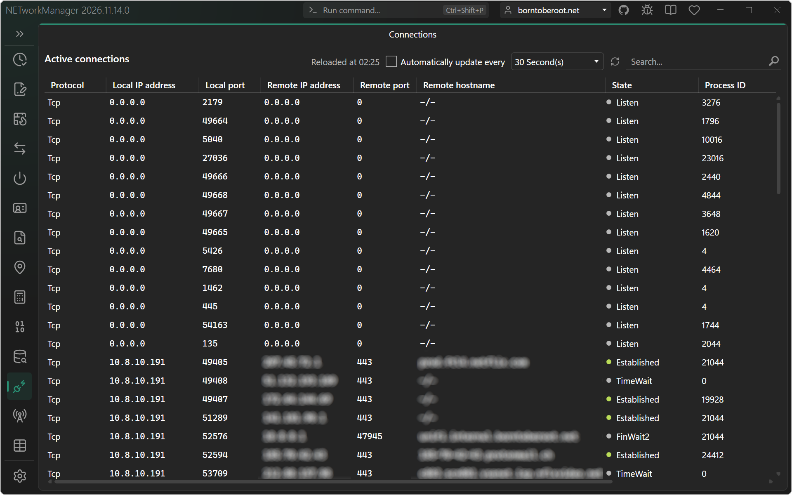

# Connections

The **Connections** view shows all active **TCP** connections with their source and destination IP endpoints (IP address and port) and the associated process running on your computer.

:::info

The data shown is similar to the output of the `netstat` command.

:::

### Context menu

| Action | Description |
|--------|-------------|
| **Copy** | Copies the selected information to the clipboard |
| **Export...** | Exports the results shown (all or the selected ones) to a file in the order shown, see [Export format](../faq/export-format.md) |

### Keyboard shortcuts

| Key | Action |
|-----|--------|
| `F5` | Refresh |

## Run command

Open the tool with `connections`. The command accepts no target and no profile, see [Run Command](../run-command.md).

## Troubleshooting and limits

- Only TCP connections over IPv4 are shown (no UDP, no IPv6 connections). For UDP, see [Listeners](./listeners.md).
- The process path of processes of other users and of system services is only shown with administrator privileges (otherwise `-/-`).
- The list is a snapshot: refresh it (`F5`) to see new connections. Short connections may be missed.
- The hostname of the remote address is resolved via DNS (`PTR`); many addresses on the internet have no or a generic name.
