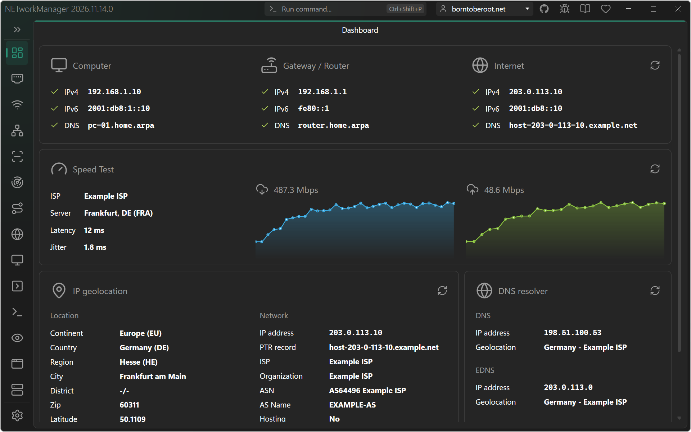

# Dashboard

The **Dashboard** shows the status of your computer's network connection at a glance: the connection to the router and the internet, the speed and latency of the connection, the location of your public IP address and the DNS resolver in use.

The [Network connection](#network-connection), [IP geolocation](#ip-geolocation) and [DNS resolver](#dns-resolver) widgets are checked:

- when the dashboard is opened,
- after a network change (e.g. an Ethernet cable is plugged in, Wi-Fi or VPN connects),
- when you switch back to the dashboard or show the window again (tray / taskbar), if the last check is at least 60 seconds old or a setting of the check has changed, so switching between the tools doesn't send a request each time,
- with **F5** or the refresh button of the widget.

The [Latency](#latency) widget pings live while the dashboard is shown, the [Speed Test](#speed-test) only runs when you start it.

Checks that send your IP address to a web service or run continuously (IP geolocation, DNS resolver, latency) are disabled by default. The widget then shows what it would do and an **Enable** button; they can also be enabled in the welcome dialog or in the [settings](#settings). A hidden widget doesn't check anything.

## Network connection

The **Network connection** widget (also shown in the [status window](../settings/status.md)) checks the **Computer**, the **Gateway / Router** and the **Internet**, each for IPv4, IPv6 and DNS:

- **Computer**: the local IP address of the network adapter that is used for the internet.
- **Gateway / Router**: the default gateway, pinged 2 times (timeout 2 seconds).
- **Internet**: a ping of the [Public IPv4 address](#public-ipv4-address) / [Public IPv6 address](#public-ipv6-address) (default Cloudflare `1.1.1.1` / `2606:4700:4700::1111`), the public IP address from [`api.ipify.org`](https://www.ipify.org/) (if [Check public IP address](#check-public-ip-address) is enabled) and the internet connectivity reported by Windows (detects a hotspot / captive portal). The value is the public IP address, or the pinged address with the round-trip time.
- **DNS**: the DNS name (PTR record) of the IPv4 address, or of the IPv6 address if the IPv4 address has none.

The icon in front of each value shows the result, hover over it to see the reason:

| Icon | Meaning |
|------|---------|
| Green | OK |
| Yellow | Works partly or may not work, e.g. only a link-local IPv4 address (`169.254.x.x`, no DHCP server), the gateway didn't reply to the ping (it may block ICMP) or there is no gateway (e.g. a VPN), a hotspot / captive portal, or only some of the internet checks work (e.g. ICMP or the API is blocked by a firewall or proxy) |
| Red | Failed, e.g. no IPv4 address, the DNS server didn't answer or the internet is not reachable |
| Gray | Information, e.g. no IPv6 connection (the IPv6 checks are skipped) or no DNS name (PTR record), which many networks don't have |

Right-click a value to open it in another tool (e.g. an IP address in the **Ping Monitor**, **Traceroute** or **DNS Lookup**, the gateway in the **Web Console**, the public IP address in **RDAP** or **IP Geolocation**) or to **Copy** it. **Copy all** copies all values with the reasons as text (e.g. for a support request).

## Speed Test

The **Speed Test** widget measures the download and upload speed, latency and jitter of your connection with [`speed.cloudflare.com`](https://speed.cloudflare.com/). The test only runs when you click **Run speed test** (refresh icon, **Stop** while it runs); **Copy all** copies the result as text.

Before the first test, a privacy disclaimer informs you that Cloudflare receives requests with your IP address and network information (see the [Cloudflare privacy policy](https://www.cloudflare.com/privacypolicy/)); click **Speed Test** to accept it and run the test. It is shown again after a restart of the application. The telemetry endpoint of Cloudflare (`aim.cloudflare.com`) is never contacted.

The result includes:

- **Download** / **Upload** speed in Mbps, with a chart of the requests (hover over it to see the speed of a request)
- **Latency** in ms (unloaded, median of the latency probes)
- **Jitter** in ms (average difference between consecutive latency probes)
- **ISP** and **Server** (Cloudflare location) as reported by Cloudflare

The test measures like the official [cloudflare/speedtest](https://github.com/cloudflare/speedtest) library (used by [speed.cloudflare.com](https://speed.cloudflare.com/)), so the results are comparable: downloads and uploads of increasing size (100 kB up to 250 MB), the speed is the 90th percentile of the requests. A test takes about 15 seconds on a fast connection and up to 1–2 minutes on a slow one.

:::note

On a fast connection (1 Gbit/s) a test transfers up to about 1 GB download and 300 MB upload, keep this in mind on a metered connection (e.g. mobile data).

:::

## Latency

The **Latency** widget pings the default gateway (router) and up to five targets and shows the round-trip time of the last ping and a chart of the last 60 seconds for each one. The default targets are the public DNS resolvers of Cloudflare (`1.1.1.1`), Google (`8.8.8.8`) and Quad9 (`9.9.9.9`), which answer pings reliably and are close to every user (anycast). If only the internet targets fail, the problem is the internet connection, not your network. The [targets](#targets) can be changed, e.g. to your own servers (without any target the widget shows **Configure**, which opens the settings).

Each target is pinged on its own every 2 seconds ([interval](#interval-seconds), timeout 2 seconds). The pings only run while the dashboard is shown, not in the background; a pause is a gap in the chart and doesn't count as lost pings. After a network change the charts start again, and host names and the default gateway are resolved again.

| Dot | Meaning |
|-----|---------|
| Green | The last ping was answered |
| Yellow | The last ping was answered, but a ping was lost in the last minute |
| Red | The last ping was not answered or the host name could not be resolved |
| Gray | Not pinged yet or no default gateway found (e.g. a VPN) |

Hover over a target to see its IP address and the minimum / average / maximum round-trip time and packet loss of the last minute. Right-click a target to open it in the **Ping Monitor**, **Traceroute** or **DNS Lookup** or to **Copy** it; **Copy all** copies the values of all targets.

By default the widget is shown next to the speed test, in a narrow window below it, see [Position](#position).

### Internal and air-gapped networks

A target can be any IP address or host name, also in your own network. Without internet access (e.g. an internal or air-gapped network, a lab) the default targets time out, so replace them with your own hosts in the [settings](#targets), e.g. a domain controller, a DNS server or a server at another site (WAN / VPN link). Internal and internet targets can be mixed.

## IP geolocation

The **IP geolocation** widget shows the location and the network of your public IPv4 address from [`ip-api.com`](https://ip-api.com/) (the same values as the [IP Geolocation](ip-geolocation.md) tool):

- **Location**: continent, country, region, city, district, zip code, latitude / longitude, time zone, offset from UTC (e.g. `UTC+01:00`, incl. daylight saving time) and currency
- **Network**: IP address, PTR record, ISP, organization, ASN / AS name, and whether the IP address belongs to a hosting provider, a proxy / VPN or a mobile network

## DNS resolver

The **DNS resolver** widget shows the DNS server that resolves the requests of your computer on the internet, detected with [`edns.ip-api.com`](https://ip-api.com/docs/dns): its IP address and geolocation (**DNS**), and the client subnet that the DNS server forwards (**EDNS**, e.g. `203.0.113.0`, `-/-` if it doesn't send one). If you use the DNS server of your router or internet provider, this is the server the requests are forwarded to (e.g. `1.1.1.1` or a server of the provider), not the router.

## IP geolocation and DNS resolver

Both widgets send your IP address to `ip-api.com` (disabled by default). The header shows the time of the last check, an error (e.g. no response within 10 seconds) or the rate limit of `ip-api.com` (45 requests per minute, with the time until the next request) is shown below it. **Refresh** checks again, **Copy all** copies all values as text.

Right-click an IP address to open it in the **Port Scanner**, **Ping Monitor**, **Traceroute**, **DNS Lookup**, **RDAP** or **IP Geolocation**, the EDNS client subnet in **RDAP** or **IP Geolocation**, and the PTR record in the **DNS Lookup**. **Copy** copies the selected text.

## Keyboard shortcuts

| Key | Action |
|-----|--------|
| `F5` | Check the **Network connection**, **IP geolocation** or **DNS resolver** widget again (while the widget has the focus, e.g. click into it first) |

## Run command

Open the tool with `dashboard`. The command accepts no target and no profile, see [Run Command](../run-command.md).

## Settings

The settings are grouped by widget, in the order of the dashboard. **Show widget** shows or hides a widget, a hidden widget doesn't check anything. The switch of a check is disabled while its widget is hidden (the value is kept). A shown widget whose check is disabled shows what it does and an **Enable** button.

### Network connection {#settings-network-connection}

The network connection widget and the [status window](../settings/status.md) use these settings to check the internet. They also apply while the widget is hidden.

#### Show widget {#show-network-connection-widget}

Show or hide the **Network connection** widget on the dashboard. The status window still checks the network connection with these settings.

**Type:** `Boolean`

**Default:** `Enabled`

#### Ping public IP address

Enables or disables the ping of the [Public IPv4 address](#public-ipv4-address) / [Public IPv6 address](#public-ipv6-address) (default Cloudflare) to check if the internet is reachable. If disabled, the internet is only checked with the [public IP address](#check-public-ip-address) and the connectivity reported by Windows; the addresses are still used to detect the local IP address. The ping can also be disabled in the welcome dialog.

**Type:** `Boolean`

**Default:** `Enabled`

#### Public IPv4 address

Public IPv4 address (not the one of your computer) that is pinged to check the internet connection (if [enabled](#ping-public-ip-address)). The route to this address is used to detect the local IPv4 address (no packet is sent for this), so it should be routed via the network adapter that is used for the internet.

**Type:** `String`

**Default:** `1.1.1.1`

#### Public IPv6 address

Public IPv6 address (not the one of your computer) that is pinged to check the internet connection (if [enabled](#ping-public-ip-address)). The route to this address is used to detect the local IPv6 address (no packet is sent for this), so it should be routed via the network adapter that is used for the internet.

**Type:** `String`

**Default:** `2606:4700:4700::1111`

#### Check public IP address

Enables or disables the request of the public IP address via [`api.ipify.org`](https://www.ipify.org/) and [`api6.ipify.org`](https://www.ipify.org/) (or a [custom API](#use-custom-ipv4-address-api)) with every check; the service receives your IP address. If disabled, the internet is only checked with the [ping](#ping-public-ip-address) and the connectivity reported by Windows (only Windows if the ping is disabled too), and the internet value is the pinged address with the round-trip time. The check can also be enabled in the welcome dialog.

**Type:** `Boolean`

**Default:** `Disabled`

#### Use custom IPv4 address API

Override the default IPv4 address API to resolve the public IP address. The API should return only a plain text IPv4 address like `xx.xx.xx.xx`, or a JSON object with the address as a string value like `{"ip":"xx.xx.xx.xx"}`. Other answers (e.g. an HTML page) are not accepted.

**Type:** `Boolean | String`

**Default:** `Disabled | Empty`

**Example:**

| API | Answer |
|-----|--------|
| [`https://api.ipify.org`](https://api.ipify.org/) | Plain text |
| [`https://api.ipify.org?format=json`](https://api.ipify.org?format=json) | JSON `{"ip":"xx.xx.xx.xx"}` |
| [`https://checkip.amazonaws.com`](https://checkip.amazonaws.com/) | Plain text |
| [`https://ifconfig.co/ip`](https://ifconfig.co/ip) | Plain text |
| [`https://ipinfo.io/ip`](https://ipinfo.io/ip) | Plain text |
| [`http://ip-api.com/line/?fields=query`](http://ip-api.com/line/?fields=query) | Plain text (`http` only, 45 requests per minute, non-commercial use only) |

Many APIs also return JSON with more information (e.g. `https://ipinfo.io/json`, `https://ifconfig.co/json`, `http://ip-api.com/json`), the first string value that is an IP address is used. An API that returns `key=value` lines (e.g. `https://1.1.1.1/cdn-cgi/trace`) is not supported.

#### Use custom IPv6 address API

Override the default IPv6 address API to resolve the public IP address. The API should return only a plain text IPv6 address like `xxxx:xx:xxx::xx`, or a JSON object with the address as a string value like `{"ip":"xxxx:xx:xxx::xx"}`. Other answers (e.g. an HTML page) are not accepted.

**Type:** `Boolean | String`

**Default:** `Disabled | Empty`

**Example:**

| API | Answer |
|-----|--------|
| [`https://api6.ipify.org`](https://api6.ipify.org/) | Plain text |
| [`https://api64.ipify.org?format=json`](https://api64.ipify.org?format=json) | JSON `{"ip":"xxxx:xx:xxx::xx"}` (IPv6 if available, otherwise IPv4 - then the answer is not accepted) |

### Speed Test {#settings-speed-test}

#### Show widget {#show-speed-test-widget}

Show or hide the **Speed Test** widget on the dashboard. A speed test that is running when the widget is hidden is canceled.

**Type:** `Boolean`

**Default:** `Enabled`

### Latency {#settings-latency}

#### Show widget {#show-latency-widget}

Show or hide the **Latency** widget on the dashboard.

**Type:** `Boolean`

**Default:** `Enabled`

#### Position

Where the widget is shown on the dashboard:

- **Next to the speed test**: to the right of the speed test (1/3 of the width), the targets one below the other. If the dashboard is narrower than about 900 pixels (or the speed test is hidden), the widget gets its own row below the speed test.
- **Own row**: below the network connection, the targets side by side.

The targets are shown one below the other whenever the widget is narrower than about 500 pixels.

**Type:** `NETworkManager.Models.Network.LatencyPosition`

**Default:** `NextToSpeedTest`

**Possible values:**

- `NextToSpeedTest`
- `OwnRow`

#### Check latency

Enables or disables the pings of the targets. The check can also be enabled in the welcome dialog or with the **Enable** button of the widget.

**Type:** `Boolean`

**Default:** `Disabled`

#### Interval (seconds)

Time between the reply (or the timeout of 2 seconds) of a ping and the next ping of a target.

**Type:** `Integer` [Min `1`, Max `10`]

**Default:** `2`

#### Ping default gateway

Ping the default gateway (router) of the network adapter that is used for the internet (the route to the [Public IPv4 address](#public-ipv4-address)), in the first line in front of the [targets](#targets). The gateway is detected again after a network change (e.g. VPN, another Wi-Fi).

**Type:** `Boolean`

**Default:** `Enabled`

#### Targets

Up to five targets of the widget (in addition to the [default gateway](#ping-default-gateway)), in this order. **Add...** adds a target (disabled when the list is full, its tooltip says why), right-click a target (or **F2** / **Del**, double-click) to edit or delete it. A target has:

- **Name**: shown in the widget (the host if it is empty).
- **Host**: IP address or host name.

**Type:** List of `NETworkManager.Models.Network.LatencyTargetInfo` (name, host)

**Default:**

| Name | Host |
|------|------|
| `Cloudflare` | `1.1.1.1` |
| `Google` | `8.8.8.8` |
| `Quad9` | `9.9.9.9` |

Use IP addresses if possible, they still work when the DNS server doesn't. For an internal or air-gapped network, see [Internal and air-gapped networks](#internal-and-air-gapped-networks).

### IP geolocation {#settings-ip-geolocation}

#### Show widget {#show-ip-geolocation-widget}

Show or hide the **IP geolocation** widget on the dashboard. The [DNS resolver](#dns-resolver) widget then uses the whole width. In a narrow window (less than about 900 pixels) both widgets are shown one below the other.

**Type:** `Boolean`

**Default:** `Enabled`

#### Check IP geolocation

Enables or disables the resolution of the IP geolocation via [`ip-api.com`](https://ip-api.com/). The check can also be enabled in the welcome dialog or with the **Enable** button of the widget.

:::note

The free API endpoint is limited to 45 requests per minute, supports only the `http` protocol and is available for non-commercial use only.

:::

**Type:** `Boolean`

**Default:** `Disabled`

### DNS resolver {#settings-dns-resolver}

#### Show widget {#show-dns-resolver-widget}

Show or hide the **DNS resolver** widget on the dashboard. The [IP geolocation](#ip-geolocation) widget then uses the whole width. In a narrow window (less than about 900 pixels) both widgets are shown one below the other.

**Type:** `Boolean`

**Default:** `Enabled`

#### Check DNS resolver

Enables or disables the detection of the DNS resolver in use via [`ip-api.com`](https://ip-api.com/). The check can also be enabled in the welcome dialog or with the **Enable** button of the widget.

**Type:** `Boolean`

**Default:** `Disabled`

## Troubleshooting and limits

- The local IP address is detected by the route to the [Public IPv4 address](#public-ipv4-address) / [Public IPv6 address](#public-ipv6-address) (no packet is sent), otherwise from the first active network interface. With several network adapters (e.g. LAN and VPN), set an address that is routed via the adapter you want to see.
- The internet is shown as reachable if the [Public IPv4 address](#public-ipv4-address) / [Public IPv6 address](#public-ipv6-address) replies to the ping or the public IP address could be requested from `api.ipify.org` / `api6.ipify.org` (or the [custom API](#use-custom-ipv4-address-api)). If both are blocked (e.g. by a firewall, or websites are only reachable via a proxy), the internet is shown as a warning if Windows reports internet access (IPv4), otherwise as not reachable; use another public IP address / API. The IP geolocation and the DNS resolver are requested from `ip-api.com` (45 requests per minute, a request fails after 10 seconds without a response).
- Without IPv6 connectivity (or no IPv6 from the internet provider), the IPv6 checks are shown as information (gray) and skipped, the IPv4 checks are not affected.
- The [Latency](#latency) widget uses ICMP (ping). A firewall, a VPN or a network that blocks ICMP shows the targets as timed out (red) although websites work; the network connection shows the internet as reachable via the public IP address API in that case.
- The [Speed Test](#speed-test) measures the connection to the nearest Cloudflare server; a VPN, a proxy or other traffic at the same time lowers the result. A request fails after 15 seconds without a response or data. Like the official library, a failed request is skipped (shown as a warning after the test) and a rate limited request (HTTP 429) is repeated up to three times. If the requests of a size keep failing (e.g. a proxy rejects large uploads), the larger sizes of the direction are skipped. The test ends with an error if no request succeeds (e.g. a proxy blocks `speed.cloudflare.com`) or the server stops answering.
