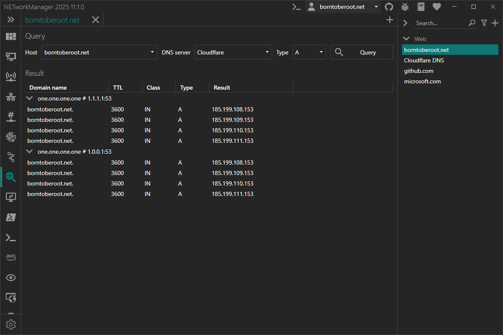

# DNS Lookup

With the **DNS Lookup** you can query DNS servers for various resource records.

:::info

DNS (Domain Name System) is a hierarchical naming system for computers, services, and other resources connected to the internet or a private network. It translates human-readable hostnames into IP addresses and supports various record types such as A (IPv4), AAAA (IPv6), MX (mail), CNAME (alias), NS (name server), and PTR (reverse lookup).

:::

### Example inputs

| Host                         | Type    | Description                                                          |
| ---------------------------- | ------- | -------------------------------------------------------------------- |
| `server-01.borntoberoot.net` | `A`     | To get the IPv4 address of the hostname.                             |
| `server-01.borntoberoot.net` | `AAAA`  | To get the IPv6 address of the hostname.                             |
| `server.borntoberoot.net`    | `CNAME` | To get the canonical name of the hostname.                           |
| `borntoberoot.net`           | `MX`    | To get the mail exchange servers for the domain.                     |
| `borntoberoot.net`           | `NS`    | To get the name servers for the domain.                              |
| `10.0.0.1`                   | `PTR`   | To get the hostname associated with the IP address (reverse lookup). |

| DNS server             | Description                                                                |
| ---------------------- | -------------------------------------------------------------------------- |
| `[Windows DNS]`        | Uses the DNS server configured in Windows.                                 |
| `Cloudflare` (profile) | Uses Cloudflare's public DNS servers from a predefined profile.            |
| `1.1.1.1:53` (input)   | Uses the custom DNS server `1.1.1.1` on port `53` from the input directly. |
| `ns3.inwx.eu` (input)  | Uses the custom DNS server `ns3.inwx.eu` from the input directly.          |
| `Google Public DNS; Cloudflare; 9.9.9.9` | Uses the DNS servers of both profiles and `9.9.9.9`.         |

:::note

Multiple inputs (host, DNS server) can be combined with a semicolon (`;`).

Example: `server-01.borntoberoot.net; 10.0.0.1`

:::

:::note

`PTR` can only be looked up for IP addresses. Hostnames are skipped with a message.

:::

The DNS server can be selected from a list of configured servers or you can enter a custom DNS server in the format `<hostname>|<ipaddress>:<port>` (`<port>` is optional, to use a custom port with IPv6 enclose the address in square brackets: `[<ipv6address>]:53`). Names of configured DNS servers (case-insensitive) and custom DNS servers can be combined with a semicolon (e.g. `Google Public DNS; Cloudflare; 9.9.9.9`), every DNS server is queried once. `[Windows DNS]` together with other DNS servers adds the DNS servers configured in Windows. The list shows the recently used DNS servers (history, a single configured DNS server is not added) and the configured DNS servers (name, with the IP addresses below). `Tab` completes the name of a configured DNS server that is being typed (e.g. `google; cl` → `google; Cloudflare`), `Tab` again shows the next match.

### Context menu

| Action        | Description                                      |
| ------------- | ------------------------------------------------ |
| **Copy**      | Copies the selected information to the clipboard |
| **Export...** | Exports the selected or all results to a file    |

## Profile

### Inherit host from general

Inherit the host from the general settings.

**Type:** `Boolean`

**Default:** `Enabled`

:::note

If this option is enabled, the [Host](#host) is overwritten by the host from the general settings and the [Host](#host) is disabled.

:::

### Host

Hostname or IP address (or any other resource record) to query.

**Type:** `String`

**Default:** `Empty`

**Example:**

- `server-01.borntoberoot.net` (`A` record)
- `1.1.1.1` (`PTR` record)

### DNS server

Use this DNS server instead of the [DNS server of the group](#dns-server-1) or, if not set there, the DNS server selected in the DNS lookup: names of [DNS servers](#dns-server-2) and / or custom DNS servers, separated by `;` (selectable in the list, `Tab` completes a name).

**Type:** `String`

**Default:** `Disabled` / `Empty`

**Example:**

- `Cloudflare`
- `Google Public DNS; 9.9.9.9`

:::note

A configured DNS server is referenced by the profile, so changes to it apply to the profile, also if it is renamed. Its IP addresses are saved with the profile as well: if the DNS server can't be found (it was deleted, or the profile file is shared from another computer - DNS servers are saved in the settings of each computer), the saved IP addresses are used and a note is shown. `[Windows DNS]` always uses the DNS servers of the computer.

:::

### Type

Record type to query instead of the automatic type: `PTR` for IP addresses, otherwise `A`.

**Type:** `QueryType`

**Default:** `Disabled` / `A`

:::note

`PTR` can only be looked up for IP addresses: if the [Host](#host) contains a hostname, the profile can't be saved.

:::

## Group

### DNS server

DNS server for the profiles of the group that don't set their own [DNS server](#dns-server), like the DNS server of a profile. If neither the profile nor the group has a DNS server, the DNS server selected in the DNS lookup is used.

**Type:** `String`

**Default:** `Disabled` / `Empty`

**Example:**

- `Cloudflare`
- `10.1.0.53; 10.1.0.54`

## Settings

### DNS server

List of DNS server profiles. A profile can contain one or more DNS servers with IP address and port.

**Type:** `List<NETworkManager.Models.Network.DNSServerConnectionInfoProfile>`

**Default:**

| Name              | Server 1          | Server 2          |
| ----------------- | ----------------- | ----------------- |
| Cloudflare        | `1.1.1.1:53`      | `1.0.0.1:53`      |
| DNS.Watch         | `84.200.69.80:53` | `84.200.70.40:53` |
| Google Public DNS | `8.8.8.8:53`      | `8.8.4.4:53`      |
| Level3            | `209.244.0.3:53`  | `209.244.0.4:53`  |
| Quad9             | `9.9.9.9`         | `149.112.112.112` |
| Verisign          | `64.6.64.6:53`    | `64.6.65.6:53`    |

:::note

Right-click on a selected DNS server to `edit` or `delete` it.

You can also use the Hotkeys `F2` (`edit`) or `Del` (`delete`) on a selected DNS server.

:::

### Add DNS suffix (primary) to hostname

Add the primary DNS suffix to the hostname. If no primary DNS suffix is configured (e.g. the computer is not domain-joined), the connection-specific DNS suffix of the active network adapter is used instead.

**Type:** `Boolean`

**Default:** `Enabled`

### Use custom DNS suffix

Add a custom DNS suffix to the hostname.

**Type:** `Boolean | String`

**Default:** `Disabled | Empty`

**Example:** `Enabled | borntoberoot.net`

### Recursion

Use recursion for the DNS query.

**Type:** `Boolean`

**Default:** `Enabled`

### Use cache

Use the cache for the DNS query.

**Type:** `Boolean`

**Default:** `Disabled`

### Query class

DNS class to use for the query.

**Type:** `String`

**Default:** `IN`

**Possible values:**

- `CS`
- `CH`
- `HS`
- `IN`

### Show only most common query types

Only show the most common query types (`A`, `AAAA`, `ANY`, `CNAME`, `DNSKEY`, `MX`, `NS`, `PTR`, `SOA`, `SRV` and `TXT`) in the dropdown menu in the view. Otherwise all available query types are shown.

**Type:** `Boolean`

**Default:** `Enabled`

### Use only TCP

Only use TCP for the DNS query. DNS uses UDP by default.

**Type:** `Boolean`

**Default:** `Disabled`

### Retries

Number of retries for the DNS query after which the query is considered lost.

**Type:** `Integer` [Min `1`, Max `10`]

**Default:** `3`

### Timeout (s)

Timeout in seconds for the DNS query, after which the query is considered lost.

**Type:** `Integer` [Min `1`, Max `15`]

**Default:** `2`
