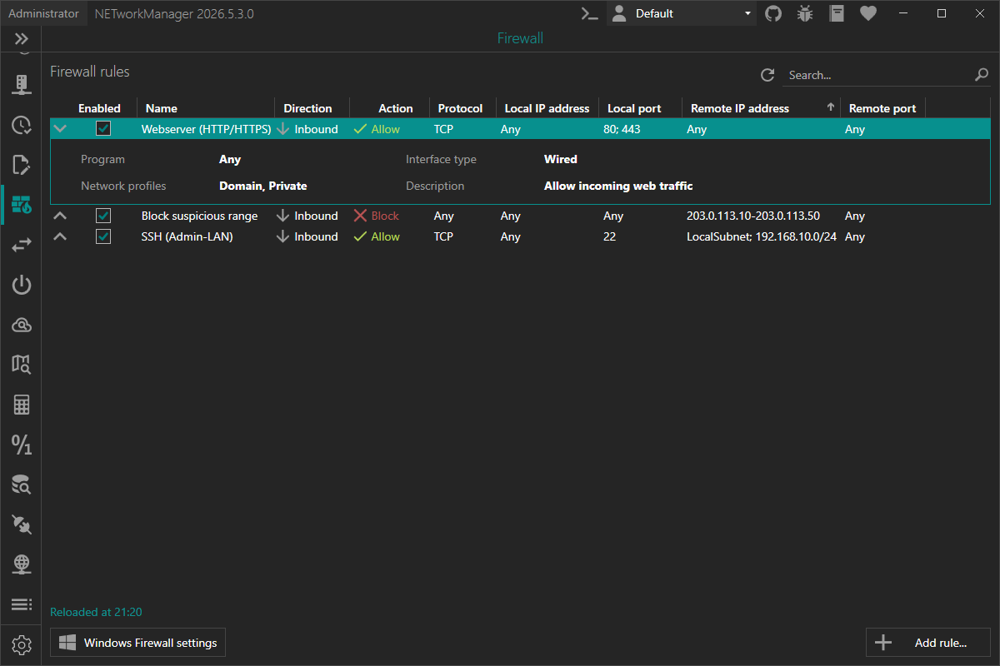
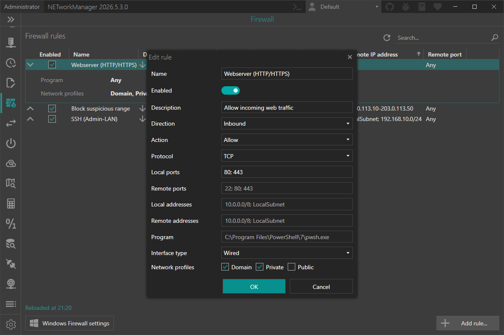

# Firewall

The **Firewall** allows you to view, add, edit, enable, disable, or delete Windows Firewall rules managed by NETworkManager. Rules are identified by a `NETworkManager_` prefix in their display name so that only rules created through NETworkManager are shown in this view. Enable [**Show all rules**](#show-all-rules) in the settings to show all Windows Firewall rules.

:::info

Windows Firewall (Windows Defender Firewall) is a built-in host-based firewall included with all versions of Windows. It filters inbound and outbound network traffic based on rules that define the protocol, port, address, program, and action (allow or block).

:::

:::warning[Administrator privileges required]

Without administrator privileges, the view is read-only. Use the **Restart as administrator** button to relaunch the application with elevated rights.

:::

The **Program** column shows the file name of the program the rule applies to (e.g. `putty.exe`). The full path (e.g. `%ProgramFiles%\PuTTY\putty.exe`) is shown as tooltip and in the row details.

The search above the list finds rules by name, program, direction, action, protocol, local / remote addresses, local / remote ports and description. The list is filtered after a short delay while typing.

### Toolbar

| Button | Description |
|--------|-------------|
| **Add rule...** | Opens a dialog to create a new firewall rule |
| **Windows Firewall Settings** | Opens the Windows Firewall management console (`WF.msc`) |

### Rules not managed by NETworkManager

By default, only rules managed by NETworkManager (display name prefixed with `NETworkManager_`) are shown. If [**Show all rules**](#show-all-rules) is enabled in the settings, all active Windows Firewall rules are shown (e.g. Windows built-in rules, rules created by other applications or from Group Policy).

When all rules are shown, an additional column shows where a rule comes from. Click the column header to sort by it (managed by NETworkManager, not managed by NETworkManager, then managed by a policy).

| Icon | Description |
|------|-------------|
| Shield | Managed by NETworkManager. All actions are available. |
| Crossed-out shield | Not managed by NETworkManager (e.g. Windows built-in rule or created by another application). The rule can be enabled, disabled, deleted or copied, but not edited. |
| Shield with lock | Managed by a policy (Group Policy or Mobile Device Management (MDM), e.g. Microsoft Intune) or created by Windows at runtime (e.g. dynamic or hardcoded rules). The rule can't be changed locally, it can only be copied. |

If at least one of the selected rules is managed by a policy, **Enable**, **Disable** and **Delete** are disabled for the whole selection.

Rules not managed by NETworkManager can be enabled, disabled, deleted (also together with other selected rules) or used as a template via **Copy as...** (the copy is created as a new rule managed by NETworkManager), but editing them is not supported (yet). These rules may use properties that can't be shown in the edit dialog (e.g. rule group, service, ICMP types, edge traversal or app packages). The **Edit** action is disabled for these rules.

Some rules (mostly Windows built-in rules) use values that are not supported by NETworkManager, such as port keywords (e.g. `RPC`, `RPCEPMap`, `IPHTTPSIn`), a combination of interface types (e.g. `Wired, Wireless`), a protocol that is not listed in the dialog (e.g. `IGMP` or `IPv6`) or the program `System`. These values are shown as they are, but such rules can neither be **edited** nor used for **Copy as...**, because the dialog can't show or keep these values and the new rule could apply to more traffic (e.g. to all ports). This also applies to rules managed by NETworkManager that were changed outside of NETworkManager (e.g. in the Windows Firewall management console).

When enabling, disabling or deleting rules and at least one of the selected rules is not managed by NETworkManager, a warning listing these rules is shown, which must be confirmed (for delete, the warning is added to the existing confirmation).

When using **Copy as...** on a rule that uses properties which are not supported by NETworkManager but restrict the traffic (ICMP types, a service, an app package, specific network adapters, or users / required authentication, e.g. set in the Windows Firewall management console), a warning listing these properties is shown first, which must be confirmed. These properties are not copied, so the new rule may apply to more traffic than the original rule (e.g. to all services of a program instead of a single one). Review the new rule carefully before saving it. When editing a rule, these properties are kept.

:::warning

Be careful when disabling or deleting Windows built-in rules or rules created by other applications, as this may break network functionality of Windows or the application.

:::

### Context menu

Multiple rules can be selected (`Ctrl` / `Shift` + click) to enable, disable or delete them at once.

| Action | Description |
|--------|-------------|
| **Enable** | Enables the selected rule or rules |
| **Disable** | Disables the selected rule or rules |
| **Edit** | Opens the edit dialog for the selected rule (single rule only, only rules managed by NETworkManager without [unsupported values](#rules-not-managed-by-networkmanager)) |
| **Copy as** | Opens the dialog pre-filled with the selected rule to create a new rule based on it (single rule only, not for rules with [unsupported values](#rules-not-managed-by-networkmanager)) |
| **Delete** | Removes the selected rule or rules (after confirmation) |
| **Copy** | Copies the rule information to the clipboard (single rule only) |
| **Export** | Exports the selected rules (or all rules) to a file |

### Keyboard shortcuts

| Key | Action |
|-----|--------|
| `F5` | Refresh |
| `F2` / Double-click | Edit selected rule (only if the rule can be edited) |
| `Del` | Delete selected rule or rules |

:::note

Before enabling, disabling or deleting, it is checked that all selected rules still exist. If one of them was removed in the meantime (e.g. in the Windows Firewall management console), none of the selected rules is changed and an error is shown. If another error occurs while the rules are changed (e.g. access denied), some of the selected rules may already be changed. The rule list is reloaded after every action (also after an error), so it always shows the current state.

:::

## Add rule

The **Add rule** dialog is opened by clicking the **Add rule...** button below the rule list. The same dialog (with the values pre-filled) is used to **edit** an existing rule, or to create a new rule based on an existing one via **Copy as...** in the context menu (the name is suffixed with ` - Copy`, the original rule is not changed).

When editing a rule, only the changed properties are updated. Properties that are not supported by NETworkManager (e.g. rule group, service or ICMP types set in the Windows Firewall management console) are kept. If the protocol is changed, ICMP types are reset to `Any`, because they are only valid for the ICMP protocol they were set for.

The display name of every rule created with NETworkManager is automatically prefixed with `NETworkManager_` so it can be picked up by NETworkManager on the next refresh. The prefix is hidden in the user interface.

### Name

Display name of the firewall rule.

**Type:** `String`

**Default:** `Empty`

**Example:** `Webserver (HTTP/HTTPS)`

:::note

The name is required and must not be empty. Internally the rule is stored with the prefix `NETworkManager_` (e.g. `NETworkManager_Webserver (HTTP/HTTPS)`).

:::

### Enabled

Whether the rule is active right after creation.

**Type:** `Boolean`

**Default:** `Enabled`

### Description

Optional description of the rule.

**Type:** `String`

**Default:** `Empty`

**Example:** `Allow incoming web traffic`

### Direction

Traffic direction the rule applies to.

**Type:** `NETworkManager.Models.Firewall.FirewallRuleDirection`

**Default:** `Inbound`

**Possible values:**

- `Inbound` (Traffic coming into the local computer.)
- `Outbound` (Traffic leaving the local computer.)

### Action

Action that is performed when a packet matches the rule.

**Type:** `NETworkManager.Models.Firewall.FirewallRuleAction`

**Default:** `Allow`

**Possible values:**

- `Allow` (Permit matching traffic.)
- `Block` (Drop matching traffic.)

### Protocol

Network protocol the rule applies to.

**Type:** `NETworkManager.Models.Firewall.FirewallProtocol`

**Default:** `Any`

**Possible values:**

- `Any`
- `TCP`
- `UDP`
- `ICMPv4`
- `ICMPv6`
- `GRE`
- `L2TP`

:::note

[Local ports](#local-ports) and [Remote ports](#remote-ports) are only available when the protocol is set to `TCP` or `UDP`.

:::

### Local ports

One or more local ports or port ranges the rule applies to. Multiple entries are separated by `;`.

**Type:** `String`

**Default:** `Empty`

**Example:**

- `80`
- `80; 443`
- `8080-8090`
- `27015-27030; 27036`

:::note

Only available if [Protocol](#protocol) is set to `TCP` or `UDP`.

An empty value means **Any** port.

:::

### Remote ports

One or more remote ports or port ranges the rule applies to. Multiple entries are separated by `;`.

**Type:** `String`

**Default:** `Empty`

**Example:**

- `53`
- `80; 443`
- `49152-65535`

:::note

Only available if [Protocol](#protocol) is set to `TCP` or `UDP`.

An empty value means **Any** port.

:::

### Local addresses

One or more local addresses the rule applies to. Multiple entries are separated by `;`.

**Type:** `String`

**Default:** `Empty`

**Example:**

- `192.168.1.10`
- `fe80::1`
- `192.168.1.0/24`
- `10.0.0.0/255.0.0.0`
- `192.168.1.10-192.168.1.50`
- `LocalSubnet; 192.168.10.0/24`

:::note

An empty value means **Any** address.

The following formats are accepted:

- Single IPv4 / IPv6 address (e.g. `1.2.3.4`, `fe80::1`)
- IPv4 / IPv6 subnet by prefix length (e.g. `1.2.3.0/24`, `fe80::/48`)
- IPv4 subnet by subnet mask (e.g. `10.0.0.0/255.0.0.0`)
- IPv4 / IPv6 range (e.g. `1.2.3.4-1.2.3.10`, `fe80::1-fe80::9`)
- Keyword: `Any`, `LocalSubnet`, `DNS`, `DHCP`, `WINS`, `DefaultGateway`, `Internet`, `Intranet`, `IntranetRemoteAccess`, `PlayToDevice`, `CaptivePortal`. Keywords can be restricted to IPv4 or IPv6 by appending `4` or `6` (e.g. `LocalSubnet4`, `Intranet6`).

According to Microsoft, the only keyword officially supported by `LocalAddress` is `Any`. The other keywords are intended for use with [Remote addresses](#remote-addresses).

:::

### Remote addresses

One or more remote addresses the rule applies to. Multiple entries are separated by `;`.

**Type:** `String`

**Default:** `Empty`

**Example:**

- `8.8.8.8`
- `10.0.0.0/8`
- `203.0.113.10-203.0.113.50`
- `DNS`
- `Internet; CaptivePortal`

:::note

An empty value means **Any** address.

The same formats as [Local addresses](#local-addresses) are accepted (single address, subnet, range, or keyword).

:::

### Program

Full path to an executable the rule applies to. When set, the rule only matches traffic to or from that program.

**Type:** `String`

**Default:** `Empty`

**Example:** `C:\Program Files\GameServer\server.exe`

:::note

If a path is provided, the file must exist on the local computer. Environment variables (e.g. `%SystemRoot%\System32\svchost.exe`) are supported.

An empty value means **Any** program.

:::

### Interface type

Network interface type the rule applies to.

**Type:** `NETworkManager.Models.Firewall.FirewallInterfaceType`

**Default:** `Any`

**Possible values:**

- `Any`
- `Wired`
- `Wireless`
- `RemoteAccess`

### Network profiles

Network profiles the rule applies to. At least one profile must be selected.

**Type:** `Boolean[]` (Domain / Private / Public)

**Default:** `Domain`, `Private`, `Public` (all enabled)

**Possible values:**

- `Domain` (Networks at a workplace that are joined to a domain.)
- `Private` (Networks at home or work where you trust the people and devices on the network.)
- `Public` (Networks in public places such as airports or coffee shops.)

:::note

The last enabled profile cannot be unchecked — at least one profile must remain selected.

:::

## Settings

### Show all rules

Show all active Windows Firewall rules (e.g. Windows built-in rules, rules created by other applications or from Group Policy / MDM) instead of only the rules managed by NETworkManager. The rule list is reloaded when the setting is changed.

See [Rules not managed by NETworkManager](#rules-not-managed-by-networkmanager) for what can be done with these rules.

**Type:** `Boolean`

**Default:** `Disabled`
