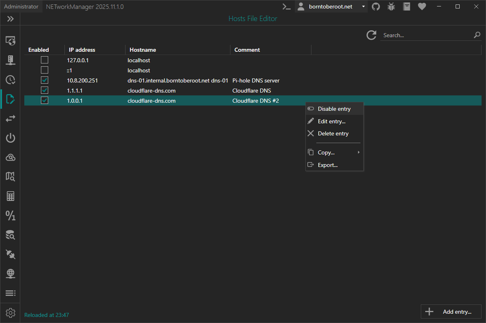
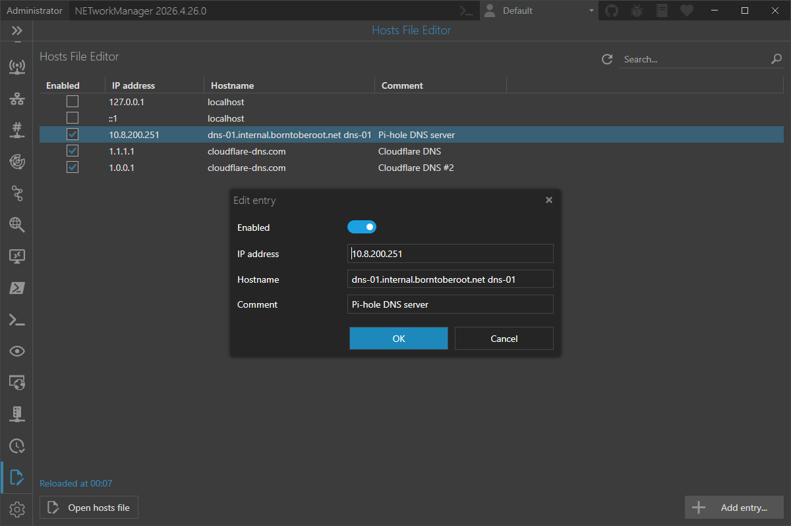

# Hosts File Editor

The **Hosts File Editor** allows you to view, add, edit, enable, disable, or remove entries in the local computer's `hosts` file.

:::info

The hosts file is a plain text file that maps hostnames to IP addresses and is checked by the operating system before querying DNS servers. It's commonly used to override DNS settings for testing websites, redirecting domains, or blocking access to certain sites. On Windows, the file is located at `C:\Windows\System32\drivers\etc\hosts` and requires administrator privileges to edit.

Each line in the hosts file typically contains an IP address followed by one or more hostnames, separated by spaces or tabs. Lines starting with `#` are comments and ignored by the system.

Example of a hosts file entry:

```plain
10.8.0.10 example.borntoberoot.net # Test server not reachable via DNS
```

:::

:::warning[Administrator privileges required]

Without administrator privileges, the view is read-only. Use the **Restart as administrator** button to relaunch the application with elevated rights.

:::



:::note

The application automatically creates a daily backup of the `hosts` file, retaining up to 5 backups in the same directory (Syntax: `hosts_backup_NETworkManager_YYYYMMDD`).

:::

### Toolbar

| Button | Description |
|--------|-------------|
| **Add entry...** | Opens a dialog to add an entry to the hosts file |

### Context menu

Multiple entries can be selected (`Ctrl` / `Shift` + click) to enable, disable, edit or delete them at once.

| Action | Description |
|--------|-------------|
| **Enable** | Enables the selected entry or entries |
| **Disable** | Disables the selected entry or entries |
| **Edit** | Opens the edit dialog for the selected entry. If multiple entries are selected, see [Edit multiple entries](#edit-multiple-entries) |
| **Copy as** | Opens the dialog pre-filled with the selected entry to create a new entry based on it (single entry only) |
| **Delete** | Removes the selected entry or entries (after confirmation) |
| **Copy** | Copies the entry information to the clipboard (single entry only) |
| **Export** | Exports the selected entries (or all entries) to a file |

### Keyboard shortcuts

| Key | Action |
|-----|--------|
| `F5` | Refresh |
| `F2` | Edit selected entry or entries |
| `Del` | Delete selected entry or entries |

:::note

If one of the selected entries was changed or removed in the `hosts` file in the meantime (e.g. by another program), the action is not applied to any of the selected entries and an error is shown. The list is refreshed automatically, so the action can simply be repeated.

:::

## Add entry

The **Add entry** dialog is opened by clicking the **Add entry...** button below the entry list. The same dialog (with the values pre-filled) is used to **edit** an existing entry, or to create a new entry based on an existing one via **Copy as...** in the context menu. The copy is added directly below the original entry (or at the end of the file, if the original entry was changed in the meantime).



### Enabled

Whether the entry is active right after creation. A disabled entry is written to the `hosts` file as a comment (prefixed with `#`) and is ignored by the operating system.

**Type:** `Boolean`

**Default:** `Enabled`

### IP address

IP address the hostname(s) should resolve to.

**Type:** `String`

**Default:** `Empty`

**Example:**

- `10.0.0.10`
- `fe80::1`

:::note

Both IPv4 and IPv6 addresses are accepted. The field is required and validated for a correct address format.

:::

### Hostname

One or more hostnames that should resolve to the [IP address](#ip-address). Multiple hostnames are separated by a space — matching the native `hosts` file format.

**Type:** `String`

**Default:** `Empty`

**Example:**

- `example.borntoberoot.net`
- `example.borntoberoot.net www.example.borntoberoot.net`

:::note

Each hostname must conform to the standard hostname / domain syntax. The field is required.

:::

### Comment

Optional comment associated with the entry. The comment is written after the hostname(s) on the same line, separated by a `#`.

**Type:** `String`

**Default:** `Empty`

**Example:** `Test server not reachable via DNS`

## Edit multiple entries

If multiple entries are selected, **Edit entries...** (or `F2`) opens the same dialog in bulk mode. Only the [comment](#comment) can be changed, it is applied to all selected entries. To enable or disable multiple entries, use **Enable** / **Disable** in the context menu.

If all selected entries have the same comment, it is pre-filled. Otherwise the field is empty and shows `Multiple values`. **OK** is only available after the comment was changed, so the existing comments are not overwritten by accident. To remove the comment from all selected entries, clear the field (e.g. type a character and delete it again) and confirm with **OK**.
