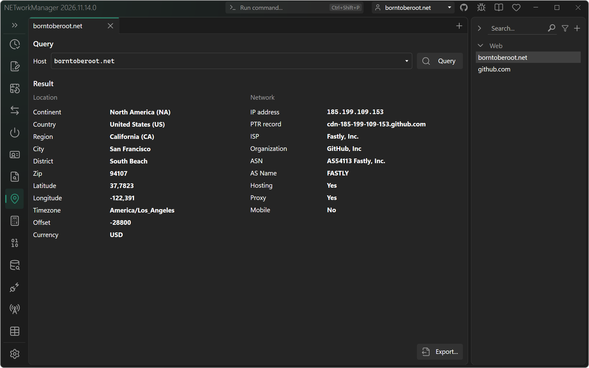

# IP Geolocation

With **IP Geolocation** you can retrieve geolocation information for a fully qualified domain name (FQDN) or a public IP address.

:::info

IP geolocation data is provided by [ip-api.com](https://ip-api.com/) and the API endpoint `http://ip-api.com/json/<host>` is queried when the information is requested.

:::



### Example inputs

| Input | Description |
|-------|-------------|
| `borntoberoot.net` | Fully qualified domain name (FQDN) |
| `1.1.1.1` | Public IP address |

### Toolbar

| Button | Description |
|--------|-------------|
| **Export...** | Exports the information to a CSV, XML, or JSON file |

### Context menu

| Action | Description |
|--------|-------------|
| **Copy** | Copies the selected information to the clipboard |

## Run command

Open the tool with `ipgeolocation` or `geo`. Add a public IP address or a host (validated like the input):

```text
geo 1.1.1.1
geo borntoberoot.net
geo 2606:4700:4700::1111
geo @borntoberoot.net
```

Every command opens a new tab, a query running in another tab continues. With `Shift+Enter` (only fill in), the host is filled in without starting the query. A profile (`@profile`) queries its host.

## Profile

### Inherit host from general

Inherit the host from the general settings.

**Type:** `Boolean`

**Default:** `Enabled`

:::note

If this option is enabled, the [host](#host) is overwritten by the host from the general settings and the [host](#host) is disabled.

:::

### Host

Host (FQDN or public IP address) to query for IP geolocation information.

**Type:** `String`

**Default:** `Empty`

**Example:**

- `borntoberoot.net`
- `1.1.1.1`

## Troubleshooting and limits

- The free API endpoint of `ip-api.com` is limited to 45 requests per minute (for all tools and computers with the same public IP address), supports only the `http` protocol and is available for non-commercial use only. Shortly before the limit, the queries stop and a message shows when to try again.
- Private and reserved IP addresses (e.g. `10.0.0.1`, `192.168.1.1`) have no geolocation.
- A hostname is resolved by `ip-api.com`, not locally: names that only exist in the local network can't be queried.
- The location of an IP address is an estimate of the provider (often the location of the internet provider or the data center, not of the device), anycast addresses (e.g. `1.1.1.1`) show one location only.
- The firewall or proxy must allow outgoing HTTP connections (TCP port `80`) to `ip-api.com`.
