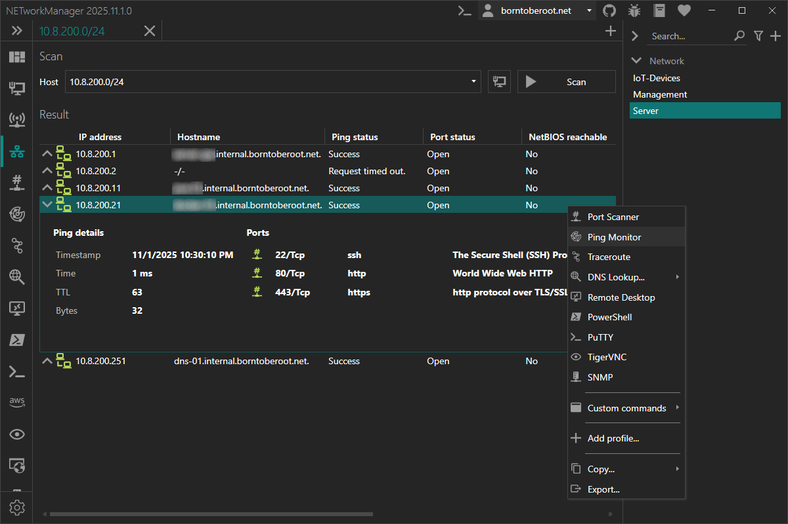

# IP Scanner

With the **IP Scanner** you can scan IP ranges, subnets and hostnames for active devices: a host is found if it answers the ping, a TCP port (open, or closed with a TCP reset), NetBIOS or SNMP; hosts in a local subnet that drop all of them (e.g. a firewall) are found by their ARP / NDP entry, see [How hosts are found](#how-hosts-are-found). For every host, the hostname (DNS, mDNS or NetBIOS), the MAC address and vendor and the open ports are shown, optionally also a guess of the operating system, the web page and the SNMP system information.

### Example inputs

| Host                             | Description                                                                                  |
| -------------------------------- | -------------------------------------------------------------------------------------------- |
| `10.0.0.1`                       | Single IP address (`10.0.0.1`)                                                               |
| `10.0.0.100 - 10.0.0.199`        | All IP addresses in a given range (`10.0.0.100`, `10.0.0.101`, ..., `10.0.0.199`)            |
| `10.0.0.100-199`                 | All IP addresses in a given range, shorthand for the last octet (`10.0.0.100`, ..., `10.0.0.199`) |
| `10.0.0.0/23`                    | All IP addresses in a subnet (`10.0.0.0`, ..., `10.0.1.255`)                                 |
| `10.0.0.0/255.255.254.0`         | All IP addresses in a subnet (`10.0.0.0`, ..., `10.0.1.255`)                                 |
| `10.0.[0-9,20].[1-2]`            | Multiple IP addresses like (`10.0.0.1`, `10.0.0.2`, `10.0.1.1`, ...,`10.0.9.2`, `10.0.20.1`) |
| `borntoberoot.net`               | Single IP address resolved from a host (`10.0.0.1`)                                          |
| `borntoberoot.net/24`            | All IP addresses in a subnet resolved from a host (`10.0.0.0`, ..., `10.0.0.255`)            |
| `borntoberoot.net/255.255.255.0` | All IP addresses in a subnet resolved from a host (`10.0.0.0`, ..., `10.0.0.255`)            |
| `!10.0.0.1`                      | Excludes an IP address (also a range, subnet or host, e.g. `!10.0.0.0/28`) from the other inputs|

:::note

Multiple inputs can be combined with a semicolon (`;`). A column pasted from Excel (one entry per line) is converted to the semicolon-separated form automatically.

An input starting with `!` excludes its IP addresses from the other inputs, e.g. `10.0.0.0/24; !10.0.0.1; !10.0.0.200-254` (all formats of the table above, a hostname is resolved first). At least one input without `!` is required; if the exclusions remove every IP address, a message is shown instead.

Example: `10.0.0.0/24; 10.0.[10-20].1; 10.0.0.100-199`

IP addresses that are part of multiple inputs (e.g. `10.0.0.1; 10.0.0.0/24`) or entered with different hostnames (e.g. two names of one server) are scanned only once. The hostname is resolved via DNS (`PTR`), mDNS or NetBIOS, not taken from the input. The network and broadcast address of a subnet are scanned as well.

A scan of more than `65,536` IP addresses (e.g. a `/15`) must be confirmed, more than `16,777,216` IP addresses (a `/8`) cannot be scanned at once.

:::

### Toolbar

| Button                                            | Description                                                                                                            |
| ------------------------------------------------- | ---------------------------------------------------------------------------------------------------------------------- |
| **Detect local subnet**                           | Populates the host field with the IP address and subnet mask of the current network interface to scan the local subnet |
| **Subnet of network interface** > _Subnet (Name)_ | Populates the host field with the IPv4 subnet of a network interface (e.g. `192.168.1.0/24`), e.g. if there are multiple network interfaces (LAN, Wi-Fi, VPN, Hyper-V) |
| **All local subnets**                             | Populates the host field with the IPv4 subnets of all network interfaces (without the link-local subnet `169.254.0.0/16`) |

The button opens a menu with these entries. The subnets of the network interfaces are read when the menu is opened; only connected network interfaces with an IPv4 address and subnet mask are listed (no single addresses like `/32`), the link-local subnet (`169.254.0.0/16`, no DHCP server answered) at the end.

:::note

The local IP address (and subnet mask) of **Detect local subnet** is determined by trying to route to a public IP address. If this fails (e.g.
no network connection), NETworkManager iterates over active network adapters and selects the first valid IPv4 address,
with link-local addresses (`169.254.x.x`) given lower priority.

:::

### Context menu

Right-clicking a result allows forwarding device information to another tool (e.g. [Port Scanner](./port-scanner), Remote Desktop), querying the registration data of its IP address or hostname via [RDAP](./rdap), creating a new profile, or executing a [custom command](#custom-commands).

| Action                                                                            | Description                                                                                                   |
| --------------------------------------------------------------------------------- | ------------------------------------------------------------------------------------------------------------- |
| **Rescan**                                                                        | Scans the selected host(s) again with the settings of the shown scan and updates their rows (a host that is unreachable now is shown as down). A canceled rescan keeps the previous results. Not available while a scan is running |
| **Port Scanner** / **Ping Monitor** / **Traceroute**                              | Opens the host (DNS hostname if resolved, otherwise the IP address) in the tool                              |
| **DNS lookup...** > **IP address** / **Hostname**                                 | Looks up the IP address (`PTR`) or the DNS hostname in [DNS Lookup](./dns-lookup)                             |
| **RDAP...** > **IP address** / **Hostname**                                       | Queries the registration data of the IP address or the registered domain of the DNS hostname in [RDAP](./rdap) |
| **Remote Desktop** / **PowerShell** / **PuTTY** / **TigerVNC** / **SNMP**         | Opens the host (DNS hostname if resolved, otherwise the IP address) in the tool                              |
| **Web Console**                                                                   | Opens the host in the [Web Console](./web-console): the port of the web page that was read (see [Read web pages](#read-web-pages)), otherwise https if port `443` is open, http on `80`, `8443` (https) or `8080`, http if none of them is open (or the port scan is disabled) |
| **Wake on LAN**                                                                   | Sends a magic packet to the MAC address of the host with [Wake on LAN](./wake-on-lan) (only with a MAC address) |
| **Custom commands**                                                               | Executes a [custom command](#custom-commands) for the host                                                    |
| **Add profile...**                                                                | Creates a new profile with the host (IP address), the hostname as name and the MAC address for Wake on LAN    |
| **Copy**                                                                          | Copies the selected information to the clipboard (values only when the probe / lookup is finished); with the optional requests also **mDNS hostname**, **Web** > **Title** / **URL** / **Server** and **SNMP** > **Name** / **Description** / **Location** |
| **Export...**                                                                     | Exports the selected or all results to a file                                                                 |

A NetBIOS or mDNS name (shown as hostname if there is no DNS hostname) is not passed to other tools, because it may not be resolvable via DNS - the IP address is used instead. **DNS lookup...** / **RDAP...** > **Hostname** are only available with a DNS hostname. In [custom commands](#custom-commands), `{{Hostname}}` is the shown hostname (DNS, mDNS or NetBIOS).

If multiple results are selected, **Rescan**, **Copy** > **IP address** / **Hostname** / **MAC address** (one value per line, in the order shown, without duplicates) and **Export...** are available.

### How hosts are found

The probes of a host run at the same time. A host is shown (and counted as up) as soon as it answers the first one, probes that answer later are added.

| Probe     | Answer                                                                                     | Setting                                                                 |
| --------- | ------------------------------------------------------------------------------------------ | ----------------------------------------------------------------------- |
| Ping      | ICMP echo reply                                                                            | [Ping hosts](#ping-hosts)                                               |
| TCP       | A [port](#ports) is open or refused the connection (TCP reset)                             | [Scan ports](#scan-ports)                                               |
| NetBIOS   | Answer to the NetBIOS request (UDP `137`, IPv4 only)                                       | [Scan for NetBIOS](#scan-for-netbios)                                   |
| SNMP      | Answer to the SNMP request (UDP `161`)                                                     | [Read the SNMP system information](#read-the-snmp-system-information)   |
| ARP / NDP | Neighbor entry of a host in a local subnet that didn't answer any of the probes above      | [Find hosts in the local subnet](#find-hosts-in-the-local-subnet)       |

The probes a host answered are shown in the tooltip of its status icon (e.g. `Up (detected by Ping, TCP)`) and as status icons in the headers of the [row details](#row-details). The export contains them as `DetectedBy` (e.g. `ICMP, TCP` or `ARP`).

Only reachable hosts are shown, unless [Show unreachable IP addresses and ports](#show-unreachable-ip-addresses-and-ports) is enabled; unreachable hosts are added when all their probes are finished.

### Result

The number of reachable (up) and unreachable (down) IP addresses is shown next to the **Result** header. A message below the input is shown if no reachable host was found, the scan was canceled, a hostname could not be resolved or an error occurred.

The columns are shown according to the settings the scan was started with, settings changed afterwards apply to the next scan:

| Column                         | Content                                                                                                                                                                  |
| ------------------------------ | ------------------------------------------------------------------------------------------------------------------------------------------------------------------------ |
| _Status_                       | Up / down, the tooltip shows the probes that answered                                                                                                                    |
| _Role_                         | Icon if the host has a role for this computer: **This computer**, **Default-Gateway**, **DNS server** or **DHCP server** of a connected network interface (all roles in the tooltip) |
| **IP address**                 | Scanned IP address                                                                                                                                                       |
| **Hostname**                   | DNS hostname (`PTR`), otherwise the mDNS hostname, otherwise the NetBIOS name                                                                                           |
| **Ping status**                | Status icon, the tooltip shows status, time and TTL (e.g. `Success (2 ms, TTL 64)`)                                                                                      |
| **Time**                       | Round trip time of the ping reply                                                                                                                                        |
| **OS (guess)**                 | Operating system guessed from the TTL of the ping reply, see [Guess the operating system from the TTL](#guess-the-operating-system-from-the-ttl)                       |
| **Port status**                | Status icon (a port is open), the tooltip shows the open ports with their service (e.g. `Open: 22 (ssh), 443 (https)`, the first 10)                                    |
| **Web**                        | Title of the web page, otherwise the realm of a login prompt, the `Server` header or the target of a redirect; the URL in the tooltip, see [Read web pages](#read-web-pages) |
| **SNMP name**                  | `sysName`, see [Read the SNMP system information](#read-the-snmp-system-information)                                                                                    |
| **NetBIOS reachable**          | Status icon, the tooltip shows the computer name and the workgroup / domain (e.g. `Yes (PC01, WORKGROUP)`)                                                               |
| **MAC address** / **Vendor**   | From the neighbor table (ARP / NDP), the NetBIOS answer as fallback                                                                                                      |

Values arrive one after another while the scan is running:

- `...`: the probe or lookup is still running. **Hostname** and **MAC address** / **Vendor** stay `...` until no source can change them any more (e.g. the NetBIOS name as fallback), **Web** until the port scan is finished (it needs the open ports).
- `-/-`: finished, no result.
- After **Cancel**, the lookups that were still running (hostname, MAC address, mDNS, web page) show `-/-`; ping, ports, NetBIOS and SNMP that didn't finish stay `...`.

A column you sorted by is not sorted again for values that arrive later, click the header again. Sorted by **Time** or **MAC address**, hosts without a value are always at the end; hosts with the same value are sorted by IP address.

The search box right of the **Result** header filters the results by IP address, hostname (DNS, mDNS, NetBIOS), MAC address, vendor, role, OS (guess), web page (title, headers, realm, redirect target, certificate), SNMP values and open ports (number or service), also while the scan is running. **Export...** > all exports the filtered results; the up / down counters always count all hosts. Results can also be exported while the scan is running, values that are still `...` are exported as empty values.

### Row details

Expand a row with the button in front of it to see all values of the host, or enable [Expand host view](#expand-host-view) to expand all hosts:

| Ping details | Ports | Web | NetBIOS |
| ------------ | ----- | --- | ------- |
| **Hostnames** | (ports) | (web) | **SNMP** |

| Section          | Content                                                                                                                                       |
| ---------------- | --------------------------------------------------------------------------------------------------------------------------------------------- |
| **Ping details** | Timestamp, time, TTL and bytes of the ping reply                                                                                              |
| **Ports**        | Open ports (all scanned ports with **Show unreachable IP addresses and ports**) with protocol, service and description                        |
| **Web**          | URL, status code, title, `Server` and `X-Powered-By` header, realm of a login prompt, redirect target and TLS certificate (subject, issuer, valid until) |
| **NetBIOS**      | Computer name, domain / workgroup and user                                                                                                    |
| **Hostnames**    | DNS and mDNS hostname                                                                                                                         |
| **SNMP**         | Name, description and location                                                                                                                |

The headers of the probes that can find a host (**Ping details**, **Ports**, **NetBIOS**, **SNMP**) show a status icon: a green check if the host answered the probe, a red cross if not (not while the probe is running). A section of a disabled setting shows a note (e.g. `SNMP is disabled!`).

### Keyboard shortcuts

| Key      | Action                                                        |
| -------- | ------------------------------------------------------------- |
| `Enter`  | Start the scan (in the search box: filter the results)        |
| `Esc`    | Cancel the running scan                                       |
| `Ctrl+T` | Open a new tab                                                |

## Profile

### Inherit host from general

Inherit the host from the general settings.

**Type:** `Boolean`

**Default:** `Enabled`

:::note

If this option is enabled, the [Host](#host) is overwritten by the host from the general settings and the [Host](#host) is disabled.

:::

### Host

Hostname or IP range to scan for active devices.

**Type:** `String`

**Default:** `Empty`

**Example:**

- `10.0.0.0/24; 10.0.[10-20].1`
- `server-01.borntoberoot.net`

:::note

See also the [IP Scanner](./ip-scanner) example inputs for more information about the supported host formats.

:::

## Settings

### Show unreachable IP addresses and ports

Show the scan result for all IP addresses and ports including the ones that are not active.

**Type:** `Boolean`

**Default:** `Disabled`

### Expand host view

Show the [row details](#row-details) of every host in the result, also of hosts that are added while the scan is running. A host that was expanded or collapsed with the button in front of the row keeps its state. Applies immediately.

**Type:** `Boolean`

**Default:** `Disabled`

### Ping hosts

Send a ping (ICMP echo request) to every IP address. Disable it if ICMP is blocked or rate limited in the network (e.g. by an IDS): without ping, an unreachable host is finished after the port scan / NetBIOS timeout instead of after all ping attempts, so the scan is faster. Hosts that only answer the ping are not found then. The **Ping status** and **Time** columns and the ping details are hidden for a scan without ping.

**Type:** `Boolean`

**Default:** `Enabled`

:::note

A host is only found if it answers a probe: at least one of **Ping hosts**, [Scan ports](#scan-ports), [Scan for NetBIOS](#scan-for-netbios) or [Read the SNMP system information](#read-the-snmp-system-information) must be enabled, otherwise the scan doesn't start. [Find hosts in the local subnet](#find-hosts-in-the-local-subnet) alone is not enough, it uses the neighbor entries created by the packets of these probes.

:::

### Attempts

Maximum number of ICMP requests sent to each IP address. Another request is only sent if the previous one has timed out (e.g. a lost packet), other replies like "destination host unreachable" are final.

**Type:** `Integer` [Min `1`, Max `10`]

**Default:** `2`

### Timeout (ms)

Timeout in milliseconds for each ICMP request, after which the packet is considered lost.

**Type:** `Integer` [Min `100`, Max `15000`]

**Default:** `2000`

### Buffer

Size of the buffer for each ICMP request in bytes.

**Type:** `Integer` [Min `1`, Max `65500`]

**Default:** `32`

### Guess the operating system from the TTL

Shows the operating system guessed from the TTL of the ping reply in the **OS (guess)** column (icon and text, `...` while the ping is running): every operating system starts with a typical TTL and every router on the way reduces it by one. The guess is the smallest typical TTL that is not lower than the received TTL, the tooltip shows the number of hops (e.g. TTL `126` → `Windows`, 2 hops). No additional packets are sent.

| Initial TTL | OS (guess)       | Icon          | Examples                                     |
| ----------- | ---------------- | ------------- | -------------------------------------------- |
| `64`        | `Linux / Unix`   | Terminal      | Linux, macOS, Android, iOS, many IoT devices |
| `128`       | `Windows`        | Windows logo  | Windows                                      |
| `255`       | `Network device` | Switch        | Routers, switches, printers, Solaris         |

**Type:** `Boolean`

**Default:** `Enabled`

:::note

It's a hint, not a detection: the TTL can be changed on the host (e.g. some devices use `64` or `128`), NAT and VPN can change it. Only available for hosts that answered the ping and only for IPv4 (the ping reply of IPv6 has no TTL). The export contains it as `OSGuess` (`LinuxUnix`, `Windows`, `NetworkDevice`).

:::

### Resolve hostname

Resolve the hostname (PTR) for each IP address.

**Type:** `Boolean`

**Default:** `Enabled`

### Scan ports

Scan each IP address for open TCP ports.

**Type:** `Boolean`

**Default:** `Enabled`

### Ports

List of TCP ports to scan for each IP address. The button next to the input restores the default ports.

**Type:** `String`

**Default:** `21; 22; 23; 53; 80; 135; 139; 389; 443; 445; 554; 631; 636; 3389; 5900; 5985; 7000; 8009; 8080; 8443; 9100; 62078`

:::note

Multiple ports and port ranges can be combined with a semicolon (e.g. `22; 80; 443`). Only common and known ports should be scanned to check if a host is reachable. Use the [Port Scanner](./port-scanner) for a detailed port scan.

:::

### Timeout (ms)

Timeout in milliseconds after which a port is considered timed out (no answer). A port is closed if the host refused the connection.

**Type:** `Integer` [Min `100`, Max `15000`]

**Default:** `2000`

:::note

A closed port is reported as soon as the host refuses the connection. Each attempt sends the connection request once (see [Attempts](#attempts-1)).

:::

### Attempts

Number of connection requests sent to each port. Another request is only sent if there was no answer (timed out), an open or closed port is final.

**Type:** `Integer` [Min `1`, Max `10`]

**Default:** `1`

:::tip

In a local network (LAN), `1` is enough. On an unreliable network (e.g. Wi-Fi, VPN) or for hosts on the internet, a lost connection request can make an open port appear as timed out and a host appear as unreachable - increase it to `2` in this case. This only takes longer for ports without answer (attempts × timeout); with the default settings, unreachable hosts are not slower up to `2` attempts, because the ping takes as long (2 × 2000 ms).

:::

### Scan for NetBIOS

Scan each IP address for NetBIOS information.

**Type:** `Boolean`

**Default:** `Enabled`

:::note

Only IPv4 addresses are scanned for NetBIOS, NetBIOS doesn't exist over IPv6.

:::

### Timeout (ms)

Timeout in milliseconds after which a NetBIOS request is considered lost.

**Type:** `Integer` [Min `100`, Max `15000`]

**Default:** `2000`

### Find hosts in the local subnet

:::info

**Find hosts in the local subnet** and [Resolve MAC address and vendor](#resolve-mac-address-and-vendor) both read the neighbor table of Windows (ARP for IPv4, NDP for IPv6), but for different purposes. They can be enabled independently (section **ARP / NDP** in the settings).

| | Find hosts in the local subnet | Resolve MAC address and vendor |
| --- | --- | --- |
| Purpose | Decides **if a host is up** | Shows **information** about a host that was found |
| Hosts | Hosts in a local subnet that didn't answer the ping, a port or NetBIOS | Every found host |
| Uses | The **state** of the entry (`Reachable` = up, `Stale` is checked again) | The **MAC address** of the entry (NetBIOS answer as fallback) and the vendor of it |
| Result | Host shown as up, **Detected by** `ARP / NDP` | **MAC address** and **Vendor** columns |

Example: a Windows client with the firewall on is only found with **Find hosts in the local subnet**; its MAC address is only shown if **Resolve MAC address and vendor** is enabled as well.

:::

Find hosts in a local subnet that don't answer the ping, a port or NetBIOS by their entry in the neighbor table (ARP for IPv4, NDP for IPv6). To send a packet to a host in a local subnet, Windows has to resolve its MAC address first - and a host answers this request even if its firewall drops everything else (e.g. a Windows client in a public network, a phone, an IoT device). After the probes of a host are finished, its entry is read from the neighbor table: a host whose entry was confirmed (`Reachable`) is shown as up (**Detected by** `ARP / NDP`). No additional packets are sent, except for an entry from earlier traffic: an entry that was not confirmed again yet (`Stale`), or that was already `Reachable` before the probes were sent (Windows doesn't resolve it again for them), is resolved again (ARP request / neighbor solicitation) to check if the host is still there.

**Type:** `Boolean`

**Default:** `Enabled`

:::note

Only hosts in a subnet of a local network interface can be found this way, hosts behind a router are never in the neighbor table. An answer with the MAC address of the default gateway (proxy ARP, e.g. a router that answers for every address of the subnet) is ignored. A host that leaves the network while its probes are running may still be shown as up.

:::

### Resolve MAC address and vendor

Show the MAC address and vendor of every found host in the **MAC address** and **Vendor** columns. It doesn't find hosts - a host that doesn't answer the ping, a port or NetBIOS is only found with [Find hosts in the local subnet](#find-hosts-in-the-local-subnet).

**Type:** `Boolean`

**Default:** `Enabled`

:::note

The MAC address is resolved via ARP (IPv4) or NDP (IPv6) from the neighbor cache. If no entry is found there, NetBIOS is used as a fallback. Because ARP and NDP are link-layer protocols, the device must be in the same subnet as the local machine.

:::

### Resolve mDNS hostname

Resolve the mDNS hostname (e.g. `macbook.local`) of every reachable host: a reverse lookup (`PTR`) is sent to UDP port `5353` of the host. Answered by Apple devices, Linux (Avahi), Android, printers and many IoT devices that have no DNS (`PTR`) record. The name is shown in the row details (**Hostnames**) and used as **Hostname** if there is no DNS hostname (order: DNS, mDNS, NetBIOS). Like a NetBIOS name, it is not passed to other tools (the IP address is used instead).

**Type:** `Boolean`

**Default:** `Disabled`

:::note

Most devices only answer requests from the local subnet. Unreachable hosts are not queried.

:::

### Timeout (ms)

Timeout in milliseconds after which an mDNS request is considered lost.

**Type:** `Integer` [Min `100`, Max `15000`]

**Default:** `2000`

### Read web pages

Read the web page (`GET /`) of every reachable host with an open port of the [Ports](#ports-1) below: status code, title, the `Server` and `X-Powered-By` headers, the realm of a login prompt (`WWW-Authenticate` header of a `401` response, e.g. `RT-AC68U` - routers, cameras and printers often name their model there) the target of a redirect to another host (e.g. `https://unifi.local:8443/`) and, for https, the TLS certificate: subject, issuer (`Self-signed` for a self-signed certificate) and the end of the validity (`(expired)` if it is expired). The title is shown in the **Web** column (the URL in the tooltip), all values in the **Web** section of the row details. The ports are tried in the order of the list, the first one that answers is used: http on `80` and `8080`, https and then http on any other port. On ports other than `443` / `8443`, the https attempt waits at most 1 second (also with a higher timeout), so a plain http device that doesn't answer the TLS handshake doesn't cost the whole timeout before http is tried. Redirects on the same host (e.g. http to https, `/` to `/login.html`) are followed. If the page has no title, the column shows the realm, the `Server` header (e.g. `nginx`) or the redirect target. The values are in the search and the export (`WebStatusCode`, `WebServer`, `WebPoweredBy`, `WebRealm`, `WebRedirectURL`, `WebCertificateSubject`, `WebCertificateIssuer`, `WebCertificateNotAfter`, `WebCertificateSelfSigned`). **Web Console** in the context menu opens the port (and scheme) that answered.

**Type:** `Boolean`

**Default:** `Disabled`

:::note

Only ports that are open in the [port scan](#scan-ports) are requested - the ports must also be in its [Ports](#ports) list. No cookies or credentials are sent, no proxy is used and certificate errors are accepted (the certificate is only read). Every request uses a new connection (`Connection: close`), so the certificate is also read on a rescan. The request appears in the log of the web server. At most 64 KB of the page are read.

:::

### Ports

Ports whose web page title is read, in the order they are tried (only ports that are open). Ports and port ranges are separated by a semicolon. The button next to the field restores the default.

**Type:** `String`

**Default:** `443; 80; 8443; 8080`

**Example:** `443; 80; 8443; 8080; 5000-5001; 9443`

### Timeout (ms)

Timeout in milliseconds of a web request (per port, scheme and redirect).

**Type:** `Integer` [Min `100`, Max `15000`]

**Default:** `2000`

### Read the SNMP system information

Read the name, description and location (`sysName`, `sysDescr`, `sysLocation`) of every IP address with an SNMP `GET` request to UDP port `161`, sent together with the ping, the port scan and the NetBIOS request. A host that answers is shown as up (**Detected by** `SNMP`), also if it doesn't answer any other probe (e.g. a switch or printer that blocks ICMP). The values are shown in the row details (**SNMP**), the name also in the **SNMP name** column, e.g. to identify switches, printers and access points.

**Type:** `Boolean`

**Default:** `Disabled`

:::note

A host with another community usually doesn't answer at all (no value after the timeout); an answer with an error (e.g. `noSuchName` of SNMP v1) still counts as up. The request is sent to every IP address of the range, also unused ones. Many intrusion detection systems report requests with common communities like `public`. SNMP v3 is not supported (it needs credentials), use the [SNMP](./snmp) tool for it.

:::

### Version

SNMP version of the request.

**Type:** `NETworkManager.Models.Network.SNMPVersion`

**Default:** `V2C`

**Possible values:**

- `V1`
- `V2C`

### Community

Community of the request.

**Type:** `String`

**Default:** `public`

:::warning

The community is saved as plain text in the settings file (not encrypted). Use a read-only community (e.g. `public`), not one with write access.

:::

### Timeout (ms)

Timeout in milliseconds after which an SNMP request is considered lost.

**Type:** `Integer` [Min `100`, Max `15000`]

**Default:** `2000`

### Custom commands

Custom commands that can be executed with a right click on the selected result.

**Type:** `List<NETworkManager.Utilities.CustomCommandInfo>`

**Default:**

| Name                      | File path      | Arguments                                        |
| ------------------------- | -------------- | ------------------------------------------------ |
| Edge                      | `cmd.exe`      | `/c start microsoft-edge:http://{{IPAddress}}/`  |
| Edge (https)              | `cmd.exe`      | `/c start microsoft-edge:https://{{IPAddress}}/` |
| Windows Explorer (c$)     | `explorer.exe` | `\\{{IPAddress}}\c$`                             |
| Windows Explorer (shares) | `explorer.exe` | `\\{{IPAddress}}`                                |
| Computer Management       | `mmc.exe`      | `compmgmt.msc /computer:\\{{IPAddress}}`         |
| Event Viewer              | `eventvwr.exe` | `\\{{IPAddress}}`                                |
| System Information        | `msinfo32.exe` | `/computer {{IPAddress}}`                        |

Computer Management, Event Viewer and System Information need administrative rights on the remote computer.

In the arguments you can use the following placeholders:

| Placeholder      | Description                                          |
| ---------------- | ---------------------------------------------------- |
| `{{IPAddress}}`  | IP address                                           |
| `{{Hostname}}`   | Hostname (DNS hostname, otherwise the NetBIOS name)  |

:::note

The hostname comes from the network (DNS PTR record or NetBIOS name). For security reasons, `{{Hostname}}` is replaced with an empty value if the hostname contains characters that are not allowed in a hostname (e.g. `&` or a space), so it can't be used to run other commands.

:::

:::note

Right-click on a selected custom command to `edit` or `delete` it.

You can also use the Hotkeys `F2` (`edit`) or `Del` (`delete`) on a selected custom command.

:::

### Max. concurrent host threads

Maximum number of hosts (IP addresses) that are scanned at the same time. A thread is not an operating system thread, but one host that is pinged, scanned for ports and NetBIOS concurrently.

**Type:** `Integer` [Min `1`, Max `256`]

**Default:** `128`

:::warning

Every host opens up to [Max. concurrent port threads](#max-concurrent-port-threads) TCP connections at the same time (with the default settings up to 128 × 11 = 1408). Too many simultaneous requests may be detected as a port scan and blocked or rate-limited by a firewall (local, on the network or on the scanned devices) and can overload small routers. If hosts are missing in the result or the network becomes slow during the scan, reduce the number of threads. This will increase the scan time.

:::

### Max. concurrent port threads

Maximum number of ports that are scanned at the same time for each host (IP address). If this is less than the number of [ports](#ports), the remaining ports are scanned after the first ones are finished, which increases the time per host by the [timeout](#timeout-ms-1).

**Type:** `Integer` [Min `1`, Max `32`]

**Default:** `16`

:::warning

Too many simultaneous requests may be detected as a port scan and blocked or rate-limited by a firewall (local, on the network or on the scanned devices). If hosts are missing in the result, reduce the number of threads. This will increase the scan time.

:::
