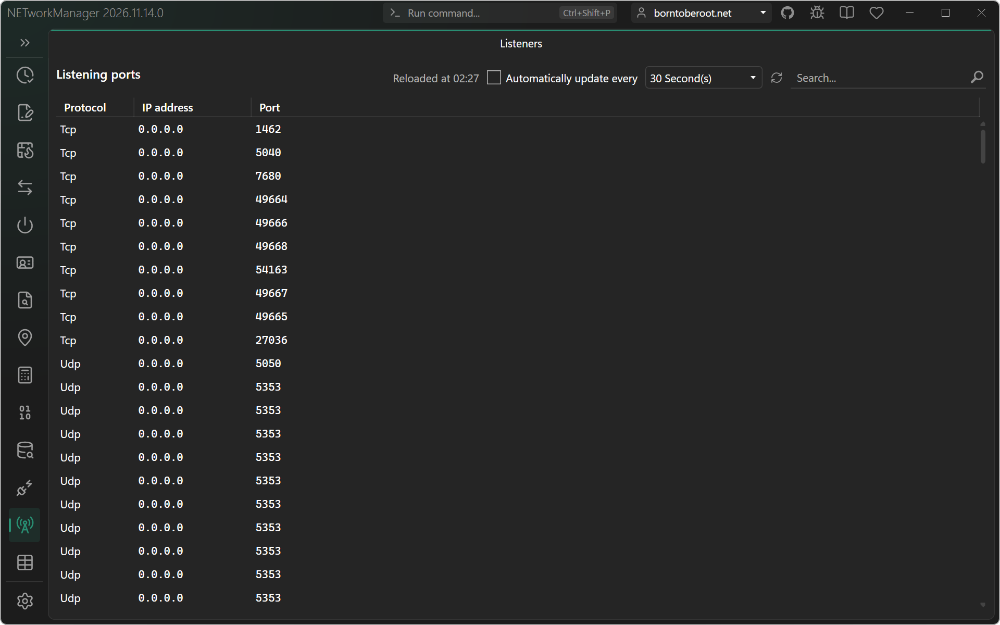

# Listeners

The **Listeners** view shows all active network listeners with their bound IP addresses and ports that are currently running on your computer.

:::info

A network listener is a socket bound to a specific local IP address and port that waits to receive incoming data or connections. TCP listeners accept incoming connections; UDP listeners receive datagrams. Applications use listeners to offer services over a network.

:::

### Context menu

| Action | Description |
|--------|-------------|
| **Copy** | Copies the selected information to the clipboard |
| **Export...** | Exports the results shown (all or the selected ones) to a file in the order shown, see [Export format](../faq/export-format.md) |

### Keyboard shortcuts

| Key | Action |
|-----|--------|
| `F5` | Refresh |

## Run command

Open the tool with `listeners`. The command accepts no target and no profile, see [Run Command](../run-command.md).

## Troubleshooting and limits

- The process of a listener is not shown. Use [Connections](./connections.md) for the process of a TCP connection.
- The list is a snapshot: refresh it (`F5`) to see new listeners.
- A listener on `0.0.0.0` / `::` accepts connections on all IP addresses of the computer; whether they are reachable from the network also depends on the [Firewall](./firewall.md).
