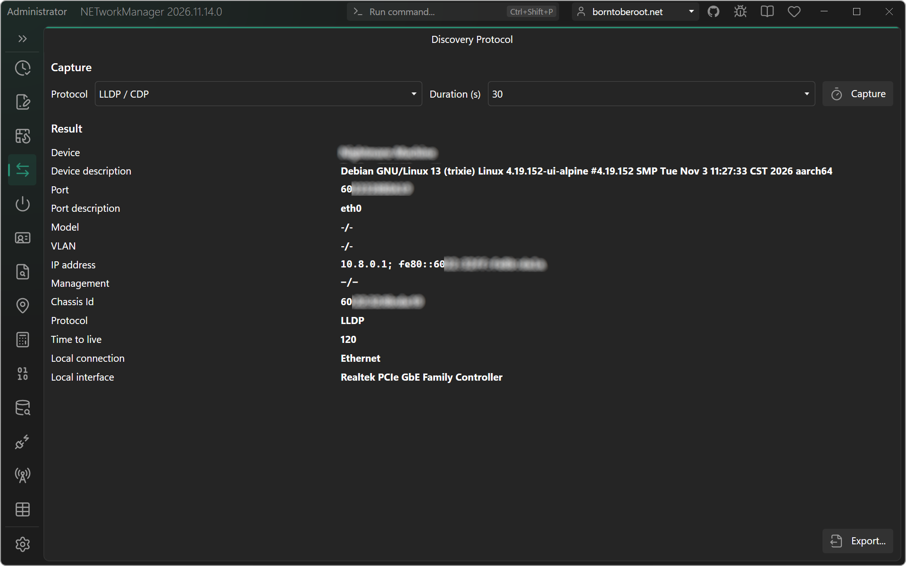

# LLDP / CDP Capture

With **LLDP / CDP Capture** you can capture LLDP (Link Layer Discovery Protocol) and CDP (Cisco Discovery Protocol) frames to see which switch or router your device is connected to. Device name, port, VLAN, and other information are shown in labeled fields.

:::info

The Link Layer Discovery Protocol (LLDP) is a vendor-neutral Layer 2 network protocol used by network devices, especially switches, to advertise their identity, capabilities, and neighbors on an IEEE 802 Local Area Network (LAN). If configured, LLDP messages are sent out periodically as frames with the destination MAC address of `01:80:c2:00:00:0e`. The default time interval is 30 seconds.

The Cisco Discovery Protocol (CDP) is a proprietary Layer 2 protocol used by Cisco Systems to exchange information about network devices. If configured, CDP messages are sent out periodically as frames with the destination MAC address `01:00:0c:cc:cc:cc`. The default time interval is 60 seconds.

:::

:::warning[Administrator privileges required]

Without administrator privileges, capturing is not available. Use the **Restart as administrator** button to relaunch the application with elevated rights.

:::

### Toolbar

| Button | Description |
|--------|-------------|
| **Export...** | Exports the information to a CSV, XML, or JSON file |

### Context menu

| Action | Description |
|--------|-------------|
| **Copy** | Copies the selected information to the clipboard |

### Keyboard shortcuts

| Key | Action |
|-----|--------|
| `F5` / `Enter` | Start capturing |

## Run command

Open the tool with `lldpcdpcapture` (or `lldp`, `cdp`). The command accepts no target and no profile, see [Run Command](../run-command.md).

## Troubleshooting and limits

- Capturing requires administrator privileges.
- The switch must send LLDP or CDP on the port (often disabled or limited to uplinks). LLDP is sent every 30 seconds, CDP every 60 seconds by default: select a duration longer than the interval, e.g. `90` seconds for CDP.
- If you are using a hypervisor like Hyper-V with a virtual switch configured as "External network" which is shared with the host where NETworkManager is running, you may not receive any packets, because the virtual switch does not forward the LLDP or CDP frames to the host. Temporarily change the virtual switch to "Internal network" or "Private network", or verify the behavior with Wireshark.
- Only the directly connected device is shown (LLDP / CDP frames are not forwarded by switches). A docking station, an unmanaged switch or a VoIP phone in between may hide the switch or show itself.
