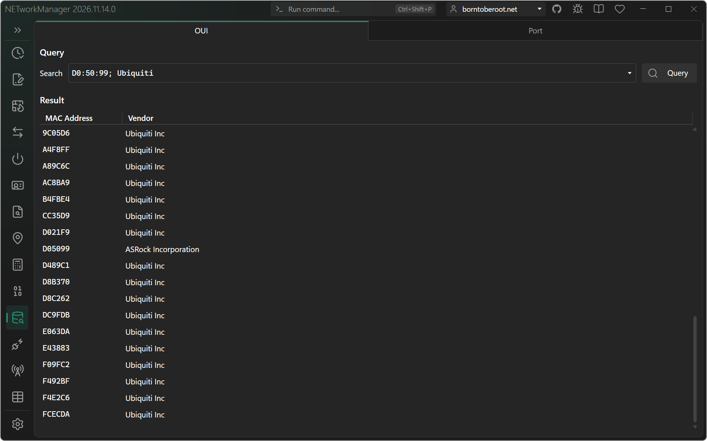
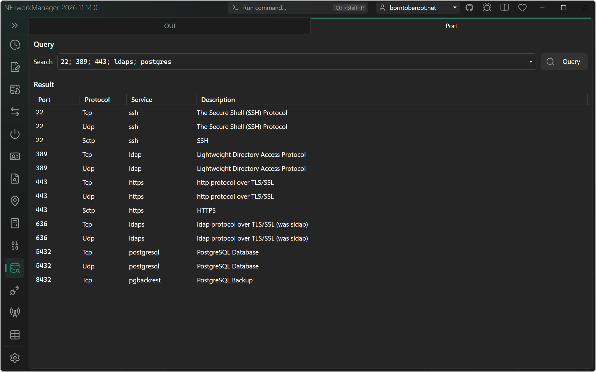

# Lookup

With **Lookup** you can search for information about [OUIs](#oui) (Organizationally Unique Identifiers) and [ports](#port).

## OUI

On the **OUI** tab, you can search for the manufacturer of a network interface card (NIC) by entering the first 24 bits of the MAC address. You can also search by vendor name to get all registered MAC addresses of the vendor.

:::info

The OUI (Organizationally Unique Identifier) is a 24-bit number assigned by the IEEE Registration Authority to identify network interface card manufacturers. It forms the first 24 bits of a MAC address.

:::



### Context menu

| Action | Description |
|--------|-------------|
| **Copy** | Copies the selected information to the clipboard |
| **Export...** | Exports the results shown (all or the selected ones) to a file in the order shown, see [Export format](../faq/export-format.md) |

## Port

On the **Port** tab, you can search for a port number to get information about the service and the protocol used by the port. You can also search by service name to get all registered port numbers of the service.

:::info

A port is a logical construct that identifies a specific process to which network traffic is to be forwarded. Ports are identified by a 16-bit number, known as a port number. Port numbers range from 0 to 65535, but only port numbers 0 to 1023 are designated as well-known ports. Well-known ports are those registered with IANA for common services such as HTTP (port 80), HTTPS (port 443), FTP (port 21), and SSH (port 22).

:::



### Context menu

| Action | Description |
|--------|-------------|
| **Copy** | Copies the selected information to the clipboard |
| **Export...** | Exports the results shown (all or the selected ones) to a file in the order shown, see [Export format](../faq/export-format.md) |

## Run command

Open the tool with `lookup`, followed by the lookup and the query:

- `oui`: MAC addresses (also only the first 3 bytes) or vendors, e.g. `lookup oui 00:11:22`.
- `port`: ports, port ranges (also with the protocol, e.g. `80-90/tcp`) or services, e.g. `lookup port 22; 443; ssh`.

The rest of the input is the query, so a vendor can contain spaces without quotes (e.g. `lookup oui Cisco Systems`). Several queries are separated by `;`. The lookups are suggested after `lookup `:

```text
lookup oui 00:11:22:33:44:55
lookup oui Cisco Systems
lookup port 22; 443; ssh
lookup port 80-90/tcp
lookup port
```

Without a query (e.g. `lookup port`), the tab of the lookup is only shown. A MAC address, the first 3 bytes of a MAC address or a port typed without a command suggest the lookup as well. With `Shift+Enter` (only fill in), the query is filled in without looking it up; while a lookup is running, the command is ignored. This tool has no profiles (`@profile`).

## Troubleshooting and limits

- The OUI and port lists are included in NETworkManager and updated with each release; no request is sent to the internet. A vendor registered after the release is not found.
- No vendor for a MAC address: randomized (private) MAC addresses, e.g. of phones and laptops with **Random hardware addresses** enabled, are locally administered (the second hex digit is `2`, `6`, `A` or `E`, e.g. `x2:...`) and not registered with the IEEE. Virtual machines and some devices also use addresses without a registered vendor.
- The port list contains the ports registered with IANA. A port used by another application (e.g. a non-standard port) shows the registered service, not the application listening on it - see [Listeners](./listeners.md) for the local computer.
