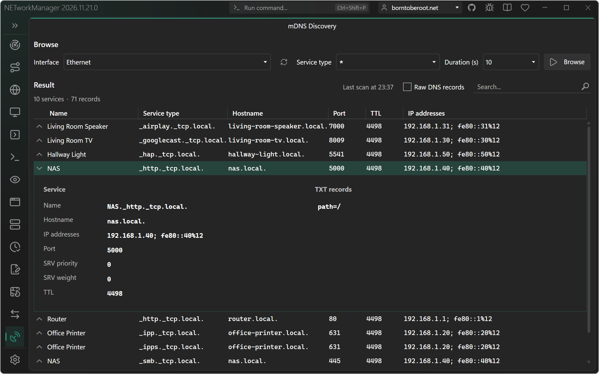

# mDNS Discovery

With **mDNS Discovery** you can find services that are advertised in the local network, e.g. printers, scanners, web servers, SSH servers and media devices, without knowing their IP addresses first. The DNS-SD service instances are browsed and their SRV, TXT, A and AAAA records are resolved via multicast DNS.

Unlike the [IP Scanner's mDNS hostname lookup](./ip-scanner.md#resolve-mdns-hostname), this tool discovers advertised services rather than looking up the name of an already discovered IP address.

:::info

Multicast DNS (mDNS, RFC 6762) resolves names in the `.local` domain without a DNS server. Queries and responses use the normal DNS message format, but are sent via UDP port `5353` to the multicast address `224.0.0.251` (IPv4) or `ff02::fb` (IPv6) of the local link. Every device answers for its own names, and responses are usually sent to the multicast group, so all devices on the link can cache them. Each record has a TTL; a device that leaves sends a "goodbye" (TTL `0`), and the cache-flush bit marks records that replace older ones. mDNS packets are not routed, so they only reach devices on the same network segment (unless a multicast reflector forwards them).

DNS-Based Service Discovery (DNS-SD, RFC 6763) describes services with standard DNS records: a `PTR` record of the service type (e.g. `_ipp._tcp.local.`) lists the service instances (e.g. `Office Printer._ipp._tcp.local.`), the `SRV` record of an instance names the host and port, its `TXT` record contains metadata as `key=value` pairs, and the `A` / `AAAA` records of the host contain its addresses. `_services._dns-sd._udp.local.` lists the service types advertised on the link. Together, mDNS and DNS-SD are known as zero-configuration networking (Zeroconf) and are implemented by Apple Bonjour, Avahi (Linux) and Windows. They are used by printers and scanners (AirPrint, IPP Everywhere, eSCL), media devices (AirPlay, Google Cast), smart home devices (HomeKit, Matter) and many embedded devices.

:::



### Example inputs

| Service type                    | Description                                                                                    |
| ------------------------------- | ---------------------------------------------------------------------------------------------- |
| `*`                             | All advertised service types (automatic discovery)                                             |
| `_ipp._tcp`                     | Single service type (IPP printers)                                                             |
| `_http._tcp.local.`             | Single service type with the `.local.` domain (web services)                                   |
| `Printers`                      | Service types of a [service type profile](#service-type-profiles)                              |
| `Printers; Scanners; _ssh._tcp` | Service types of several service type profiles and other service types                         |

:::note

Multiple inputs can be combined with a semicolon (`;`). The `.local.` suffix is optional; other domains are not accepted.

With `*`, the tool queries `_services._dns-sd._udp.local.` and browses the returned types. It also probes common printer, scanner, web, file sharing and media types because some devices do not answer service type enumeration.

:::

### Service type

The **Service type** input lists the recently used inputs (history, inputs other than `*` or a single profile), `*` (always first) and the [service type profiles](#service-type-profiles) (name, with the service types below). Select an entry, or type service types and names of service type profiles separated by `;` (e.g. `Printers; _ssh._tcp`). `Tab` completes the name of a service type profile that is being typed, `Tab` again shows the next matching service type profile.

### Interface and duration

Select the **Interface** connected to the devices (the refresh button next to it reloads the available interfaces) and the **Duration (s)** (`10` (default), `30`, `60`, `120`, `300` or **Until stopped**), then press **Browse**. If the last used interface is not available, the first active interface with multicast support is selected and a warning is shown (also for the [run command](#run-command)). The interface, service type and duration are remembered.

Discovery uses IPv4 (`224.0.0.251`) and IPv6 (`ff02::fb`) multicast on UDP port `5353`, where available on the selected interface. Records from different interfaces are kept separate. No Bonjour installation or administrator rights are required.

A progress bar shows the elapsed duration while browsing (with **Until stopped** it runs until **Stop** is pressed). Errors (e.g. UDP port `5353` can't be used) and "canceled by user" (stopped before the duration expired) are shown below the input.

Discovery stops when its duration expires or when **Stop** is pressed. With a duration it continues in the background when you switch to another tool. With **Until stopped** it is paused while another tool is shown and continues when you return; the results are kept (records that expired meanwhile are removed). The last results remain available for inspection and export. Starting again clears the previous results.

### Result

The results show one row per advertised service instance and are updated live while browsing. One printer can advertise several services and therefore appear in several rows. The header shows the time of the last browse (**Last scan at**), **Raw DNS records** and the search box; below it the number of services and records.

| Column       | Description                                                                          |
| ------------ | ------------------------------------------------------------------------------------ |
| Name         | Human-readable service instance name                                                 |
| Service type | Advertised type, including protocol and `.local.` domain                             |
| Hostname     | SRV target, such as `printer.local.`                                                 |
| Port         | Advertised service port, such as `631` for IPP                                       |
| TTL          | Remaining lifetime in seconds of the service instance's PTR record while browsing    |
| IP addresses | Resolved IPv4 and IPv6 addresses; link-local IPv6 addresses include the interface scope |

Empty hostname, port or address fields mean those records have not been resolved (or have expired). Details can arrive in separate responses and update while browsing. Goodbye messages and expired advertisements remove services while discovery is running. After discovery stops, TTL and other values remain at their last observed values.

The search box filters by name, type, hostname, port, addresses and TXT contents, also while browsing. `Enter` in the search box applies the filter without starting discovery.

Control characters and binary TXT values are escaped for display and export. Names that are not UTF-8 text (e.g. Latin-1 of older devices) or contain control characters keep their bytes escaped as `\DDD` in the full name, hostname and raw records (e.g. `B\252ro._ipp._tcp.local.`); the **Name** column shows them as text (UTF-8, otherwise Latin-1, e.g. `Büro`), except names with control characters.

### Row details

Expand a row with the button in front of it to see the details of the service:

| Section         | Content                                                                                                       |
| --------------- | ------------------------------------------------------------------------------------------------------------- |
| **Details**     | Full name, hostname, IP addresses, port, SRV priority / weight (used for service selection) and TTL           |
| **TXT records** | Advertised metadata, one TXT string per line; printer records often include model, capabilities and queue path |

### Raw DNS records

With **Raw DNS records** checked, the result shows the cached DNS records received on the selected interface instead of the services, including records for services outside the selected type. Records occupy individual lines with **Name**, **Type**, **Class**, **TTL** and **Value** columns. Each character string within a TXT record is shown as a separate row, with the same owner name and TTL. Repeated announcements update the rows instead of adding duplicates. The TTL counts down during discovery; after stopping, records remain as a snapshot until the next browse.

| Type             | Value                                                                                                  |
| ---------------- | ------------------------------------------------------------------------------------------------------ |
| `PTR`            | The service type or instance the record points to                                                      |
| `SRV`            | Priority, weight, port and target hostname, in that order                                              |
| `TXT`            | One entry per row (e.g. `txtvers=1`, `ty=Printer` or `rp=ipp/print`), control characters are escaped. Hover over the value to read the complete text |
| `A` / `AAAA`     | The host address, with an interface scope for link-local IPv6 addresses                                |
| Other types      | Recognized DNS types keep their standard name (e.g. `NSEC`), unknown or private types use `TYPE<number>` (e.g. `TYPE65400`). Their raw data is shown as `\# <byte count> <hex data>` (RFC 3597), including zero-length values |

The search box filters the records by name, type and value.

### Context menu

| Action        | Description                                                                                                    |
| ------------- | -------------------------------------------------------------------------------------------------------------- |
| **Copy...**   | Copies the name, service type, hostname, port, IP addresses, TXT records or all details of the selected services (one per line, in the order shown). With **Raw DNS records**: the name, value or the whole record (name, type, class, TTL and value) |
| **Export...** | Exports the results shown (all or the selected ones) to a file in the order shown, see [Export format](../faq/export-format.md). Services include the interface, full service name, SRV fields, addresses, TXT records and remaining PTR TTL; raw DNS records include the cache-flush flag and interface |

### Keyboard shortcuts

| Key     | Action                                                                  |
| ------- | ----------------------------------------------------------------------- |
| `Enter` | Start the discovery (in the search box: filter the results)             |
| `Tab`   | In the service type input: complete the name of a service type profile  |
| `Esc`   | Stop the running discovery                                              |

## Run command

Open the tool with `mdnsdiscovery`, `mdns` or `dnssd`. Add `*` (all service types), service types and / or names of service type profiles (validated like the input; case-insensitive, a name with spaces in quotes, also in a list, e.g. `"File sharing";web`) to start browsing, optionally followed by the duration in seconds (`10`, `30`, `60`, `120`, `300` or `0` = until stopped). `*` and the service type profiles are suggested while the target is typed (also after a `;`), the durations after the target:

```text
mdns *
mdns _ipp._tcp
mdns printers
mdns printers 30
dnssd Printers;_http._tcp.local. 0
```

The selected interface is used, and the selected duration if none is entered. A running browse is stopped and the new one started; with `Shift+Enter` (only fill in) a running browse continues and the input is filled in when it has ended. This tool has no profiles (`@profile`).

## Settings

### Service type profiles

List of common service types to browse for. A service type profile can be entered by its name in the service type input (case-insensitive, also several and together with service types, e.g. `Printers; Scanners; _ssh._tcp`), so the name must be unique, must not contain `;` and must not be `*` or a service type (e.g. `_ipp._tcp`). The service types of a profile are separated by `;` (`*` and other profiles are not allowed). Several service type profiles can be selected and deleted at once (context menu or `Del`). Missing default profiles are added again on an update.

**Type:** `List<NETworkManager.Models.Network.MDNSServiceTypeProfileInfo>`

**Default:**

| Name          | Service types                                                                                     |
| ------------- | ------------------------------------------------------------------------------------------------- |
| Printers      | `_ipp._tcp; _ipps._tcp; _printer._tcp; _pdl-datastream._tcp`                                      |
| Scanners      | `_uscan._tcp; _uscans._tcp; _scanner._tcp`                                                        |
| Web           | `_http._tcp; _https._tcp`                                                                         |
| File sharing  | `_smb._tcp; _afpovertcp._tcp; _nfs._tcp; _ftp._tcp; _webdav._tcp; _webdavs._tcp`                  |
| Remote access | `_ssh._tcp; _sftp-ssh._tcp; _rfb._tcp; _rdp._tcp; _telnet._tcp`                                   |
| Media         | `_airplay._tcp; _raop._tcp; _googlecast._tcp; _spotify-connect._tcp; _sonos._tcp`                 |
| Smart home    | `_hap._tcp; _hap._udp; _matter._tcp; _matterc._udp; _home-assistant._tcp; _hue._tcp`              |
| Apple devices | `_companion-link._tcp; _device-info._tcp; _airplay._tcp; _apple-mobdev2._tcp`                     |

:::note

Right-click on a selected service type profile to `edit` or `delete` it.

You can also use the Hotkeys `F2` (`edit`) or `Del` (`delete`) on a selected service type profile, or double-click it to edit it.

:::

## Troubleshooting and limits

- Devices must advertise the services themselves. This tool does not probe arbitrary ports or configure printers.
- Discovery is limited to the selected local link and the `.local.` domain. VLANs, routed networks, VPNs, firewalls and Wi-Fi client isolation can prevent replies. A multicast reflector may make services from another link visible.
- On the first browse, Windows Defender Firewall asks whether NETworkManager may receive traffic (the answers arrive on UDP port `5353`). Allow it for the network type of the interface (usually **Private networks**). If the prompt was canceled or the network type was not allowed, Windows adds a rule that blocks the answers: the browse sends its questions, but no services are found. Allow NETworkManager in **Windows Security > Firewall & network protection > Allow an app through firewall** (or remove the blocking inbound rule of NETworkManager in **Windows Defender Firewall with Advanced Security**, administrator rights required). Another application that exclusively owns UDP port `5353` can prevent the browser from starting.
- If the interface disconnects, stop discovery, refresh the interface list and browse again.
- The browser caches up to 4096 records to remain responsive on busy networks; above, only the records of the browsed services are cached (up to 8192), so other traffic of the network can't hide them. The raw DNS records show up to 8192 rows (each TXT string is a row); above, the records of the browsed services are shown first. Packets larger than 9000 bytes (not allowed for mDNS) are ignored.
- Questions are repeated with a growing interval (1 second, doubled up to 60 minutes), and cached records are refreshed before their TTL expires. Several questions are sent in one packet together with the services already found (known-answer suppression, RFC 6762; a long list continues in the next packets), so devices only answer with what is new and the load on the network stays low, also with `*`.
- Advertised names and metadata are supplied by other devices and do not establish their identity. The tool displays metadata without executing TXT values or opening advertised URLs.
