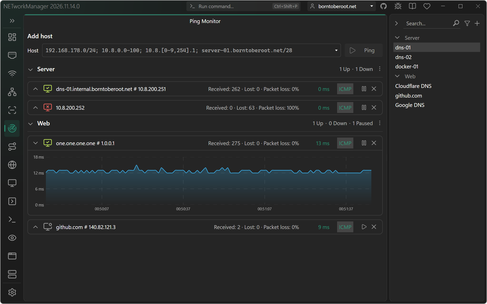

# Ping Monitor

With the **Ping Monitor** you can monitor one or multiple hosts with ICMP echo requests to determine whether each host is reachable.

:::info

ICMP (Internet Control Message Protocol) is a network-layer protocol used to send diagnostic and control messages. An ICMP echo request (commonly known as a ping) asks a remote host to send back an echo reply, confirming it is reachable on the network.

:::



### Example inputs

| Host                             | Description                                                                                |
| -------------------------------- | ------------------------------------------------------------------------------------------ |
| `10.0.0.1`                       | Single IP address (`10.0.0.1`)                                                             |
| `10.0.0.100 - 10.0.0.199`        | All IP addresses in a given range (`10.0.0.100`, `10.0.0.101`, ..., `10.0.0.199`)          |
| `10.0.0.100-199`                 | All IP addresses in a given range, shorthand for the last octet (`10.0.0.100`, ..., `10.0.0.199`) |
| `10.0.0.0/23`                    | All IP addresses in a subnet (`10.0.0.0`, ..., `10.0.1.255`)                               |
| `10.0.0.0/255.255.254.0`         | All IP addresses in a subnet (`10.0.0.0`, ..., `10.0.1.255`)                               |
| `10.0.[0-9,20].[1-2]`            | Multiple IP addresses like (`10.0.0.1`, `10.0.0.2`, `10.0.1.1`, ...,`10.0.9.2`, `10.0.20.1`) |
| `borntoberoot.net`               | Single IP address resolved from a host (`10.0.0.1`)                                        |
| `borntoberoot.net/24`            | All IP addresses in a subnet resolved from a host (`10.0.0.0`, ..., `10.0.0.255`)          |
| `borntoberoot.net/255.255.255.0` | All IP addresses in a subnet resolved from a host (`10.0.0.0`, ..., `10.0.0.255`)          |
| `!10.0.0.1`                      | Excludes an IP address (also a range, subnet or host, e.g. `!10.0.0.0/28`) from the other inputs|

:::note

Multiple inputs can be combined with a semicolon (`;`). A column pasted from Excel (one entry per line) is converted to the semicolon-separated form automatically.

An input starting with `!` excludes its IP addresses from the other inputs, e.g. `10.0.0.0/24; !10.0.0.1; !10.0.0.200-254` (all formats of the table above; a hostname excludes all its IPv4 and IPv6 addresses, independent of the IPv4 preference). At least one input without `!` is required; if the exclusions remove every IP address, a message is shown instead. If the hostname of an exclusion can't be resolved (also if only the IPv4 or the IPv6 lookup fails, e.g. a timeout), nothing is scanned (otherwise its IP addresses would be scanned).

Example: `10.0.0.0/24; 10.0.[10-20].1; 10.0.0.100-199`

:::

### Chart

Each monitored host shows a latency chart over time. By default the chart displays the last 2 minutes (see [Chart time (seconds)](#chart-time-seconds)) and scrolls automatically as new results arrive (**live mode**).

You can interact with the chart to inspect past results:

| Action | Description |
|--------|-------------|
| **Mouse wheel** | Zoom in and out on the time axis |
| **Left mouse button + drag** | Pan the chart left and right |
| **Right mouse button + drag** | Zoom into the selected section |

When you zoom or pan, the chart leaves live mode and stops scrolling. A **Live** button then appears in the top-right corner of the chart — click it to return to live mode and resume auto-scrolling.

### Groups

Hosts are grouped by their profile group (or **Hosts** if none is set). Each group header shows a live count of hosts that are up, down and paused (**Paused** is only shown while at least one host in the group is paused).

Click/tap the **⋮** icon on the right of a group header to open its action menu:

| Action | Description |
|--------|-------------|
| **Start** | Starts every host in the group that isn't currently running |
| **Pause** | Pauses every host in the group that's currently running |
| **Close** | Stops and removes every host in the group |

### Context menu

Right-click a monitored host (anywhere except the chart) to open the context menu:

| Action        | Description                                      |
| ------------- | ------------------------------------------------- |
| **Copy**      | Copies the selected information to the clipboard |
| **Export...** | Exports the results of the host to a file        |

### Notifications

When a monitored host changes its reachability state (up → down or down → up), a small notification popup can appear in the bottom-right corner of the primary screen, optionally accompanied by a system sound.

- The header shows the tool that sent the notification (**Ping Monitor** with its icon) and the time; below it a status icon (green when the host is up, red when it is down), the hostname (or the IP address as a fallback) and a line with the IP address and the status in its color (e.g. `10.0.0.1 · Up` / `10.0.0.1 · Down`; only the status if the title is the IP address). The [IP Scanner](./ip-scanner#show-notification-popup-on-changes) and the [Port Scanner](./port-scanner#show-notification-popup-on-changes) use the same notification.
- Multiple notifications **stack** upwards, so several hosts changing state at once are all visible.
- **Click anywhere** on a notification to bring the main window to the front and open the **Ping Monitor**. Use the **×** button to dismiss a single notification without opening the main window.
- Each notification closes automatically after a configurable [duration](#display-duration-seconds); a thin progress bar at the bottom shows the remaining time.
- To avoid noise from flapping hosts, a state change is only reported after a configurable number of consecutive successes ([Success threshold](#success-threshold)) or failures ([Failure threshold](#failure-threshold)).
- The **initial** state of a host (established when monitoring starts) never triggers a notification or sound — only later transitions do.

:::note

When many hosts change state at almost the same time (for example, when an uplink goes down and all hosts time out together), every host still shows its own popup, but the sound is played only once within a short interval to avoid an overlapping cacophony.

:::

## Run command

Open the tool with `pingmonitor` or `ping`. Add hosts, IP ranges and / or subnets (validated like the input, also with exclusions) to add and ping them:

```text
ping 10.0.0.1
ping borntoberoot.net
ping 10.0.0.1; 10.0.0.2; server-01
ping 10.0.0.0/29; !10.0.0.1
ping @server-01
```

The hosts are added to the monitored hosts, hosts that are already monitored keep running. With `Shift+Enter` (only fill in), the host is filled in without adding it. A profile (`@profile`) adds its host to the group of the profile. While hosts are being added (e.g. a range), no other host can be added and an error is shown.

## Profile

### Inherit host from general

Inherit the host from the general settings.

**Type:** `Boolean`

**Default:** `Enabled`

:::note

If this option is enabled, the [Host](#host) is overwritten by the host from the general settings and the [Host](#host) is disabled.

:::

### Host

Hostname or IP address to ping.

**Type:** `String`

**Default:** `Empty`

**Example:**

- `server-01.borntoberoot.net`
- `1.1.1.1`

## Settings

### Timeout (ms)

Timeout in milliseconds for each ICMP packet, after which the packet is considered lost.

**Type:** `Integer` [Min `100`, Max `15000`]

**Default:** `4000`

### Buffer

Buffer size of the ICMP packet.

**Type:** `Integer` [Min `1`, Max `65500`]

**Default:** `32`

### TTL

Time to live of the ICMP packet.

**Type:** `Integer` [Min `1`, Max `255`]

**Default:** `64`

### Don't fragment

Don't fragment the ICMP packet.

**Type:** `Boolean`

**Default:** `Enabled`

### Time (ms) to wait between each ping

Time in milliseconds to wait between each ping.

**Type:** `Integer` [Min `100`, Max `15000`]

**Default:** `1000`

### Chart time (seconds)

Time range in seconds displayed in the latency chart.

**Type:** `Integer` [Min `30`, Max `3600`]

**Default:** `120`

### Expand host view

Expand the host view to show more information when the host is added.

**Type:** `Boolean`

**Default:** `Disabled`

### Show notification popup on status change

Show a notification popup in the bottom-right corner of the primary screen when a monitored host changes its reachability state. See [Notifications](#notifications) for details.

**Type:** `Boolean`

**Default:** `Enabled`

### Play sound on status change

Play a system sound when a monitored host changes its reachability state. This is independent of the [popup](#show-notification-popup-on-status-change) — you can enable the sound without the popup, or vice versa.

**Type:** `Boolean`

**Default:** `Disabled`

### Success threshold

Number of consecutive successful pings required before an **Up** notification is shown. Higher values reduce noise from flapping hosts.

**Type:** `Integer` [Min `1`, Max `10`]

**Default:** `1`

### Failure threshold

Number of consecutive failed pings (timeouts) required before a **Down** notification is shown. Higher values reduce noise from flapping hosts.

**Type:** `Integer` [Min `1`, Max `10`]

**Default:** `3`

### Display duration (seconds)

Time in seconds the notification popup is shown before it closes automatically.

**Type:** `Integer` [Min `3`, Max `60`]

**Default:** `10`

## Troubleshooting and limits

- A host that blocks ICMP (e.g. Windows with the firewall enabled, many cloud servers) is shown as down, although it is reachable. Check it with the [Port Scanner](./port-scanner) instead.
- A hostname is resolved once when it is added (see [preferred protocol](../settings/network.md#preffered-protocol-when-resolving-hostnames)); the IP address is pinged, a later DNS change is not noticed. Remove and add the host again.
- Every IP address of a range or subnet is added as its own host, e.g. a `/24` adds 256 hosts. To find the active hosts of a network, use the [IP Scanner](./ip-scanner).
- A host that doesn't answer within the [timeout](#timeout-ms) counts as lost. A host on a slow or busy link (e.g. VPN, mobile) may need a higher timeout; brief losses only trigger a notification after the [Failure threshold](#failure-threshold).
- With [Don't fragment](#dont-fragment) enabled, a [Buffer](#buffer) larger than the MTU of the path (e.g. above `1472` bytes with an MTU of `1500`) gets no reply.
- The results are only kept while the host is monitored. Export them to keep them.
