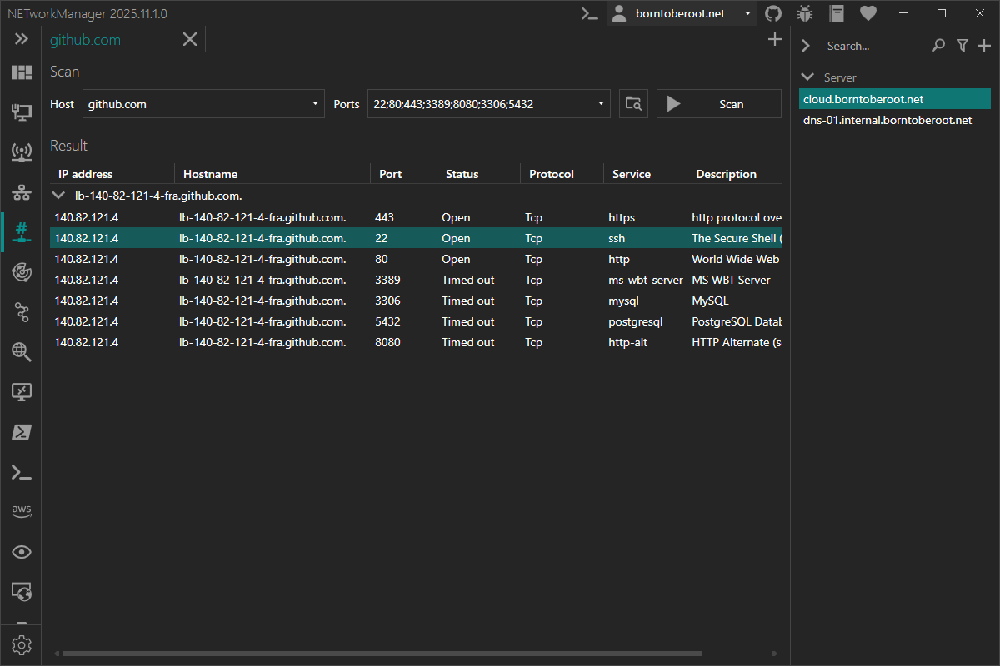

# Port Scanner

With the **Port Scanner** you can scan for open TCP ports on one or multiple hosts to determine which services are running.

:::info

TCP (Transmission Control Protocol) is a connection-oriented transport-layer protocol. Establishing a connection requires a three-way handshake between client and server. Port scanning tests whether this handshake can be initiated on a given port, which indicates a listening service.

:::

### Example inputs

| Host                             | Description                                                                                  |
| -------------------------------- | -------------------------------------------------------------------------------------------- |
| `10.0.0.1`                       | Single IP address (`10.0.0.1`)                                                               |
| `10.0.0.100 - 10.0.0.199`        | All IP addresses in a given range (`10.0.0.100`, `10.0.0.101`, ..., `10.0.0.199`)            |
| `10.0.0.100-199`                 | All IP addresses in a given range, shorthand for the last octet (`10.0.0.100`, ..., `10.0.0.199`) |
| `10.0.0.0/23`                    | All IP addresses in a subnet (`10.0.0.0`, ..., `10.0.1.255`)                                 |
| `10.0.0.0/255.255.254.0`         | All IP addresses in a subnet (`10.0.0.0`, ..., `10.0.1.255`)                                 |
| `10.0.[0-9,20].[1-2]`            | Multiple IP addresses like (`10.0.0.1`, `10.0.0.2`, `10.0.1.1`, ...,`10.0.9.2`, `10.0.20.1`) |
| `borntoberoot.net`               | Single IP address resolved from a host (`10.0.0.1`)                                          |
| `borntoberoot.net/24`            | All IP addresses in a subnet resolved from a host (`10.0.0.0`, ..., `10.0.0.255`)            |
| `borntoberoot.net/255.255.255.0` | All IP addresses in a subnet resolved from a host (`10.0.0.0`, ..., `10.0.0.255`)            |
| `!10.0.0.1`                      | Excludes an IP address (also a range, subnet or host, e.g. `!10.0.0.0/28`) from the other inputs|

| Port                  | Description                                        |
| --------------------- | -------------------------------------------------- |
| `1-1024`              | All ports in a given range (`1`, `2`, ..., `1024`) |
| `80; 443; 8080; 8443` | Multiple ports like (`80`, `443`, `8080`, `8443`)  |
| `Webserver; 8080`     | Ports of a [port profile](#port-profiles) (`80`, `443`) and other ports (`8080`) |

:::note

Multiple inputs can be combined with a semicolon (`;`). A column pasted from Excel (one entry per line) is converted to the semicolon-separated form automatically.

An input starting with `!` excludes its IP addresses from the other inputs, e.g. `10.0.0.0/24; !10.0.0.1; !10.0.0.200-254` (all formats of the table above; a hostname excludes all its IPv4 and IPv6 addresses, independent of the IPv4 preference). At least one input without `!` is required; if the exclusions remove every IP address, a message is shown instead. If the hostname of an exclusion can't be resolved (also if only the IPv4 or the IPv6 lookup fails, e.g. a timeout), nothing is scanned (otherwise its IP addresses would be scanned).

Example: `10.0.0.0/24; 10.0.[10-20].1; 10.0.0.100-199` or `1-1024; 8080; 8443`

IP addresses and ports that are part of multiple inputs (e.g. `10.0.0.1; 10.0.0.0/24` or `80; 1-100`) are scanned only once, also an IP address entered with different hostnames (e.g. two names of one server). The hostname is resolved via DNS (`PTR`), not taken from the input.

A scan of more than `65,536` ports (hosts × ports, e.g. 64 hosts with `1-1024`) must be confirmed, more than `16,777,216` ports cannot be scanned at once.

:::

### Ports

The **Ports** input lists the recently scanned ports (history) and the [port profiles](#port-profiles) (name, with the ports below). Select an entry, or type ports, port ranges and names of port profiles separated by `;` (e.g. `Webserver; Database; 8080`). Port profiles are replaced by their ports when the scan starts. `Tab` completes the name of a port profile that is being typed (e.g. `webserver; dat` → `webserver; Database`), `Tab` again shows the next matching port profile.

### Context menu

| Action          | Description                                                                                                    |
| --------------- | -------------------------------------------------------------------------------------------------------------- |
| **Rescan**      | Scans the selected port(s) again with the settings of the shown scan and updates their state in place. Every rescanned port is shown with its new state, also if it is closed now and closed ports are not shown (until the next scan). Not available while a scan is running |
| **Ping Monitor** / **Traceroute** | Opens the host (hostname if resolved, otherwise the IP address) in the tool |
| **DNS lookup...** > **IP address** / **Hostname** | Looks up the IP address (`PTR`) or the hostname in [DNS Lookup](./dns-lookup) |
| **RDAP...** > **IP address** / **Hostname** | Queries the registration data of the IP address or the registered domain of the hostname in [RDAP](./rdap) |
| **Remote Desktop** / **PowerShell** / **PuTTY** / **TigerVNC** | Opens the host (hostname if resolved, otherwise the IP address) in the tool (with its default port) |
| **Web Console** | Opens the open web port (`80`, `443`, `8080`, `8443`) in the [Web Console](./web-console) (https for 443 / 8443) |
| **SNMP** | Opens the host (hostname if resolved, otherwise the IP address) in [SNMP](./snmp) |
| **Add profile...** | Creates a new profile with the host (IP address), the hostname as name and the ports of the shown scan for the Port Scanner |
| **Copy**        | Copies the selected information to the clipboard                                                               |
| **Export...**   | Exports the selected or all results to a file                                                                  |

If multiple results are selected, **Rescan**, **Copy** > **IP address** / **Hostname** / **Port** / **IP address:Port** (one value per line, in the order shown, without duplicates; IPv6 as `[address]:port`) and **Export...** are available.

Right-click the header of a host (group) for the actions of the host:

| Action          | Description                                                                                                    |
| --------------- | -------------------------------------------------------------------------------------------------------------- |
| **Rescan host** | Scans the host again with all ports and settings of the shown scan and replaces its results (e.g. to find ports that are open now). A canceled rescan keeps the previous results. Not available while a scan is running |
| **Ping Monitor** / **Traceroute** / **DNS lookup...** / **RDAP...** / **Remote Desktop** / **PowerShell** / **PuTTY** / **TigerVNC** / **SNMP** | Opens the host like the context menu of a result |
| **Add profile...** | Creates a new profile with the host and the ports of the shown scan |
| **Copy** > **IP address** / **Hostname** / **Open ports** | Copies the IP address, the hostname or the open ports of the host (e.g. `22; 80; 443`) |

### Result

The results are grouped by host (one group per IP address, the header shows the hostname, the IP address and the number of open ports) and sorted by IP address and port. The number of open, closed and timed out ports is shown next to the **Result** header. A port is **open** if the connection was established, **closed** if the host refused the connection and **timed out** if there was no answer within the [timeout](#timeout-ms) (e.g. blocked by a firewall). Only open ports are shown, unless [Show closed ports](#show-closed-ports) is enabled (closed and timed out ports). The **Hostname** column is shown if [Resolve hostname](#resolve-hostname) was enabled when the scan was started.

The search box right of the **Result** header filters the results by IP address, hostname, port, protocol, service, description and status, also while the scan is running. **Export...** > all exports the filtered results; the counters always count all ports.

### Changes since the last scan

A scan of the same hosts and ports as the last completed scan in the tab shows what changed since then in the **Since last scan** column: **Now open** (the port is open now, it was not open in the last scan) and **No longer open** (it was open in the last scan, it is closed or timed out now). A port that is no longer open is shown with its status, also if [Show closed ports](#show-closed-ports) is disabled; if its host was not scanned (e.g. it didn't answer the [ping before the scan](#ping-hosts-before-the-scan)), it is shown as timed out. The counters next to the **Result** header (e.g. `1 Now open · 2 No longer open`) and the column are only shown if the result is compared with a previous scan. **Last scan at** shows when the last scan was completed (the tooltip shows the date).

Only completed scans are compared: a canceled scan or a scan with other hosts or ports (also a changed port profile) starts over. **Rescan** updates the rows and their changes against the same previous scan (e.g. a port that is open again), but is not a scan of the input. The last scan is only kept in memory, as long as the tab is open. The change is also in the search and the export (`Change`).

### Repeat the scan

**Automatically scan every** right of the **Result** header repeats the scan after the selected interval (`1 min` to `1 h`, the pause after a scan, so scans don't overlap) - e.g. to watch whether a service is still running, see [Changes since the last scan](#changes-since-the-last-scan). The repetition starts with the next completed scan; while it waits, the header shows the countdown (`Next scan in 04:32`, the tooltip shows the last scan).

A repeated scan keeps the rows and updates their status in place (selection, scroll position, collapsed hosts and search stay): new open ports are added, ports that are no longer open are shown with their status. The scan is not asked to be confirmed again (many ports) and is not added to the history again.

The repetition stops when a scan is canceled, the hosts or ports are changed (also while a scan is running) or the tab is closed; a manual **Scan** starts the interval again after the scan. If a repeated scan fails (e.g. a hostname can't be resolved for a moment), the message is shown and the scan is tried again after the interval. The scan is also repeated while another tab or application is shown. The checkbox is per tab and not saved (a new tab doesn't repeat), the interval is saved.

### Keyboard shortcuts

| Key      | Action                                                        |
| -------- | ------------------------------------------------------------- |
| `Enter`  | Start the scan (in the search box: filter the results)        |
| `Tab`    | In the ports input: complete the name of a port profile       |
| `Esc`    | Cancel the running scan                                       |
| `Ctrl+T` | Open a new tab                                                |

## Profile

### Inherit host from general

Inherit the host from the general settings.

**Type:** `Boolean`

**Default:** `Enabled`

:::note

If this option is enabled, the [Host](#host) is overwritten by the host from the general settings and the [Host](#host) is disabled.

:::

### Host

Hostname or IP range to scan for open ports.

**Type:** `String`

**Default:** `Empty`

**Example:**

- `server-01.borntoberoot.net`
- `1.1.1.1; 1.0.0.1`
- `10.0.0.0/24`

:::note

See also the [Port Scanner](./port-scanner) example inputs for more information about the supported host formats.

:::

### Ports

TCP ports to scan each host for: ports, port ranges and names of [port profiles](#port-profiles) (selectable in the list). Only used if the checkbox is enabled (then the ports are required), otherwise the [ports of the group](#ports-2) are used (if set there).

**Type:** `String`

**Default:** `Empty`

**Example:**

- `1-1024`
- `80; 443; 8080; 8443`
- `Webserver; Database; 8080`

:::note

A port profile is referenced by the profile, so changes to the port profile apply to the profile, also if it is renamed. Its ports are saved with the profile as well: if the port profile can't be found (it was deleted, or the profile file is shared from another computer - port profiles are saved in the settings of each computer), the saved ports are used and a note is shown.

:::

:::note

See also the [Port Scanner](./port-scanner) example inputs for more information about the supported port formats.

:::

## Group

### Ports

TCP ports to scan for the profiles of the group that don't set their own [ports](#ports-1) (required if the checkbox is enabled), like the ports of a profile: ports, port ranges and names of [port profiles](#port-profiles). If neither the profile nor the group has ports, the ports input is empty and the scan is not started.

**Type:** `String`

**Default:** `Empty`

**Example:**

- `22; 3389; 5985`
- `Webserver; 8080`

## Settings

### Port profiles

List of common TCP ports to scan for. A port profile can be entered by its name in the ports input (case-insensitive, also several and together with ports, e.g. `Webserver; Database; 8080`), so the name must be unique, must not contain `;` and must not be a port or port range (e.g. `80`). Several port profiles can be selected and deleted at once (context menu or `Del`).

**Type:** `List<NETworkManager.Models.Network.PortProfileInfo>`

**Default:**

| Name              | Ports                               |
| ----------------- | ----------------------------------- |
| DNS (via TCP)     | `53`                                |
| NTP (via TCP)     | `123`                               |
| Webserver         | `80; 443`                           |
| Webserver (Other) | `80; 443; 8080; 8443`               |
| Remote access     | `22; 23; 3389; 5900`                |
| Mailserver        | `25; 110; 143; 465; 587; 993; 995`  |
| Filetransfer      | `20-21; 22; 989-990; 2049`          |
| Database          | `1433-1434; 1521; 1830; 3306; 5432` |
| SMB               | `139; 445`                          |
| LDAP              | `389; 636`                          |
| HTTP proxy        | `3128`                              |
| Well-known ports  | `1-1024`                            |

:::note

Right-click on a selected port profile to `edit` or `delete` it.

You can also use the Hotkeys `F2` (`edit`) or `Del` (`delete`) on a selected port profile, or double-click it to edit it.

:::

### Show closed ports

Show closed and timed out ports in the result list.

**Type:** `Boolean`

**Default:** `Disabled`

### Timeout (ms)

Timeout in milliseconds after which a port is considered timed out (no answer). A port is closed if the host refused the connection.

**Type:** `Integer` [Min `100`, Max `15000`]

**Default:** `2000`

:::note

A closed port is reported as soon as the host refuses the connection. Each attempt sends the connection request once (see [Attempts](#attempts)).

:::

### Attempts

Number of connection requests sent to each port. Another request is only sent if there was no answer (timed out), an open or closed port is final.

**Type:** `Integer` [Min `1`, Max `10`]

**Default:** `1`

:::tip

In a local network (LAN), `1` is enough. On an unreliable network (e.g. Wi-Fi, VPN) or for hosts on the internet, a lost connection request can make an open port appear as timed out - increase it to `2` in this case. This only takes longer for ports without answer (attempts × timeout), e.g. ports blocked by a firewall.

:::

### Ping hosts before the scan

Pings every host before its ports are scanned (ICMP echo, with the [Attempts](#attempts-1), [Timeout](#timeout-ms-1) and [Buffer](#buffer) below). Only hosts that answer are scanned, the number of hosts that were not scanned is shown below the input after the scan. Faster for ranges with many unused IP addresses (e.g. a `/24` with `1-1024`), because the ports of unused addresses are not scanned until their timeout. With [Adjust threads automatically](#adjust-threads-automatically), up to `128` hosts are pinged at the same time and a host is scanned as soon as it answers; otherwise each host is pinged when it is scanned, so [Max. concurrent host threads](#max-concurrent-host-threads) also limits the pings.

**Type:** `Boolean`

**Default:** `Disabled`

:::warning

Hosts that block ICMP (e.g. Windows with the firewall enabled) are not scanned, even if they have open ports.

:::

### Attempts

Maximum number of ICMP requests sent to each host before the scan (only with [Ping hosts before the scan](#ping-hosts-before-the-scan)). Another request is only sent if the previous one has timed out (e.g. a lost packet), other replies like "destination host unreachable" are final.

**Type:** `Integer` [Min `1`, Max `10`]

**Default:** `2`

### Timeout (ms)

Timeout in milliseconds for each ICMP request before the scan (only with [Ping hosts before the scan](#ping-hosts-before-the-scan)), after which the packet is considered lost. A host that doesn't answer is skipped after about attempts × timeout.

**Type:** `Integer` [Min `100`, Max `15000`]

**Default:** `2000`

### Buffer

Size of the buffer for each ICMP request before the scan in bytes (only with [Ping hosts before the scan](#ping-hosts-before-the-scan)).

**Type:** `Integer` [Min `1`, Max `65500`]

**Default:** `32`

### Resolve hostname

Resolve the hostname for given IP addresses.

**Type:** `Boolean`

**Default:** `Enabled`

### Show notification popup on changes

Show a notification popup in the bottom-right corner of the primary screen when a [repeated scan](#repeat-the-scan) found changes since the previous scan (see [Changes since the last scan](#changes-since-the-last-scan); only ports that are open now like a host that is up, a port that is no longer open like a host that is down). One notification per scan: up to three changes, one per line, otherwise the number of changes. Not for a scan that was started manually. The header shows the tool, the title the scanned input; the status icon is green for only ports that are open now, red for only ports that are no longer open, half green / half red for both. A click opens the tab of the scan.

**Type:** `Boolean`

**Default:** `Disabled`

### Play sound on changes

Play a system sound when a [repeated scan](#repeat-the-scan) found changes. Independent of the [popup](#show-notification-popup-on-changes).

**Type:** `Boolean`

**Default:** `Disabled`

### Display duration (seconds)

Time in seconds the notification popup is shown before it closes automatically.

**Type:** `Integer` [Min `3`, Max `60`]

**Default:** `10`

### Adjust threads automatically

Adjusts the number of hosts and ports that are scanned at the same time to the scan: up to `512` connections at the same time, at most `128` hosts and `128` ports per host. For example, `1-1024` scans 4 hosts with 128 ports at the same time, a single port (e.g. `3389` on a `/24`) 128 hosts. [Max. concurrent host threads](#max-concurrent-host-threads) and [Max. concurrent port threads](#max-concurrent-port-threads) are only used if this option is disabled, e.g. to slow down a scan.

**Type:** `Boolean`

**Default:** `Enabled`

:::note

When updating from an older version, this option is disabled if the threads were changed, so the changed values still apply.

:::

### Max. concurrent host threads

Maximum number of hosts that are scanned at the same time, if [Adjust threads automatically](#adjust-threads-automatically) is disabled. A thread is not an operating system thread, but one host whose ports are scanned concurrently.

**Type:** `Integer` [Min `1`, Max `256`]

**Default:** `4`

:::warning

The scan opens up to host threads × [Max. concurrent port threads](#max-concurrent-port-threads) TCP connections at the same time (with the default settings up to 4 × 128 = 512), at most `8,192` (every connection uses a local port, this is half of them) - the maximum of one setting depends on the other (e.g. 256 host threads allow 32 port threads). Too many simultaneous requests may be detected as a port scan and blocked or rate-limited by a firewall (local, on the network or on the scanned host) and can overload small routers. If ports are missing in the result (shown as timed out) or the network becomes slow during the scan, reduce the number of threads. This will increase the scan time.

:::

### Max. concurrent port threads

Maximum number of ports that are scanned at the same time for each host, if [Adjust threads automatically](#adjust-threads-automatically) is disabled.

**Type:** `Integer` [Min `1`, Max `512`]

**Default:** `128`

:::warning

Too many simultaneous requests may be detected as a port scan and blocked or rate-limited by a firewall (local, on the network or on the scanned host). If ports are missing in the result (shown as timed out), reduce the number of threads. This will increase the scan time.

:::
