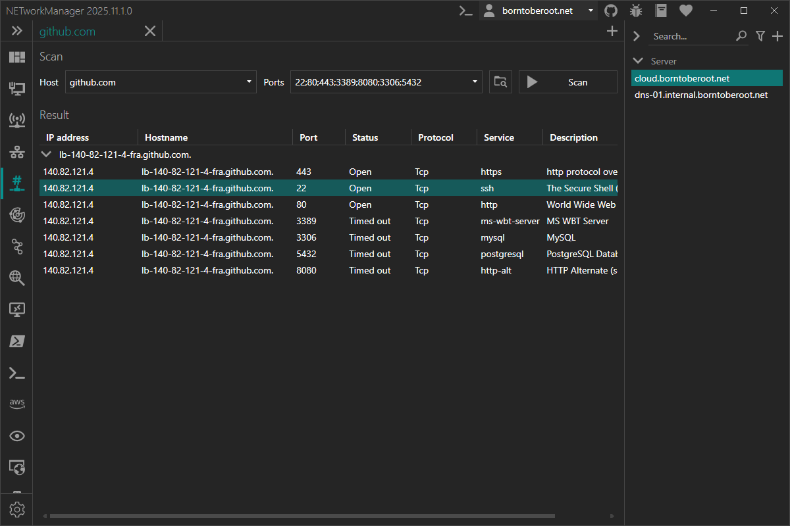

# Port Scanner

With the **Port Scanner** you can scan for open TCP ports on one or multiple hosts to determine which services are running.

:::info

TCP (Transmission Control Protocol) is a connection-oriented transport-layer protocol. Establishing a connection requires a three-way handshake between client and server. Port scanning tests whether this handshake can be initiated on a given port, which indicates a listening service.

:::

### Example inputs

| Host                             | Description                                                                                  |
| -------------------------------- | -------------------------------------------------------------------------------------------- |
| `10.0.0.1`                       | Single IP address (`10.0.0.1`)                                                               |
| `10.0.0.100 - 10.0.0.199`        | All IP addresses in a given range (`10.0.0.100`, `10.0.0.101`, ..., `10.0.0.199`)            |
| `10.0.0.100-199`                 | All IP addresses in a given range, shorthand for the last octet (`10.0.0.100`, ..., `10.0.0.199`) |
| `10.0.0.0/23`                    | All IP addresses in a subnet (`10.0.0.0`, ..., `10.0.1.255`)                                 |
| `10.0.0.0/255.255.254.0`         | All IP addresses in a subnet (`10.0.0.0`, ..., `10.0.1.255`)                                 |
| `10.0.[0-9,20].[1-2]`            | Multiple IP addresses like (`10.0.0.1`, `10.0.0.2`, `10.0.1.1`, ...,`10.0.9.2`, `10.0.20.1`) |
| `borntoberoot.net`               | Single IP address resolved from a host (`10.0.0.1`)                                          |
| `borntoberoot.net/24`            | All IP addresses in a subnet resolved from a host (`10.0.0.0`, ..., `10.0.0.255`)            |
| `borntoberoot.net/255.255.255.0` | All IP addresses in a subnet resolved from a host (`10.0.0.0`, ..., `10.0.0.255`)            |

| Port                  | Description                                        |
| --------------------- | -------------------------------------------------- |
| `1-1024`              | All ports in a given range (`1`, `2`, ..., `1024`) |
| `80; 443; 8080; 8443` | Multiple ports like (`80`, `443`, `8080`, `8443`)  |

:::note

Multiple inputs can be combined with a semicolon (`;`). A column pasted from Excel (one entry per line) is converted to the semicolon-separated form automatically.

Example: `10.0.0.0/24; 10.0.[10-20].1; 10.0.0.100-199` or `1-1024; 8080; 8443`

IP addresses and ports that are part of multiple inputs (e.g. `10.0.0.1; 10.0.0.0/24` or `80; 1-100`) are scanned only once. If an IP address is also entered as hostname, the hostname is kept; an IP address entered with different hostnames is scanned once per hostname.

A scan of more than `65,536` ports (hosts × ports, e.g. 64 hosts with `1-1024`) must be confirmed, more than `16,777,216` ports cannot be scanned at once.

:::

### Toolbar

| Button                  | Description                                                                     |
| ----------------------- | ------------------------------------------------------------------------------- |
| **Select port profile** | Opens a dialog to select a pre-defined port profile to populate the ports field |

### Context menu

| Action          | Description                                                                                                    |
| --------------- | -------------------------------------------------------------------------------------------------------------- |
| **Web Console** | Opens the open web port (`80`, `443`, `8080`, `8443`) in the [Web Console](./web-console) (https for 443 / 8443) |
| **Copy**        | Copies the selected information to the clipboard                                                               |
| **Export...**   | Exports the selected or all results to a file                                                                  |

If multiple results are selected, **Copy** > **IP address** / **Hostname** / **Port** / **IP address:Port** (one value per line, in the order shown, without duplicates; IPv6 as `[address]:port`) and **Export...** are available.

### Result

The results are grouped by host and sorted by IP address and port. The number of open and closed ports is shown next to the **Result** header. A port is **open** if the connection was established, **closed** if the host refused the connection and **timed out** if there was no answer within the [timeout](#timeout-ms) (e.g. blocked by a firewall). Only open ports are shown, unless [Show closed ports](#show-closed-ports) is enabled. The **Hostname** column is shown if [Resolve hostname](#resolve-hostname) was enabled when the scan was started.

The search box right of the **Result** header filters the results by IP address, hostname, port, protocol, service, description and status, also while the scan is running. **Export...** > all exports the filtered results; the open / closed counters always count all ports.

### Keyboard shortcuts

| Key      | Action                                                        |
| -------- | ------------------------------------------------------------- |
| `Enter`  | Start the scan (in the search box: filter the results)        |
| `Esc`    | Cancel the running scan                                       |
| `Ctrl+T` | Open a new tab                                                |

## Profile

### Inherit host from general

Inherit the host from the general settings.

**Type:** `Boolean`

**Default:** `Enabled`

:::note

If this option is enabled, the [Host](#host) is overwritten by the host from the general settings and the [Host](#host) is disabled.

:::

### Host

Hostname or IP range to scan for open ports.

**Type:** `String`

**Default:** `Empty`

**Example:**

- `server-01.borntoberoot.net`
- `1.1.1.1; 1.0.0.1`
- `10.0.0.0/24`

:::note

See also the [Port Scanner](./port-scanner) example inputs for more information about the supported host formats.

:::

### Ports

TCP ports to scan each host for.

**Type:** `String`

**Default:** `Empty`

**Example:**

- `1-1024`
- `80; 443; 8080; 8443`

:::note

See also the [Port Scanner](./port-scanner) example inputs for more information about the supported port formats.

:::

## Settings

### Port profiles

List of common TCP ports to scan for.

**Type:** `List<NETworkManager.Models.Network.PortProfileInfo>`

**Default:**

| Name              | Ports                               |
| ----------------- | ----------------------------------- |
| DNS (via TCP)     | `53`                                |
| NTP (via TCP)     | `123`                               |
| Webserver         | `80; 443`                           |
| Webserver (Other) | `80; 443; 8080; 8443`               |
| Remote access     | `22; 23; 3389; 5900`                |
| Mailserver        | `25; 110; 143; 465; 587; 993; 995`  |
| Filetransfer      | `20-21; 22; 989-990; 2049`          |
| Database          | `1433-1434; 1521; 1830; 3306; 5432` |
| SMB               | `139; 445`                          |
| LDAP              | `389; 636`                          |
| HTTP proxy        | `3128`                              |
| Well-known ports  | `1-1024`                            |

:::note

Right-click on a selected port profile to `edit` or `delete` it.

You can also use the Hotkeys `F2` (`edit`) or `Del` (`delete`) on a selected port profile.

:::

### Show closed ports

Show closed ports in the result list.

**Type:** `Boolean`

**Default:** `Disabled`

### Timeout (ms)

Timeout in milliseconds after which a port is considered timed out (no answer). A port is closed if the host refused the connection.

**Type:** `Integer` [Min `100`, Max `15000`]

**Default:** `2000`

:::note

A closed port is reported as soon as the host refuses the connection. Each attempt sends the connection request once (see [Attempts](#attempts)).

:::

### Attempts

Number of connection requests sent to each port. Another request is only sent if there was no answer (timed out), an open or closed port is final.

**Type:** `Integer` [Min `1`, Max `10`]

**Default:** `1`

:::tip

In a local network (LAN), `1` is enough. On an unreliable network (e.g. Wi-Fi, VPN) or for hosts on the internet, a lost connection request can make an open port appear as timed out - increase it to `2` in this case. This only takes longer for ports without answer (attempts × timeout), e.g. ports blocked by a firewall.

:::

### Resolve hostname

Resolve the hostname for given IP addresses.

**Type:** `Boolean`

**Default:** `Enabled`

### Max. concurrent host threads

Maximum number of hosts that are scanned at the same time. A thread is not an operating system thread, but one host whose ports are scanned concurrently.

**Type:** `Integer` [Min `1`, Max `10`]

**Default:** `4`

:::warning

Every host opens up to [Max. concurrent port threads](#max-concurrent-port-threads) TCP connections at the same time (with the default settings up to 4 × 128 = 512). Too many simultaneous requests may be detected as a port scan and blocked or rate-limited by a firewall (local, on the network or on the scanned host) and can overload small routers. If ports are missing in the result (shown as timed out) or the network becomes slow during the scan, reduce the number of threads. This will increase the scan time.

:::

### Max. concurrent port threads

Maximum number of ports that are scanned at the same time for each host.

**Type:** `Integer` [Min `1`, Max `512`]

**Default:** `128`

:::warning

Too many simultaneous requests may be detected as a port scan and blocked or rate-limited by a firewall (local, on the network or on the scanned host). If ports are missing in the result (shown as timed out), reduce the number of threads. This will increase the scan time.

:::
