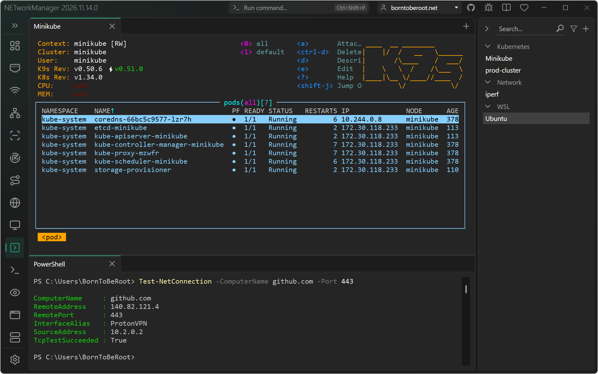

# PowerShell

With **PowerShell** you can launch PowerShell consoles locally or connect to remote computers using [PowerShell Remoting](https://learn.microsoft.com/en-us/powershell/scripting/learn/ps101/08-powershell-remoting). You can also execute command-line applications such as `wsl`, `aws ssm`, `k9s`, or any other tool or module typically accessible from a PowerShell session. In addition, you can run PowerShell scripts directly within the console.

The integration of PowerShell with NETworkManager supports tabs and profiles for hosts (and tools). You can launch the console / establish a connection via a profile (double-click, Enter key or right-click `Connect`) or directly via the [connection](#connect) dialog.

:::info

PowerShell is a command-line shell and scripting language developed by Microsoft for automating administrative tasks and managing system configurations. It provides a robust set of built-in commands and access to .NET Framework objects for efficient system administration and automation. PowerShell uses a verb-noun cmdlet syntax, giving users a consistent and predictable way to perform a wide range of operations.

:::

:::note

Windows PowerShell (`powershell`) and PowerShell (`pwsh`) are supported. **Use PowerShell (`pwsh`) for the best experience.**

Instructions for installing PowerShell (`pwsh`) can be found on the [official website](https://learn.microsoft.com/en-us/powershell/scripting/install/installing-powershell?).

:::

:::tip

Launching a command-line application such as `wsl`, `aws ssm` or `k9s` can be done by passing the [command](#command) to the PowerShell console.

```powershell
# Connect to WSL
wsl -d <DISTRIBUTION>

# Connect to an EC2 instance via AWS Session Manager
aws ssm start-session --target <instance-id>

# Connect to Kubernetes
k9s
```

See [FAQ > PowerShell with command-line applications](../faq/powershell-cmd-apps) for more information.

:::

:::warning

If Windows Terminal is installed, change the `Default terminal application` in the settings of Windows Terminal to `Windows Console Host` instead of `Windows Terminal` to use PowerShell in NETworkManager.

:::



### Tab context menu

Right-clicking a session tab opens a context menu:

| Action        | Description                                                            |
| ------------- | ---------------------------------------------------------------------- |
| **Reconnect** | Restart the PowerShell console (and reconnect to the remote computer). |
| **Resize**    | Resize the PowerShell console to the current view size (if connected). |

## Run command

Open the tool with `powershell`, `ps` or `pwsh`. Add a host (validated like the [host](#host) of the connect dialog) to connect to it with PowerShell Remoting:

```text
ps server-01
pwsh server-01.borntoberoot.net
ps @server-01
```

A host opens the [connect dialog](#connect) with the host filled in, so the options can be adjusted before connecting. A profile (`@profile`) connects directly with the settings of the profile and its group (also a local console or a [command](#command), e.g. `wsl`). `Shift+Enter` behaves like `Enter`. Without a host, the tool is only opened (e.g. `ps`).

## Connect

### Remote console

Connect to a remote computer via PowerShell Remoting.

**Type:** `Boolean`

**Default:** `Disabled`

### Host

Host name or IP address of the remote computer.

**Type:** `String`

**Default:** `Empty`

**Example:**

- `server-01.borntoberoot.net`
- `10.0.0.10`

:::note

Only available if [Remote console](#remote-console) is enabled.

:::

### Command

Command to execute when the PowerShell console is started locally.

**Type:** `String`

**Default:** [`Settings > Command`](#command-3)

**Example:** `Set-Location ~; Get-ChildItem`

:::note

Only available if [Remote console](#remote-console) is disabled.

:::

:::tip

Use `wsl -d <DISTRIBUTION>` to connect to Windows Subsystem for Linux.

:::

### Additional command line

Additional command line arguments to pass to the PowerShell console when it is started.

**Type:** `String`

**Default:** [`Settings > Additional command line`](#additional-command-line-3)

:::note

`{{Host}}` can be used to insert the [Host](#host) entered above.

:::

### Execution policy

Execution policy of the PowerShell console when it is started.

**Type:** `NETworkManager.Models.PowerShell.ExecutionPolicy`

**Default:** [`Settings > Execution policy`](#execution-policy-3)

**Possible values:**

- `Restricted`
- `AllSigned`
- `RemoteSigned`
- `Unrestricted`
- `Bypass`

## Profile

### Remote console

Connect to a remote computer via PowerShell Remoting.

**Type:** `Boolean`

**Default:** `Enabled`

### Inherit host from general

Inherit the host from the general settings.

**Type:** `Boolean`

**Default:** `Enabled`

:::note

If this option is enabled, the [Host](#host-1) is overwritten by the host from the general settings and the [Host](#host-1) is disabled.

:::

### Host

Host name or IP address of the remote computer.

**Type:** `String`

**Example:**

- `server-01.borntoberoot.net`
- `10.0.0.10`

:::note

Only available if [Remote console](#remote-console-1) is enabled.

:::

### Command

Command to execute when the PowerShell console is started locally.

**Type:** `String`

**Default:** `Empty`

**Example:** `Set-Location ~; Get-ChildItem`

:::note

Only available if [Remote console](#remote-console-1) is disabled.

:::

:::tip

Use `wsl -d <DISTRIBUTION>` to connect to Windows Subsystem for Linux.

Use `k9s` or `k9s --readonly` to manage Kubernetes clusters.

:::

### Additional command line

Additional command line arguments to pass to the PowerShell console when it is started.

**Type:** `String`

**Default:** `Empty`

:::note

`{{Host}}` can be used to insert the profile's host.

:::

### Execution policy

Execution policy of the PowerShell console when it is started.

**Type:** `NETworkManager.Models.PowerShell.ExecutionPolicy`

**Default:** `RemoteSigned`

**Possible values:**

- `Restricted`
- `AllSigned`
- `RemoteSigned`
- `Unrestricted`
- `Bypass`

## Group

### Command

Command to execute when the PowerShell console is started locally.

**Type:** `String`

**Default:** `Empty`

**Example:** `Set-Location ~; Get-ChildItem`

:::tip

Use `wsl -d <DISTRIBUTION>` to connect to Windows Subsystem for Linux.

Use `k9s` or `k9s --readonly` to manage Kubernetes clusters.

:::

### Additional command line

Additional command line arguments to pass to the PowerShell console when it is started.

**Type:** `String`

**Default:** `Empty`

:::note

`{{Host}}` can be used to insert the profile's host.

:::

### Execution policy

Execution policy of the PowerShell console when it is started.

**Type:** `NETworkManager.Models.PowerShell.ExecutionPolicy`

**Default:** `RemoteSigned`

**Possible values:**

- `Restricted`
- `AllSigned`
- `RemoteSigned`
- `Unrestricted`
- `Bypass`

## Settings

### File path

Path to the PowerShell console.

**Type:** `String`

**Default:** `%ProgramFiles%\PowerShell\7\pwsh.exe`, `%ProgramFiles(x86)%\PowerShell\7\pwsh.exe` or `%windir%\System32\WindowsPowerShell\v1.0\powershell.exe`

**Example:**

- `C:\Program Files\PowerShell\7\pwsh.exe`

:::note

The `Configure` button opens the PowerShell console to configure it.

:::

### Command

Default command to execute when the PowerShell console is started locally.

**Type:** `String`

**Default:** `Set-Location ~`

**Example:** `Set-Location ~; Get-ChildItem`

:::tip

Use `wsl -d <DISTRIBUTION>` to connect to Windows Subsystem for Linux.

Use `k9s` or `k9s --readonly` to manage Kubernetes clusters.

:::

### Additional command line

Default additional command line arguments to pass to the PowerShell console when it is started.

**Type:** `String`

**Default:** `Empty`

:::note

`{{Host}}` can be used to insert the host.

:::

### Execution policy

Default execution policy of the PowerShell console when it is started.

**Type:** `NETworkManager.Models.PowerShell.ExecutionPolicy`

**Default:** `RemoteSigned`

**Possible values:**

- `Restricted`
- `AllSigned`
- `RemoteSigned`
- `Unrestricted`
- `Bypass`

## Troubleshooting and limits

- If the [file path](#file-path) of PowerShell is not configured or the file doesn't exist, the tool shows a message instead of the console, and the run command only opens the tool. Configure the path and connect again.
- The console is not embedded but opens in its own window (or in Windows Terminal): change the **Default terminal application** in the settings of Windows Terminal to **Windows Console Host**. NETworkManager waits up to 10 seconds for the console window.
- A remote host is connected with `Enter-PSSession`: PowerShell Remoting (WinRM, TCP port `5985` / `5986`) must be enabled on the remote computer (`Enable-PSRemoting`). Connecting to an IP address or to a computer outside the domain needs it in the `TrustedHosts` of the local computer (or HTTPS). The error is shown in the console.
- Scripts are blocked: the console is started with the [Execution policy](#execution-policy-3) of the settings (default `RemoteSigned`, downloaded scripts must be signed). It only applies to the consoles started by NETworkManager.
