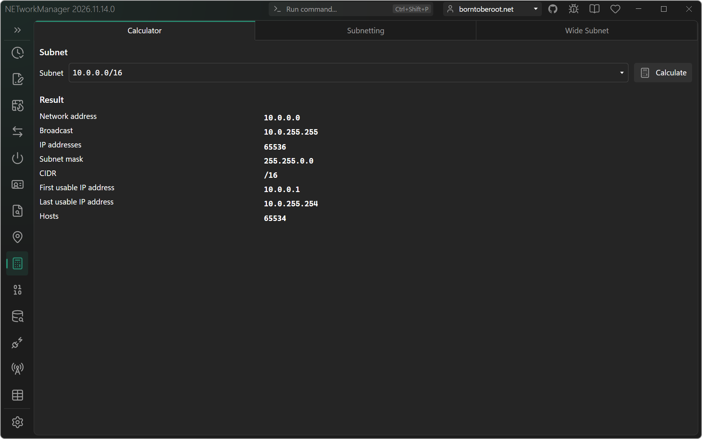
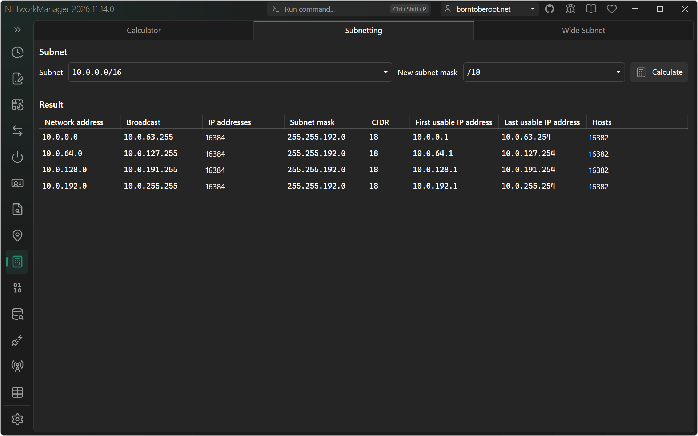
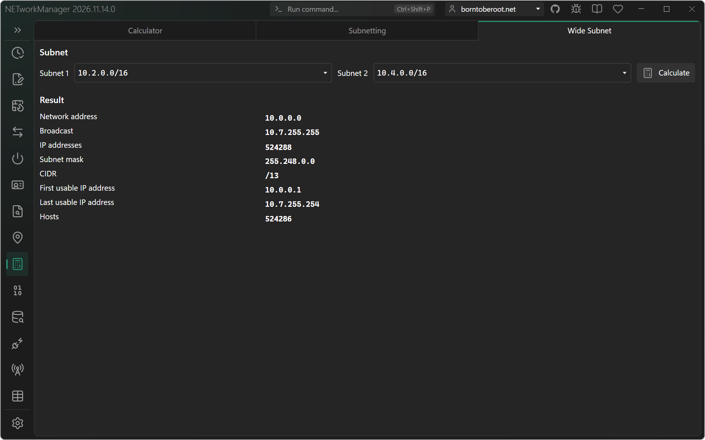

# Subnet Calculator

With the **Subnet Calculator** you can [calculate a subnet](#calculator), [split subnets](#subnetting) and create a [wide subnet](#wide-subnet). Both IPv4 and IPv6 are supported.

## Calculator

On the **Calculator** tab, you can calculate a subnet by entering the IP address and the subnet mask. The subnet mask can be entered in CIDR notation.

Example inputs:

- `10.0.0.0/16`
- `192.168.0.0/255.255.255.0`
- `2001:db8::/32`



:::note

Right-click on the result to copy the information.

:::

## Subnetting

On the **Subnetting** tab, you can split a subnet into smaller subnets. The subnet mask can be entered in CIDR notation.

Example inputs:

| Subnet                      | New subnet mask   |
| --------------------------- | ----------------- |
| `10.0.0.0/16`               | `/18`             |
| `192.168.0.0/255.255.255.0` | `255.255.255.128` |
| `2001:db8::/32`             | `/48`             |



:::note

Right-click on the result to copy or export the information.

:::

## Wide Subnet

On the **Wide Subnet** tab, you can create a wide subnet that includes both given subnets. The subnet mask can be entered in CIDR notation.

Example inputs:

| Subnet 1                    | Subnet 2         |
| --------------------------- | ---------------- |
| `10.0.0.0/16`               | `10.2.0.0/16`    |
| `192.168.0.0/255.255.255.0` | `192.168.4.0/23` |

:::note

IPv6 is not supported.

:::



:::note

Right-click on the result to copy the information.

:::

## Run command

Open the tool with `subnetcalculator`, `subnet` or `ipcalc`. Add a subnet (validated like the input), optionally followed by a second value, which selects the tab:

- Only a subnet: calculated in [Calculator](#calculator).
- A new subnet mask or CIDR (e.g. `/26`, `26` or `255.255.255.192`): the subnet is split in [Subnetting](#subnetting). The new mask must be between the CIDR of the subnet and `/32` (IPv4) or `/128` (IPv6).
- A second subnet: the [Wide Subnet](#wide-subnet) of both is calculated (IPv4 only).

```text
subnet 10.0.0.0/16
ipcalc 192.168.0.0/255.255.255.0
subnet 10.0.0.0/16 /24
subnet 2001:db8::/32 /48
subnet 10.0.0.0/24 10.0.1.0/24
```

With `Shift+Enter` (only fill in), the values are filled in without calculating. While a subnetting is running, the command is ignored. This tool has no profiles (`@profile`).

## Troubleshooting and limits

- A subnetting into more than `65,535` subnets (e.g. a `/8` into `/26`, or an IPv6 `/32` into `/48`) must be confirmed, since it can take some time and memory and slows down the application while the subnets are added. With IPv6, choose a new CIDR close to the one of the subnet.
- The **Wide Subnet** only supports IPv4.
- The IP address of the input is reduced to the network address of the subnet (e.g. `10.0.0.10/24` is calculated as `10.0.0.0/24`).
