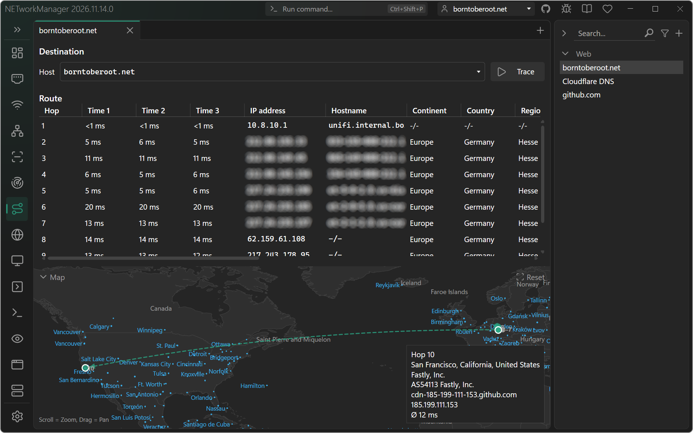

# Traceroute

With the **Traceroute** you can trace the route to a host using ICMP echo requests to determine the network path and each intermediate hop.

:::info

Traceroute works by sending ICMP packets with incrementally increasing TTL (Time to Live) values. Each router along the path decrements the TTL by one; when it reaches zero, the router discards the packet and sends back an ICMP "time exceeded" message, revealing its address. This process repeats until the destination is reached.

:::



### Example inputs

- `server-01.borntoberoot.net`
- `10.0.0.1`

### Context menu

Right-clicking a hop allows forwarding it to another tool (e.g. [Port Scanner](./port-scanner), [DNS Lookup](./dns-lookup)) or querying the registration data of its IP address (e.g. the network and its owner), hostname or AS number via [RDAP](./rdap).

| Action | Description |
|--------|-------------|
| **Copy** | Copies the selected information to the clipboard |
| **Export...** | Exports the results shown (all or the selected ones) to a file in the order shown, see [Export format](../faq/export-format.md) |

### Map

Below the hop list, a **Map** visualizes each resolved hop's geolocation on an offline world map. Consecutive hops are connected with curved, directional arrows showing the path the trace took.

:::note

The map is only shown if [Check IP geolocation](#check-ip-geolocation) and [Show map](#show-map) are both enabled — without a resolved geolocation, there is nothing to plot a hop's marker at.

:::

Hover a marker to show its details (location, ISP/ASN, hostname, IP address and average round-trip time) in the bottom-right info panel. Hovering an arrow shows just the source and destination location of that segment.

You can interact with the map:

| Action | Description |
|--------|-------------|
| **Mouse wheel** | Zoom in and out |
| **Left mouse button + drag** | Pan the map |
| **Reset** (top-right) | Resets pan/zoom to fit the current route |

Click the **Map** toggle in the top-left corner to collapse or expand the map.

## Run command

Open the tool with `traceroute`, `trace` or `tracert`. Add a host (validated like the input) to trace the route to it in a new tab:

```text
trace 1.1.1.1
trace borntoberoot.net
tracert 10.0.0.1
trace @server-01
```

Every command opens a new tab, a trace running in another tab continues. With `Shift+Enter` (only fill in), the host is filled in without starting the trace. A profile (`@profile`) traces its host.

## Profile

### Inherit host from general

Inherit the host from the general settings.

**Type:** `Boolean`

**Default:** `Enabled`

:::note

If this option is enabled, the [Host](#host) is overwritten by the host from the general settings and the [Host](#host) is disabled.

:::

### Host

Hostname or IP address to trace the route to.

**Type:** `String`

**Default:** `Empty`

**Example:**

- `server-01.borntoberoot.net`
- `1.1.1.1`

## Settings

### Maximum hops

Maximum number of hops to search for the target.

**Type:** `Integer` [Min `1`, Max `255`]

**Default:** `30`

### Timeout (ms)

Timeout in milliseconds for each ICMP packet, after which the packet is considered lost.

**Type:** `Integer` [Min `100`, Max `15000`]

**Default:** `4000`

### Buffer

Buffer size of the ICMP packet.

**Type:** `Integer` [Min `1`, Max `65500`]

**Default:** `32`

### Resolve hostname

Resolve the hostname of the IP address (PTR lookup) for each hop.

**Type:** `Boolean`

**Default:** `Enabled`

### Check IP geolocation

Enables or disables the resolution of the IP geolocation for each hop via [`ip-api.com`](https://ip-api.com/).

:::note

The free API endpoint is limited to 45 requests per minute, supports only the `http` protocol and is available for non-commercial use only.

:::

**Type:** `Boolean`

**Default:** `Disabled`

### Show map

Shows the [Map](#map) below the hop list.

:::note

Only takes effect if [Check IP geolocation](#check-ip-geolocation) is also enabled — without it, no hop has a resolved geolocation to plot.

:::

**Type:** `Boolean`

**Default:** `Enabled`

## Troubleshooting and limits

- Every hop is probed with three ICMP echo requests (no UDP or TCP traceroute). A hop without answer (shown as timed out) is a router that doesn't send ICMP "time exceeded" messages or rate-limits them, the trace still continues. If the target blocks ICMP, the last hops time out until [Maximum hops](#maximum-hops) is reached.
- The time of a hop is the time of its ICMP reply. Routers answer with a low priority, so a high time on one hop (but not on the following ones) is not a problem of the path.
- A hop without hostname has no `PTR` record in DNS.
- The geolocation is only looked up for public IP addresses (not for private ones). The free endpoint of `ip-api.com` allows 45 requests per minute: the lookups stop shortly before the limit and continue after it is reset, so on long or repeated traces some hops have no geolocation (and no marker on the map). It is only used if [Check IP geolocation](#check-ip-geolocation) is enabled; the request is sent via `http`.
- The route may differ for every probe (load balancing), only one address per hop is shown.
