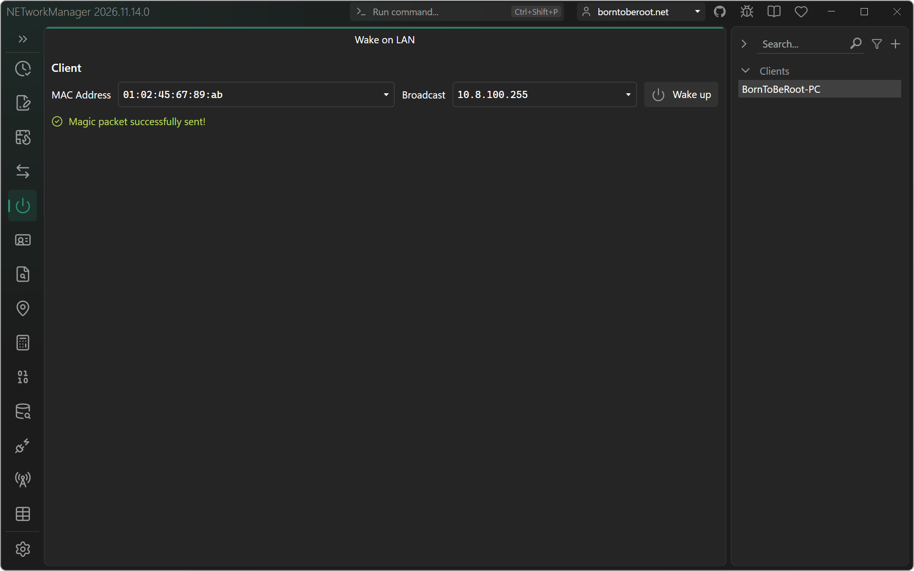

# Wake on LAN

With **Wake on LAN** you can wake up a computer in the local network from a low power state.

:::info

Wake on LAN uses a magic packet starting with 6 bytes with the value `0xFF` followed by 16 repetitions of the MAC address of the computer to be woken up. The magic packet is sent on layer 2 to the broadcast address via port `9/UDP` of the network where the computer is located. The computer must be in a low power state in order to detect the magic packet and wake up.

:::



### Example inputs

| MAC address | Broadcast address | Note |
|-------------|-------------------|------|
| `00:11:22:33:44:55` | `192.168.0.255` | Broadcast address of a `192.168.0.0/24` network |

## Run command

Open the tool with `wakeonlan` or `wol`. Add the MAC address (validated like the input), optionally followed by the broadcast address:

```text
wol 00:11:22:33:44:55
wol 00:11:22:33:44:55 192.168.1.255
wol 00-11-22-33-44-55 10.0.0.255
wol @pc-01
```

The magic packet is sent to the broadcast address, or to the one last used in the tool if none is entered. If there is no valid broadcast address yet, the MAC address is only filled in. With `Shift+Enter` (only fill in), the values are filled in without sending the magic packet. A profile (`@profile`) sends the magic packet with the MAC address and broadcast address of the profile (with `Shift+Enter`, they are only filled in).

## Profile

### MAC address

MAC address of the device to wake up.

**Type:** `String`

**Default:** `Empty`

**Example:** `00:11:22:33:44:55`

### Broadcast

Broadcast address of the network in which the device is located.

**Type:** `String`

**Default:** `Empty`

**Example:** `192.168.0.255`

## Settings

### Port

UDP port on which the magic packet is sent.

**Type:** `Integer` [Min `1`, Max `65535`]

**Default:** `9`

## Troubleshooting and limits

- The network interface card (NIC) of the computer must support Wake on LAN and the feature must be enabled in the BIOS / UEFI and in the driver settings of the NIC in Windows (e.g. **Wake on Magic Packet**). The computer must also be connected to the network via cable — Wake on LAN does not work over WLAN.
- Windows Fast Startup can prevent a computer from waking up after it was shut down. Disable it or put the computer to sleep / hibernate instead.
- The magic packet is a UDP broadcast to the [port](#port) (default `9`). Use the broadcast address of the network of the computer (e.g. `192.168.1.255` for `192.168.1.0/24`). Routers don't forward broadcasts by default: to wake a computer in another network, the router must forward directed broadcasts to it (or use a computer in that network). Firewalls in between must allow the packet.
- The magic packet is sent without an answer: the tool shows that it was sent, not that the computer woke up. Check it with the [Ping Monitor](./ping-monitor.md).
