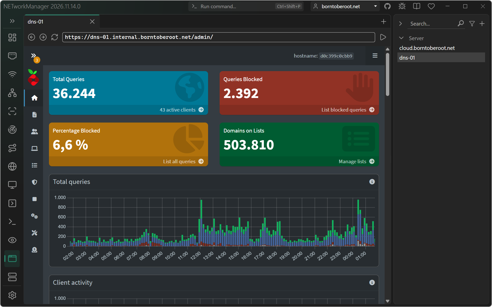

# Web Console

The **Web Console** allows you to browse the web interface of a host (e.g. server, switch, router, or dashboard) to view information or configure it. The connection can be established via a profile (double-click, Enter key or right-click `Connect`) or directly via the [connection](#connect) dialog.

:::note

WebView2 must be installed on the local computer in order to use this feature. You can download the latest version of WebView2 from the [official website](https://developer.microsoft.com/de-de/microsoft-edge/webview2/).

:::



### Tab context menu

Right-clicking a session tab opens a context menu:

| Action     | Description         |
| ---------- | ------------------- |
| **Reload** | Reload the website. |

## Run command

Open the tool with `webconsole` or `web`. Add a URL with `http://` or `https://` (validated like the URL of the connect dialog):

```text
web https://borntoberoot.net
web http://10.0.0.1
web https://pihole.borntoberoot.net/admin/
web @pihole
```

A URL opens the [connect dialog](#connect) with the URL filled in. A profile (`@profile`) opens the URL of the profile directly. `Shift+Enter` behaves like `Enter`. A URL typed without a command (e.g. `https://...`) suggests the Web Console as well.

## Connect

URL of the website to display in the web console.

**Type:** `String`

**Example:** `https://pihole.borntoberoot.net/admin/`

## Profile

### URL

URL of the website to display in the web console.

**Type:** `String`

**Default:** `Empty`

**Example:** `https://pihole.borntoberoot.net/admin/`

:::note

`{{Host}}` can be used to insert the profile's host (e.g. `https://{{Host}}/`).

:::

## Settings

### Show address bar

Show or hide the navigation / address bar.

**Type:** `Boolean`

**Default:** `Enabled`

### Show status bar

Show or hide the status bar in the bottom-left corner (e.g. to show the URL on hover).

**Type:** `Boolean`

**Default:** `Enabled`

### Save credentials

Enable or disable the option to save credentials in the WebView2 browser. This will display
a dialog similar to the one in Microsoft Edge when a website requests to save the login information.

**Type:** `Boolean`

**Default:** `Enabled`

### Delete browsing data

Button to delete the browsing data (e.g. history, cookies, cache, credentials, etc.) of the current WebView2 profile.

## Troubleshooting and limits

- If the Microsoft Edge WebView2 runtime is not installed, the tool shows a message instead of the web page, and the run command only opens the tool. Install the runtime and restart NETworkManager.
- A web page with an invalid or self-signed certificate (e.g. the web interface of a switch or router) shows the certificate warning of Microsoft Edge.
- All tabs share one browser profile of NETworkManager (cookies, cache, saved passwords), separate from Microsoft Edge. If a web interface behaves strangely after an update of the device, use [Delete browsing data](#delete-browsing-data).
