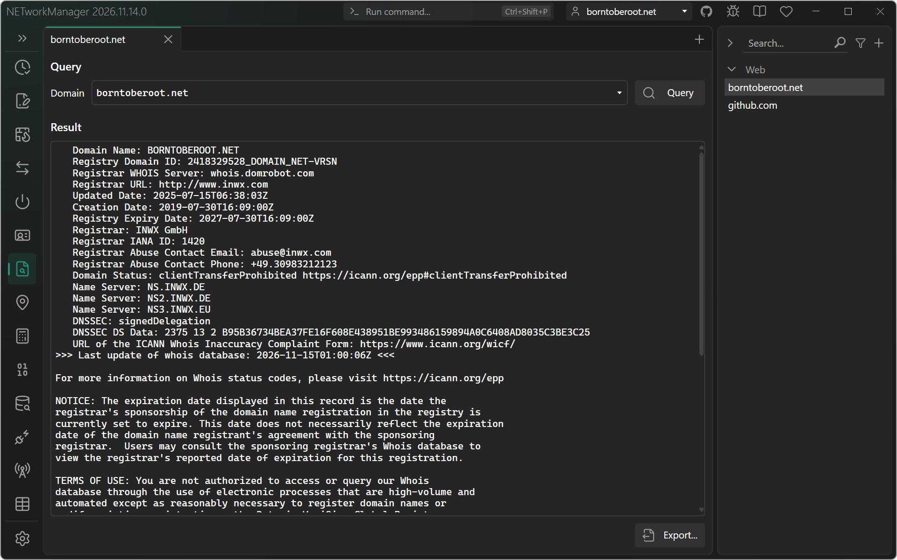

# Whois

With **Whois** you can retrieve Whois information for a domain directly from the Whois server associated with the top-level domain.

:::info

Whois data for a domain is publicly available and provided by the domain registrar. The Whois protocol is based on TCP and uses port 43. Data is transmitted as unencrypted plain text. Because the Whois protocol is not standardized, the format of the response may vary by registrar.

:::



### Example inputs

| Domain | Description |
|--------|-------------|
| `borntoberoot.net` | Query Whois information for a .net domain |

### Export

The result can be exported via the **Export...** button below the result or via the context menu (right-click).

### Context menu

| Action | Description |
|--------|-------------|
| **Copy** | Copies the selected information to the clipboard |
| **Export...** | Exports the selected or all results to a file |

## Run command

Open the tool with `whois`. Add a domain (validated like the input):

```text
whois borntoberoot.net
whois example.org
whois @borntoberoot.net
```

Every command opens a new tab, a query running in another tab continues. With `Shift+Enter` (only fill in), the domain is filled in without starting the query. A profile (`@profile`) queries its domain.

## Profile

### Inherit host from general

Inherit the host from the general settings.

**Type:** `Boolean`

**Default:** `Enabled`

:::note

If this option is enabled, the [domain](#domain) is overwritten by the host from the general settings and the [domain](#domain) is disabled.

:::

### Domain

Domain to query for Whois information.

**Type:** `String`

**Default:** `Empty`

**Example:** `borntoberoot.net`

## Troubleshooting and limits

- The query is sent to the Whois server of the top-level domain, from a list included in NETworkManager (updated with each release). If the list has no server for the top-level domain, a message is shown. Use [RDAP](./rdap.md) instead, the standardized successor of Whois.
- The firewall must allow outgoing TCP connections on port `43` to the Whois server of the top-level domain. For example, querying `borntoberoot.net` requires access to `whois.verisign-grs.com:43`.
- The domain is queried as entered: enter the registered domain (e.g. `borntoberoot.net`, not `www.borntoberoot.net`).
- Only the server of the registry is queried, a referral to the Whois server of the registrar (e.g. for `.com` / `.net`) is not followed. The registry may only return the registrar and the name servers.
- For `.de` domains, DENIC no longer provides information via the Whois protocol. Personal data is usually redacted (GDPR).
- Whois servers limit the number of queries per IP address; too many queries are answered with an error text or not at all.
