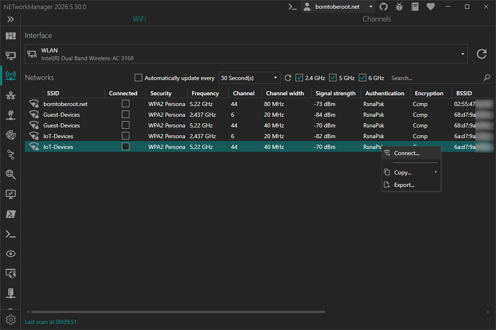
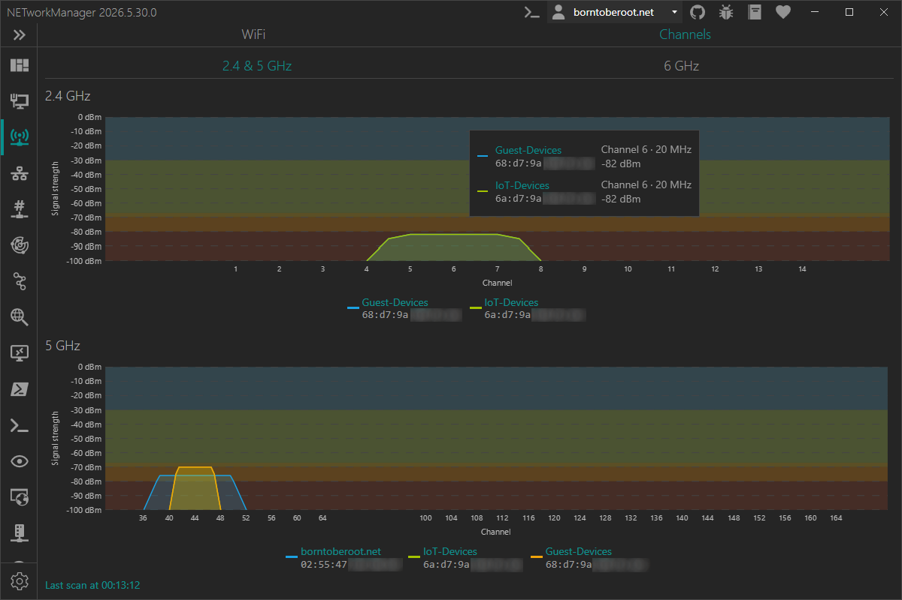

# WiFi

The **WiFi** tool shows the wireless networks (access points) in range of a WiFi adapter, with channel, channel width, signal strength and security, shows them on the channels of the 2.4, 5 and 6 GHz bands and connects to them.

:::info

Wi-Fi is a wireless networking technology based on IEEE 802.11 standards. Access points periodically advertise network information (such as SSID and security capabilities) in beacons, which clients can scan and display.

:::

:::note

Starting with Windows 11 24H2, you must allow access to the Wi-Fi adapter: open `Windows Settings > Privacy & security > Location` and enable access for Desktop Apps / NETworkManager. **Open settings** below the message opens these settings; after allowing the access, **Refresh** below the message (or switching back to **WiFi**) loads the adapters, a restart is not needed.

:::

## WiFi

### Toolbar

| Element                       | Description                                                                                                                                                                                                                            |
| ----------------------------- | -------------------------------------------------------------------------------------------------------------------------------------------------------------------------------------------------------------------------------------- |
| **Interface**                 | WiFi adapter that is scanned (the icon shows if it is connected). The selected adapter is saved. The button next to it reloads the adapters (e.g. after an adapter was plugged in). The adapter can't be changed while scanning or connecting. |
| **Last scan at**              | Time of the last scan (the tooltip shows the date), with **Automatically update every** a countdown to the next scan (`Next refresh in 00:12`).                                                                                         |
| **Automatically update every** | Scans the networks again after the selected interval (`5 s` to `5 min`, default `30 s`, the pause after a scan). It pauses while another tool or a dialog is shown. The interval and the checkbox are saved.                                |
| **Refresh**                   | Scans the networks again (`F5`). Not available while **Automatically update every** is enabled.                                                                                                                                         |
| **2.4 GHz** / **5 GHz** / **6 GHz** | Show or hide the networks of a band (saved).                                                                                                                                                                                       |
| Search                        | Filters the networks by SSID (`Hidden Network` for hidden networks), security, frequency, channel, BSSID (MAC address), vendor, PHY kind and the change since the last scan. Case-insensitive, after a short delay while typing (`Enter` filters right away). |

A refresh (manual, automatic or after connecting) keeps the networks and the selected network visible while scanning (the refresh icon spins). If a refresh fails, the networks of the last scan stay and the error is shown below them.

### Columns

| Column              | Description                                                                                                                                                                  |
| ------------------- | ---------------------------------------------------------------------------------------------------------------------------------------------------------------------------- |
| Icon                | Signal bars, with a lock if the network is secured (sorts by the signal bars)                                                                                                |
| **Since last scan** | Change since the previous scan, see [Changes since the last scan](#changes-since-the-last-scan) (only if the networks are compared with one)                               |
| **SSID**            | Name of the network, `Hidden Network` for a hidden network                                                                                                                   |
| **Connected**       | The selected adapter is connected to this access point                                                                                                                      |
| **Security**        | Authentication, e.g. `WPA2 Personal (PSK)`, `WPA3 Personal (SAE)`, `WPA2 Enterprise`, `OWE`, `Open`                                                                          |
| **Frequency**       | Frequency of the primary channel (e.g. `5.18 GHz`)                                                                                                                           |
| **Channel**         | Primary channel (where the access point sends its beacons, e.g. `36`)                                                                                                        |
| **Channel width**   | Channel width (`20`, `40`, `80`, `160` or `320 MHz`), read from the beacon of the access point. If it can't be read, it is estimated from the band and the WiFi standard and shown as `~80 MHz` (the tooltip explains it) |
| **Signal strength** | Received signal strength (RSSI) in dBm                                                                                                                                       |
| **Authentication**  | Authentication type as reported by Windows (e.g. `RsnaPsk`)                                                                                                                  |
| **Encryption**      | Encryption type as reported by Windows (e.g. `Ccmp`)                                                                                                                         |
| **BSSID**           | MAC address of the access point (e.g. `AA:BB:CC:DD:EE:FF`)                                                                                                                   |
| **Vendor**          | Vendor of the BSSID (OUI)                                                                                                                                                    |
| **PHY kind**        | WiFi standard, e.g. `802.11ax`                                                                                                                                               |
| **Network kind**    | `Infrastructure` (access point) or `Adhoc`                                                                                                                                   |
| **Beacon interval** | Interval of the beacons in milliseconds                                                                                                                                      |
| **Uptime**          | Time since the access point was started                                                                                                                                      |

### Changes since the last scan

Each scan is compared with the previous scan of the same adapter (by BSSID):

- **New**: the network is visible now, it was not visible in the last scan.
- **Gone**: the network was visible in the last scan, it is not visible now. The row is shown faded (as it was in the last scan) until the next scan; it can't be connected.
- **Changed**: the channel, the channel width or the security of the network changed (e.g. the access point switched the channel because of interference or radar). The tooltip shows the previous values. A change of the signal strength is not shown (it varies with every scan), and an estimated channel width is not compared.

The **Since last scan** column and the counters right of the **Networks** header (e.g. `2 New · 1 Gone`) are only shown if the networks are compared with a previous scan. The counters count all networks, also the ones hidden by the band filter or the search. Changing the adapter starts over. The last scan is only kept in memory. The change is also in the search and the export (`Change`). Together with **Automatically update every**, this shows new access points or channel changes in the area; the changes of an automatic refresh can be shown as a notification, see [Show notification popup on changes](#show-notification-popup-on-changes).

### Context menu

| Action                     | Description                                                                                                       |
| -------------------------- | ----------------------------------------------------------------------------------------------------------------- |
| **Connect...**             | Opens a dialog to connect to the selected network, see [Connect](#connect) (only if not connected)                |
| **Disconnect**             | Disconnects the adapter from the selected network (only if connected)                                             |
| **Copy...**                | Copies a value of the selected network to the clipboard                                                           |
| **Export...**              | Opens a dialog to export the selected or all networks to a file, see [Export](#export)                            |

If multiple networks are selected, **Copy...** > **SSID** / **BSSID** (one value per line, in the order shown, without duplicates) and **Export...** are available.

### Connect

**Connect...** opens a dialog with the fields required by the security of the network:

| Field                     | Description                                                                                                                                         |
| ------------------------- | --------------------------------------------------------------------------------------------------------------------------------------------------- |
| **SSID**                  | Name of the network (only for a hidden network)                                                                                                    |
| **Connect automatically** | Windows connects to the network automatically in the future                                                                                         |
| **Pre-shared key**        | Password of a WPA / WPA2 / WPA3 Personal (or WEP) network                                                                                            |
| **Use credentials**       | WPA / WPA2 / WPA3 Enterprise (EAP) network: connect with **Username**, **Domain** (optional) and **Password**. If disabled, Windows uses the logged-on user or a certificate |

Open and OWE (Enhanced Open) networks need no password. If the network supports WPS (push button), **WPS** connects by pressing the WPS button of the access point (checked when the dialog is opened, `Checking WPS...`).

The status of the connection (`Connecting to ...`, the result or the error) is shown below the networks for 15 seconds, and the networks are scanned again a few seconds later.

### Export

**Export...** exports the networks as CSV, XML or JSON: **all** exports the networks shown (filtered by band and search) in the order shown, **selected** the selected networks in the order shown. Columns / elements in the order of the grid: `Ssid`, `IsConnected`, `Security`, `ChannelCenterFrequencyInKilohertz`, `Channel`, `ChannelWidth` (MHz), `ChannelWidthEstimated`, `SignalBars`, `NetworkRssiInDecibelMilliwatts`, `NetworkAuthenticationType`, `NetworkEncryptionType`, `Bssid`, `Vendor`, `PhyKind`, `NetworkKind`, `IsWiFiDirect`, `BeaconInterval`, `Uptime` and `Change`, see [Export format](../faq/export-format.md).

### Keyboard shortcuts

| Key  | Action                                                            |
| ---- | ----------------------------------------------------------------- |
| `F5` | Scan the networks (not while **Automatically update every** is enabled) |

## Channels

On the **Channels** tab, the networks of the selected adapter are drawn on the channels of their band, with their channel width and signal strength. This helps to find overlapping networks and a free channel.

The tab is split into two sub-tabs:

- **2.4 & 5 GHz**: one chart for the 2.4 GHz and one for the 5 GHz band. The unused range between the channels 64 and 100 of the 5 GHz band is compressed.
- **6 GHz**: the lower (channels 1 - 125) and the upper channels (129 - 233) in two charts. A network whose channel crosses the split (e.g. 320 MHz around channel 127) is shown in both.

Each network is drawn as a band over its whole channel width (20, 40, 80, 160 or 320 MHz), centered on the center of the channel (e.g. 80 MHz with the primary channel 36 covers the channels 36 - 48), so overlapping networks can be identified. If the channel width is estimated, the network is drawn around its primary channel. The legend below each chart lists the networks with their color (SSID and BSSID). The background shows the signal quality: excellent (-30 dBm and better), good (-67 to -30 dBm), reliable (-70 to -67 dBm), weak (-80 to -70 dBm) and poor (below -80 dBm).

The charts show all networks of the last scan: the band filter, the search and the gone networks don't apply.

:::note

Move the mouse over a network to display details such as SSID, BSSID, channel, channel width and signal strength in a tooltip.

:::

## Settings

### Show notification popup on changes

Show a notification popup in the bottom-right corner of the primary screen when an automatic refresh (**Automatically update every**) found changes since the previous scan (see [Changes since the last scan](#changes-since-the-last-scan)). One notification per scan: up to three changes, one per line with the SSID and BSSID and the change in its color (e.g. `MyNetwork (AA:BB:CC:DD:EE:FF) · New`, green for new, red for gone, orange for changed), otherwise one line per counter (e.g. `5 New`, `2 Gone`). Not for a scan that was started manually, and only while **WiFi** is shown (the automatic refresh pauses while another tool is shown). The header shows the tool, the title the adapter; the status icon is green for only new networks, red for only gone networks, half green / half red for both, orange for only changed networks. A click opens **WiFi**.

**Type:** `Boolean`

**Default:** `Enabled`

### Play sound on changes

Play a system sound when an automatic refresh found changes. Independent of the [popup](#show-notification-popup-on-changes).

**Type:** `Boolean`

**Default:** `Disabled`

### Display duration (seconds)

Time in seconds the notification popup is shown before it closes automatically.

**Type:** `Integer` [Min `3`, Max `60`]

**Default:** `10`
