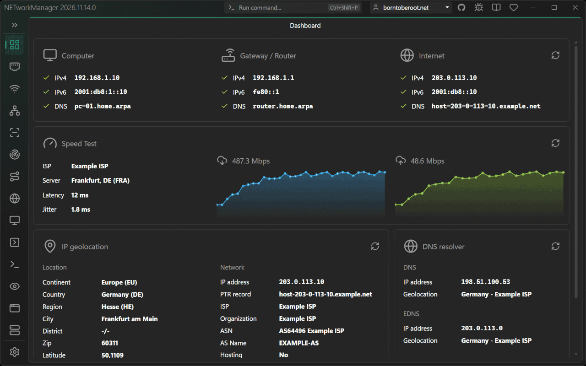

# Run Command

The **Run Command** opens a feature and runs it directly from the keyboard: press `Ctrl+Shift+P`, type a command like `ping 10.0.0.1` and press `Enter`.

The run command can also be opened with the **Run command...** box in the center of the title bar, or from anywhere with a global hotkey (default `Ctrl+Alt+P`, disabled by default), which brings the window to the foreground, see [Settings > HotKeys](./settings/hotkeys.md).



## Syntax

```
command [target] [argument] [type]
command @profile
```

- **Command:** Name or alias of the feature (e.g. `dnslookup` or `dns`), see [Commands](#commands). Without a target, the feature is only opened.
- **Target:** Host(s), IP range, query or URL, depending on the feature. Lists are separated with `;` as everywhere in NETworkManager, spaces around `;` are allowed (e.g. `ping 10.0.0.1; 10.0.0.2`).
- **Argument** and **type:** Additional values of some features (e.g. DNS server and record type of the DNS lookup), in any order after the target. A value with spaces is written in quotes (e.g. `dns borntoberoot.net "Google Public DNS" aaaa`).
- **Profile:** `@` at the beginning of the target, followed by the name of a profile, runs the profile with its settings (e.g. `rdp @server-01`). Only profiles that are enabled for the feature can be used. The name can contain spaces (e.g. `rdp @Web Server 01`). If several profiles have the same name, an error is shown; select the profile in the [suggestions](#suggestions), which show its group.

The input is validated like the input field of the feature (e.g. a valid host or IP range). If it is not valid, an error is shown and the dialog stays open.

## Commands

| Command                                                              | Aliases            | Arguments                           | Example                                  |
| -------------------------------------------------------------------- | ------------------ | ----------------------------------- | ---------------------------------------- |
| [`networkinterface`](./application/network-interface.md#run-command) |                    | `[@profile]`                        | `networkinterface @home`                 |
| [`ipscanner`](./application/ip-scanner.md#run-command)               | `ipscan`           | `<range>`                           | `ipscan 10.0.0.0/24`                     |
| [`portscanner`](./application/port-scanner.md#run-command)           | `portscan`         | `<hosts> <ports\|port profiles>`    | `portscan 10.0.0.1 webserver;22`         |
| [`pingmonitor`](./application/ping-monitor.md#run-command)           | `ping`             | `<hosts>`                           | `ping 10.0.0.1; 10.0.0.2`                |
| [`traceroute`](./application/traceroute.md#run-command)              | `trace`, `tracert` | `<host>`                            | `trace borntoberoot.net`                 |
| [`dnslookup`](./application/dns-lookup.md#run-command)               | `dns`, `nslookup`  | `<hosts> [server] [type]`           | `dns borntoberoot.net 1.1.1.1 aaaa`      |
| [`remotedesktop`](./application/remote-desktop.md#run-command)       | `rdp`, `mstsc`     | `<host[:port]>`                     | `rdp server-01`                          |
| [`powershell`](./application/powershell.md#run-command)              | `ps`, `pwsh`       | `<host>`                            | `ps server-01`                           |
| [`putty`](./application/putty.md#run-command)                        | `ssh`              | `<host>`                            | `ssh server-01`                          |
| [`tigervnc`](./application/tigervnc.md#run-command)                  | `vnc`              | `<host>`                            | `vnc server-01`                          |
| [`webconsole`](./application/web-console.md#run-command)             | `web`              | `<url>`                             | `web https://borntoberoot.net`           |
| [`snmp`](./application/snmp.md#run-command)                          |                    | `<host>`                            | `snmp 10.0.0.1`                          |
| [`rdap`](./application/rdap.md#run-command)                          |                    | `<query> [type]`                    | `rdap 1.10 asn`                          |
| [`whois`](./application/whois.md#run-command)                        |                    | `<domain>`                          | `whois borntoberoot.net`                 |
| [`ipgeolocation`](./application/ip-geolocation.md#run-command)       | `geo`              | `<host>`                            | `geo 1.1.1.1`                            |
| [`lldpcdpcapture`](./application/lldp-cdp-capture.md#run-command)    | `lldp`, `cdp`      |                                     | `lldp`                                   |
| [`mdnsdiscovery`](./application/mdns-discovery.md#run-command)       | `mdns`, `dnssd`    | `<service types\|profiles\|*> [duration]` | `mdns printers;_ssh._tcp 30`        |
| [`wakeonlan`](./application/wake-on-lan.md#run-command)              | `wol`              | `<MAC address> [broadcast]`         | `wol 00:11:22:33:44:55 192.168.1.255`    |
| [`subnetcalculator`](./application/subnet-calculator.md#run-command) | `subnet`, `ipcalc` | `<subnet> [new mask \| subnet 2]`   | `subnet 10.0.0.0/16 /24`                 |
| [`lookup`](./application/lookup.md#run-command)                      |                    | `<oui\|port> <query>`               | `lookup port 22; 443; ssh`               |
| `settings`                                                           |                    |                                     | `settings`                               |

The arguments, examples and the behavior of each command (e.g. the connect dialog of the remote tools, `Shift+Enter`) are described in the **Run command** section of the feature, linked in the table. All features that accept a target also accept a profile (`@profile`), except the Subnet Calculator, Lookup and mDNS Discovery tools, which have no profiles. **Network Interface** accepts no target, but a profile. The other features (e.g. `firewall`, `listeners`) can be opened with their name. Features that are hidden in [Settings > General](./settings/general.md) are not available.

## Target without a command

Type only the target (e.g. `10.0.0.1`) to get the commands that accept it, e.g. `ping 10.0.0.1`, `trace 10.0.0.1`, `dns 10.0.0.1`. Commands that were used with the same kind of target before (e.g. IP addresses) come first, otherwise they are in the order of the table. `Enter` runs the first command, which is selected; if it was already run with this target, it is shown under the recent commands, which are listed above. A host without a domain and a port are not selected, since they can also be a mistyped command or the start of an IP address (e.g. `192`). A shortened or partly typed IP address (e.g. `192.168.1`) is not a target.

| Target                                              | Suggested commands                                                                  |
| --------------------------------------------------- | ----------------------------------------------------------------------------------- |
| IP address or host with a domain (`server.lan`)     | Ping Monitor, Traceroute, DNS Lookup, remote tools, IP Geolocation, Whois, …        |
| Host without a domain (`server01`)                  | Ping Monitor, Traceroute, DNS Lookup, remote tools, SNMP, IP Scanner                |
| Several hosts (`10.0.0.1; 10.0.0.2`)                | Ping Monitor, DNS Lookup, IP Scanner                                                |
| IP range (`10.0.0.1-100`) or subnet (`10.0.0.0/24`) | IP Scanner, Subnet Calculator (subnet), Ping Monitor, RDAP (subnet)                 |
| MAC address (`00:11:22:33:44:55`)                   | Wake on LAN, `lookup oui`                                                           |
| First 3 bytes of a MAC address (`00:11:22`)         | `lookup oui`                                                                        |
| Port(s) (`22`, `80-90/tcp`)                         | `lookup port`                                                                       |
| AS number (`AS13335`)                               | RDAP                                                                                |
| URL (`https://...`)                                 | Web Console                                                                         |
| DNS-SD service type (`_ipp._tcp`, `_http._tcp.local.`) or `*` | mDNS Discovery                                                                  |

A command always has priority (e.g. `web` is the Web Console). A list (e.g. `10.0.0.1; server01`) is a target if at least one entry is an IP address, a host with a domain, a range or a subnet; with a range or subnet, it is handled like an IP range. A list with an exclusion (e.g. `10.0.0.0/24; !10.0.0.1`, see the IP Scanner) is an IP range as well. Ports are `1` to `65535`. A host without a domain (e.g. `server01`) can also be a mistyped command, so its commands are only suggested if no command starts with the word (e.g. not for `pi`), and none is selected: select one with the arrow keys.

**Clipboard:** If enabled in [Settings > General](./settings/general.md#suggest-the-clipboard-content-as-target), the commands for a target in the clipboard (e.g. a copied IP address) are suggested when the dialog is opened (up to 3), and `Enter` runs the first one. While typing the command, the commands for the clipboard that start with it are suggested (e.g. `pi` → `ping 10.0.0.1`). The clipboard is read when the dialog is opened; a single word (host without a domain) is not suggested. Disabled by default.

## Dialog

- **Icon:** The icon of the recognized feature is shown in front of the input.
- **Syntax:** Below the input, the syntax of the command is shown; the part that is being typed is highlighted (e.g. `[DNS server]`). After the target, the argument comes before the type (e.g. DNS server, then record type), unless a complete type is typed (e.g. `aaaa`).
- **Values:** The values as they were understood are shown (e.g. `Hosts: borntoberoot.net` · `DNS server: 1.1.1.1` · `Type: AAAA`).
- **Validation:** While typing, what `Enter` runs is validated: a green check mark for valid input, or a red warning icon with the error as tooltip (e.g. an invalid host). If `Enter` is pressed with an invalid input, the dialog stays open and the tooltip with the error is shown until the next key.
- **Size:** The dialog and the suggestions use more space in a large window.

## Suggestions

While typing, suggestions are shown below the input, grouped (e.g. _Recent_, _Profiles_, _Type_). The typed text is highlighted.

| Input                        | Suggestions                                                              |
| ---------------------------- | ------------------------------------------------------------------------ |
| _empty_                      | Commands for the clipboard (if enabled), recently run commands, examples (without recent commands) and all features |
| Command (e.g. `tr`)          | Matching features, recent commands that contain the word (e.g. a host) and commands for the clipboard (if enabled) that start with it |
| Target (e.g. `10.0.0.1`)     | Recent commands that contain the target and the commands that accept it, see [Target without a command](#target-without-a-command) |
| After the command (`rdp `)   | Recent commands of the feature and its profiles; values of the target of some features (e.g. the service type profiles of mDNS Discovery, see the feature) |
| After `lookup `              | The lookups (`oui`, `port`) and recent commands                          |
| `@` (e.g. `rdp @web`)        | Profiles of the feature (with group and host); exact names first, recently run profiles first within the same match |
| After the target             | Values of the argument of the feature (e.g. DNS servers, port profiles, durations, see the feature), its types (e.g. DNS record types) and recent commands, up to 10 of each |

`Enter` runs what was typed if no suggestion is selected: after the command, nothing is selected; profiles, recent commands, types and DNS servers are selected with the arrow keys (`Up` on the first suggestion selects none again). While typing the command, the best matching feature is selected (completing it keeps the arguments, e.g. `pin 10.0.0.1` → `ping 10.0.0.1`), but not if an unknown command has arguments; for a target without a command, see [Target without a command](#target-without-a-command). With an empty input, only the first command for the clipboard is selected (if enabled). While typing `@`, a profile is only selected if exactly one matches. While typing the lookup (e.g. `lookup po`), the matching lookup is selected.

| Key           | Action                                                                                          |
| ------------- | ----------------------------------------------------------------------------------------------- |
| `Up`, `Down`  | Select a suggestion (`PageUp`, `PageDown`: 5 suggestions)                                       |
| `Tab`         | Insert the selected suggestion into the input. If none is selected, the first profile, DNS server, port profile or type that matches the typed word (e.g. `dns borntoberoot.net c` → `cloudflare`) |
| `Enter`       | Run the selected suggestion, or the input if none is selected                                   |
| `Ctrl+Enter`  | Run and keep the dialog open, with the command in the input (e.g. `ping `) to run it with the next target. Commands that open a dialog (connect dialog of the remote tools, settings) close the dialog, as does a message of a feature (e.g. an error or the confirmation of a large subnetting). |
| `Shift+Enter` | Open the feature with the input filled in, without starting it (e.g. to adjust the options of a scan). The remote tools open the connect dialog (target) or connect (profile) as with `Enter`. |
| `Shift+Del`   | Remove the selected recent command from the history (or click the remove button of a recent command) |
| `Esc`         | Close the dialog (or the close button)                                                          |

The keys are also shown at the bottom of the dialog (can be hidden in [Settings > General](./settings/general.md#show-key-hints)).

Run commands are saved in a history (20 entries by default, set in [Settings > General](./settings/general.md#number-of-stored-entries-run-command)).
